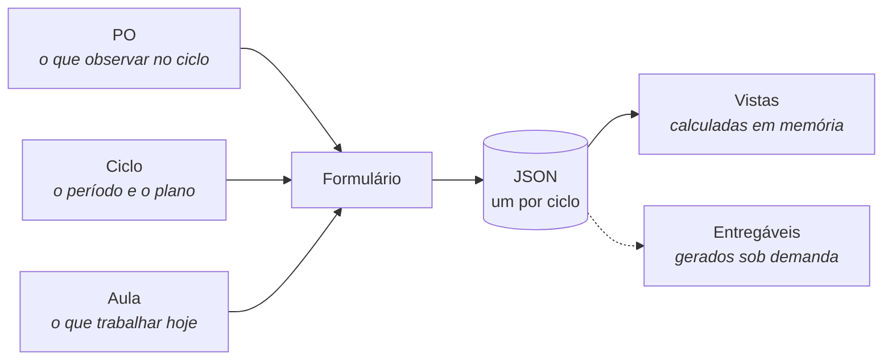
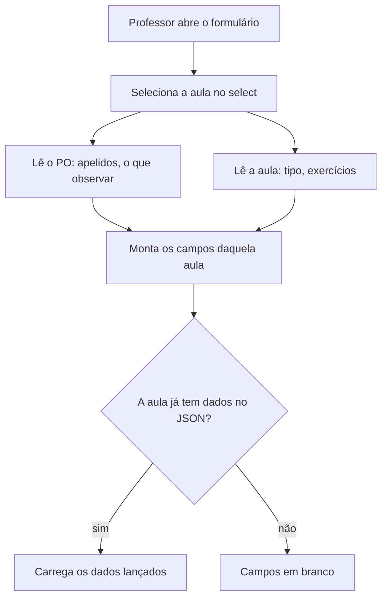
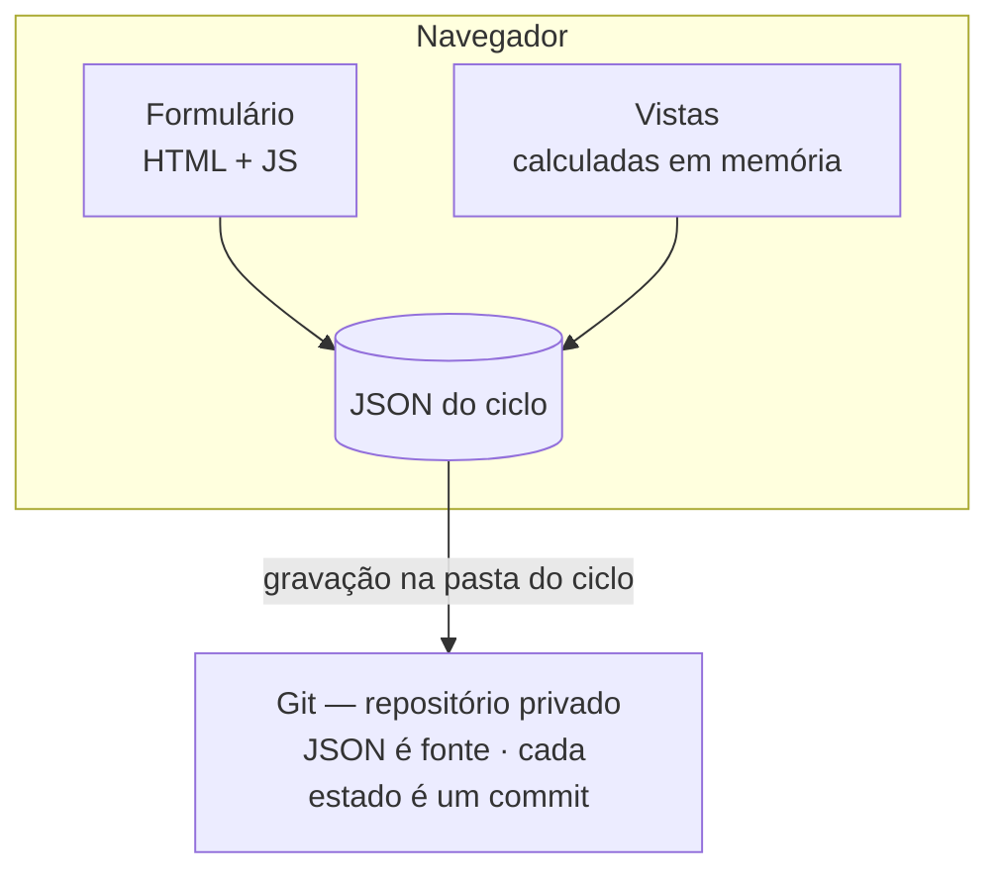

# Arquitetura — Formulário de captura em JSON

> **Resumo (para o HANDOFF):** arquitetura técnica do formulário dinâmico com
> JSON por ciclo — modelo de dados, schema, fluxo, segurança e perguntas em
> aberto.

> **Estado (27/09/2026).** O que este documento desenha **não é mais só proposta**. O
> **estado derivado** da aula (§1 do `ARQUITETURA-AULA.md`) vigora desde o `B6`; o **prazo
> declarado pelo índice**, desde o `B7`; e o **ajuste no plano** — o segundo dos dois
> ajustes descritos abaixo —, desde o `B8`. O que segue desenhado e **não implementado** é
> o **painel da escola** (§7 do `ARQUITETURA-AULA.md`) e as perguntas abertas do fim deste
> arquivo. Leia as seções pelo que elas **são**: onde houver nota datada, ela manda.

> **Escopo.** Documento do **Projeto Ciclo** — a memória da aula dada. Cada aula é
> **planejada** antes de ser dada, e o plano é a **linha de base daquela aula** do que se
> registra — a outra, a **linha de base dos sujeitos**, é declarada no PO (P-10), e depois do
> primeiro lançamento a referência vira a **linha de corte** (`ARQUITETURA-AULA.md` §2). Este
> projeto é **protótipo**, testado no **universo da dança**; o projeto que deve ser
> **agnóstico** será criado a partir dele. O PO usado nos exemplos vem do projeto de
> mestrado, e o **FIPP não é implementado aqui**: a cobertura de hash descrita abaixo é a da
> **âncora encadeada deste repositório** (`tools/hash-ciclo.sh` → `.fipp`), uma aproximação do
> framework.

**Do plano à captura: três referentes.** O plano é a **linha de base daquela aula** — é contra
ele que o formulário registra o que mudou. O PO declara à parte a **linha de base dos sujeitos**
(P-10), o estado inicial do ciclo. E depois do primeiro lançamento a referência **desloca**:
passa a valer a **linha de corte**, o registro da última aula que teve dado — por isso uma aula
pulada não interrompe a corrente, e o lançamento atrasado reordena a linha. A regra, com os dois
cenários, está em `ARQUITETURA-AULA.md` §2. Efeito na captura: são **dois** ajustes, e cada um
compara contra o seu próprio anterior — o do **plano** contra o plano anterior
(`plano-aula-NN-anterior.json`) e o do **lançamento** contra a versão anterior daquele mesmo
lançamento (`ajuste_de`). A **linha de corte** não é o referente do formulário: ela é o estado
dos sujeitos entre aulas. E o que fecha o plano é o **lançamento** — a partir dele o plano deixou
de ser intenção (§1.1).

> **Os dois ajustes existem desde 27/09/2026** (o `B8`; `REGISTRO.md`). O do lançamento já tinha
> o seu par; o do **plano** ganhou o dele: o gerador arquiva `plano-aula-NN.json` como
> `plano-aula-NN-anterior.json` antes de sobrescrevê-lo. Medido: os três ciclos têm o par em disco
> (Diaghilev, todas as cinco aulas; Duo e Ritmos, a aula 01). O **relógio** de cada um é diferente —
> o do plano fecha no **lançamento**, o do lançamento fecha no **prazo** —, e é isso que os impede
> de estar abertos ao mesmo tempo; a divergência do *"Motivo do ajuste"* entre o `§1.1` e o
> formulário segue **aberta**, como a nota datada da §5.1 declara.
>
> **Correção de 28/09/2026.** A redação acima dizia que *"o formulário exporta o elo para o
> professor anexar à fonte `aula-NN.md`"*. **Isso era erro de assistente e saiu** — o botão
> `#ajustar-plano` (*"Exportar ajuste do plano"*) foi removido de `tools/templates/lancamento.html`
> e das três cópias. **O par `plano-aula-NN.json` / `-anterior.json` continua sendo produzido** (é
> a proveniência do estado anterior do plano, e é o que o guard do `pre-commit` lê), mas **não tem
> leitor na página**. Ver o `REGISTRO.md`, 28/09/2026.

> **Por que esta ideia existe.** O projeto não tem problema de **volume** (ver
> §6 — o limite físico de uma escola é ~230 MB em 10 anos). Tem problema de
> **navegação**: um menu com N capturas e N relatórios fica imenso na medida em
> que as aulas acontecem. Esta ideia resolve a navegação — não a escala.

> **Documento técnico.** Complementa o `IDEIA-CAPTURA.md` (conceito) com o
> desenho da arquitetura. O que descreve vale como **contrato do que foi implementado** onde há
> nota datada dizendo que foi (o `B6`, o `B7`, o `B8`) e como **desenho do que seria** no resto.
> Os diagramas vêm em duas formas: **Mermaid** (renderiza no
> GitHub) e **ASCII** (para o PDF, onde o Mermaid não renderiza sem plugin).

## O que é entregável derivado — e um deles já existe hoje

**O guia de observação** (`guia-de-observacao-<NN>`) é **derivado de PO + Aula** ✓ — ele declara *"o que
observar durante a aula"* a partir do que o professor **declarou para aquela aula** (o PO) e do que ela
trabalha (o plano). **Ele é, portanto, um entregável**, não uma fonte primária: ninguém "digita" o guia — ele
se escreve do que já foi declarado. Desde 2026-09-20 ele **não é digitado em lugar nenhum**: o pacote do ciclo
o **gera** das duas entradas, com a **data da aula vinda do calendário** (peças 3 e 5 da migração — §8), e o
Duo e a Ritmos já são assim na prática.

**O que ele tem em comum com o relatório, o caderno e os acompanhamentos:** o **grão por aula** ✓ — e, com
ele, o mesmo problema que esta arquitetura resolve (**um item de menu por aula** ✗). Ele entra na mesma
categoria: **vista gerada sob demanda** ✓.

**O que mudou, e por que isto está escrito aqui:** até 2026-09-20 o guia se chamava `relatorio-aula-<NN>` —
a chave dizia *relatório* e o documento era *guia*, e o rótulo do menu era corrigido **no gerador** para
disfarçar ✗. A chave passou a se chamar o que o documento **é** (`guia-de-observacao-<NN>`), e o remendo saiu.
**Com a chave honesta, `relatorio-aula-<NN>` volta a significar só o relatório** — que é o que este documento
propõe gerar sob demanda.

## 1. Modelo de dados

### 1.1 Entidades

**Mermaid:**



**ASCII (mesma estrutura, para o PDF):**

```
PO ─────┐
        │
Ciclo ──┼───> Formulário ───> JSON (um por ciclo)
        │                       │
Aula ───┘                       ├──> Vistas (calculadas em memória)
                                │
                                └──> Entregáveis (gerados sob demanda):
                                     caderno · relatório · acompanhamento
```

**Descrição:**

- **PO** — define o que observar no ciclo (alunas, fenômeno, linha de base)
- **Ciclo** — define o período, o intervalo e a duração de referência (o manifesto)
- **Aula** — define o que trabalhar hoje (tipo, exercícios, objetivo)
- **Formulário** — combina PO + ciclo + aula para montar os campos daquela aula
- **JSON** — armazena os valores lançados (um por ciclo, com todas as aulas)
- **Vistas** — recortes calculados em memória (por aula, por aluna): o que se lê na tela
- **Entregáveis** — caderno, relatório pós-aula e acompanhamento por aluna: gerados
  **sob demanda**, quando há um arquivo a entregar (§3.5)

### 1.2 Relações

| Entidade | Fornece | Consome |
|:--|:--|:--|
| **PO** | Apelidos, fenômeno, linha de base | — |
| **Aula** | Tipo, exercícios, objetivo | PO (para saber o que observar) |
| **Formulário** | Campos (montados dinamicamente) | PO + Aula |
| **JSON** | Valores + textos | Formulário (grava) |
| **Vistas** | Recortes | JSON (lê) |
| **Entregáveis** | Caderno, relatório pós-aula e acompanhamento — **sob demanda** | JSON (lê) |

## 2. Schema do JSON

### 2.1 Estrutura geral

```json
{
  "ciclo": "01",
  "escola": "duo",
  "professor": "tiago",
  "criado_em": "2026-09-19",
  "aulas": {
    "01": { },
    "02": { }
  }
}
```

### 2.2 Estrutura de uma aula

```json
{
  "data": "2026-09-19",
  "presentes": ["ceci", "ana", "mel", "sofi"],
  "ausentes": [],
  "duracao_min": 120,
  "condicoes_contorno": {
    "plano_seguido": "sim",
    "animo": 5,
    "interesse": 5,
    "harmonia": 5,
    "mudou": ""
  },
  "tecnica": {
    "ceci": {
      "metatarsos": "ok",
      "tempo": "ok",
      "transferencia": "ok",
      "braco_perna": "parcial"
    }
  },
  "funcional": {
    "ceci": {
      "duracao_min": 120,
      "tonus": "parcial",
      "fadiga_antes": false
    }
  },
  "musicalidade": { },
  "linha_de_base": { },
  "relatorio": {
    "texto": "...",
    "surpresas": "...",
    "ajustes": "..."
  },
  "materiais": [],
  "ultimo_lancamento": "2026-09-20T14:30"
}
```

**Nota:** o schema é **por aula** dentro do JSON. As vistas não ficam
armazenadas — são calculadas pelo formulário. O `ultimo_lancamento` é o carimbo
de gravação **daquela aula**.

> **Nota datada — 27/09/2026. A redação acima envelheceu.** Ela dizia, e não diz mais,
> *"é o que ancora o prazo do ajuste (§5.1)"*. Desde o `B7`, o prazo é **declarado pelo
> índice** — `aulas[].prazo`, calculado do cronograma (§3.1 do `ARQUITETURA-AULA.md`) —
> e o carimbo passou a ser só o que ele é: a hora da última escrita daquela aula. A
> redação antiga **não** foi apagada (P-03/P-04): esta nota é o elo novo, e a §5.1
> registra o que o prazo virou.

E `plano_seguido` e `mudou` são **um par**, com regra declarada: se o plano **não**
foi seguido (`parcial`/`não`), `mudou` é **obrigatório** — é ali que a mudança se
registra, em uma linha (a estrutura executada e o que foi abandonado vão no
`relatorio` da aula, que é o lugar da execução diferente); se o plano **foi**
seguido (`sim`), `mudou` fica **vazio** — e vazio quer dizer *nada mudou*. Os
documentos gerados declaram os dois estados ("nada — o plano foi seguido"), em vez
de ficarem em silêncio.

O formulário **sugere** a data e a duração da aula a partir do plano do ciclo: a
aula N é a N-ésima do período declarado, no intervalo declarado (`intervalo_dias`),
e a duração de referência é a do ciclo (`duracao_min`). São valores **iniciais**,
editáveis — a aula pode ter acontecido em outro dia ou durado outro tempo.

## 3. Fluxo

### 3.1 Antes da aula

**Mermaid:**



**ASCII:**

```
Professor abre o formulário
    ↓
Seleciona a aula no <select>
    ↓
Formulário lê o PO (apelidos, o que observar)
    ↓
Formulário lê a aula (tipo, exercícios)
    ↓
Formulário monta os campos daquela aula
    ↓
Se a aula já tem dados no JSON → carrega
Se não → campos em branco
```

### 3.2 Durante a aula

```
Professor marca os valores no formulário
```

### 3.3 Depois da aula

```
Professor lança os dados → formulário atualiza o JSON em memória
    ↓
Escreve o texto do relatório → também vai para o JSON
    ↓
Cada gravação cria um ARQUIVO novo, com carimbo no nome, e o índice passa a
apontar para ele — o anterior permanece (ver §5.1)
    ↓
Salva o JSON novo e o índice atualizado na pasta do ciclo
    ↓
Commita no Git (repositório privado)
```

> **Nota datada — 28/09/2026. A redação acima envelheceu.** O penúltimo passo dizia, e não
> diz mais, *"Baixa o JSON novo e o índice atualizado"*. Desde o `Salvar`, o formulário
> **grava os dois arquivos na pasta do ciclo** que o professor escolher, com a File System
> Access API; onde o navegador não a oferece (Firefox, Safari), ele cai no download e
> **declara a queda** ao professor. O commit continua sendo dele — a página grava, não
> commita. A redação antiga **não** foi apagada (P-03/P-04): esta nota é o elo novo, e ela
> governa as demais ocorrências da §3.5, da §4 e da §5.1 abaixo.

### 3.4 Visualizar

```
Professor abre o formulário
    ↓
Seleciona "Aula 03" → formulário carrega dados do JSON
    ↓
OU seleciona "Carol" no filtro → formulário calcula a vista por aluna
    ↓
OU o período do ciclo aparece como informação (não é filtro)
```

### 3.5 Gerar um entregável (sob demanda)

Os artefatos de saída — **caderno**, **relatório pós-aula** e **acompanhamento por
aluna** — são **vistas dos dados já lançados**: o professor clica em "Gerar" quando
precisa de um arquivo para entregar (enviar, imprimir, arquivar), com o filtro que
quiser. **Nada é mantido atualizado automaticamente.** O JSON é o armazenamento; os
`.md` são os entregáveis.

E não é escrever duas vezes: no modelo atual o caderno e o relatório são **escritos à
mão**; aqui eles são **lidos** do que já foi lançado.

Isso não muda o §3.3 — a gravação continua sendo lançar → salvar na pasta do ciclo →
commitar. O
que muda é que o documento entregue deixa de ser escrito à mão: ele é o espelho do
filtro, no momento em que se precisa dele.

## 4. Componentes

**Mermaid:**



**ASCII:**

```
┌─────────────────────────────────────────────┐
│              Navegador                       │
│  ┌─────────────────┐  ┌─────────────────┐   │
│  │   Formulário    │  │     Vistas      │   │
│  │   (HTML + JS)   │  │  (calculadas)   │   │
│  └────────┬────────┘  └────────┬────────┘   │
│           │                     │             │
│           └──────────┬──────────┘             │
│                      │                        │
│           ┌──────────┴──────────┐             │
│           │        JSON         │             │
│           │   (ciclo-XX.json)   │             │
│           └─────────────────────┘             │
└─────────────────────────────────────────────┘
              │
              │ gravação na pasta do ciclo / commit manual
              ▼
┌─────────────────────────────────────────────┐
│        Git (repositório privado)             │
│  - JSON é a fonte (entra no hash)            │
│  - Cada estado do JSON é um commit           │
└─────────────────────────────────────────────┘
```

## 5. Segurança

Os dados do JSON são os mesmos dos acompanhamentos atuais — dados de menores.
As proteções são as mesmas (ver `CONGELAMENTO.md`):

| Camada | O que protege |
|:--|:--|
| **Repositório privado** (GitHub) | O JSON não é legível publicamente |
| **Fora do Git?** | Decisão pendente — ver seção 7 |
| **Criptografia no site** | Se o JSON for publicado, é criptografado como os acompanhamentos hoje |
| **Acesso** | Só o professor (com senha) |

**Onde o JSON vive:** decisão pendente — ver seção 7.

## 5.1 Ajuste com prazo

O JSON pode ser **ajustado** dentro do prazo **daquela aula**. O prazo **não é fixo em
48 h**: ele é **declarado pelo índice** — `aulas[].prazo`, calculado do cronograma pela
fórmula da §3.1 do `ARQUITETURA-AULA.md` (`maior` entre *24 h antes da próxima DATA de
aula* e *fim do bloco + 18 h*, o piso de tempo hábil). Medido nos três ciclos vivos: 143 h
(Duo), 23 h e 95 h (Diaghilev), 57 h e 60 h (Ritmos).

Duas consequências da fórmula valem aqui, porque são elas que a contagem antiga não tinha
(§3.3 do `ARQUITETURA-AULA.md`):

- **O prazo é fixo por aula, e nenhuma gravação o renova.** Salvar a aula 05 **não** reabre
  a janela da aula 01 — e salvar um ajuste da 01 também não a reabre. Fechado, é definitivo.
  É o *contrário* da contagem antiga, que reiniciava a cada escrita: dentro do prazo o
  ajuste é memória fresca; depois, é reconstrução, e não vale.
- **Os prazos são independentes**, e a aula pulada simplesmente não tem um. Pular a 02 não
  desloca o prazo da 03.

> **A ressalva das 48 h (27/09/2026).** A redação antiga — *"cada vez que a aula é salva o
> contador **dela** reinicia… cada aula fecha quando **ela** fica 48 h sem ser tocada"* —
> **não** foi apagada (P-03/P-04). Ela sobrevive como **RESSALVA**, e só para um caso: um
> ciclo **anterior a esta regra**, que não declara o prazo (índice sem `aulas[]`, aula
> antiga). Aí não há declaração nenhuma a respeitar e valem as 48 h contadas do último
> carimbo, renovadas a cada gravação — é o comportamento que o formulário já tinha para
> esses ciclos, e ele não muda. **Nos ciclos atuais a ressalva não dispara.** Quem a
> implementa é `HORAS_DE_RESSALVA = 48` no `lancamento.html` (peça 7 do §10 do
> `ARQUITETURA-AULA.md`).

**O que é um ajuste (não é edição):**

- O professor abre a aula já lançada (modo leitura) → botão **"Ajustar
  lançamento"** (só dentro do prazo **daquela aula**)
- O formulário **reabre em modo captura** com os dados atuais carregados
- O professor corrige e salva; a gravação fica registrada com autor
  (**"Gerado por"**)
- Cada gravação cria um **arquivo novo, com carimbo no nome**
  (`dados-exemplo-2026-09-20T1430.json`), e o índice (`ciclos.json`) passa a apontar
  para ele. O arquivo anterior **permanece** — acessível, e não é o vigente
- O novo arquivo declara: `ajuste_de` (de onde veio), `ajustado_em`, `ajustado_por`,
  `motivo` — e `ajustes`, a lista do que mudou, **gravada no ato do ajuste**. O
  documento gerado depois (§3.4) reproduz o que mudou sem depender de o arquivo
  anterior estar acessível: sem servidor, ele pode ter ficado fora da pasta do ciclo
  — se o navegador não oferece a gravação direta, o formulário cai no download

> **Divergência declarada — o "Motivo do ajuste" (27/09/2026).** Este documento descreve
> o ajuste com um campo de **motivo**, e o formulário implementado o exige: sem ele, e sem
> autor, a gravação é **bloqueada** — a justificativa no código é que *"sem ele, o ajuste
> muda o registro sem dizer por quê, e a correção deixa de ser auditável"*. A regra geral
> do modelo canônico é outra: em **ambos** os objetos — o plano e o lançamento — o ajuste é
> o **mesmo mecanismo**, o anterior permanece, o novo é um elo, e **o diff é a
> justificativa, sem campo de motivo obrigatório** (§1.1 e §1.2 do `ARQUITETURA-AULA.md`).
> Não é contradição de princípio, é **divergência de implementação**: o formulário é
> congelado, e onde ele e o modelo se desencontram, o documento diz o que foi feito. Fica
> **declarada**, a resolver quando o formulário for revisto — e a peça que unifica os dois
> objetos é o **item 8 do §10 do `ARQUITETURA-AULA.md` (o `B8`): o ajuste no plano, com o
> mesmo mecanismo do ajuste do lançamento.**
>
> **Correção de 28/09/2026 (a revisão chegou).** A ressalva acima dizia *"a resolver quando o
> formulário for revisto"*. A revisão aconteceu, e resolveu **pelo lado de fora**: o botão de
> exportar o ajuste do plano **saiu**, e com ele a fonte da divergência do **plano**. O que resta
> — e é o que a regra geral do §1.1 do `ARQUITETURA-AULA.md` descreve — é o ajuste **do
> lançamento**, que é o único objeto que o formulário ajusta. ⚠️ **A divergência do campo de
> motivo no ajuste do LANÇAMENTO segue aberta**: o formulário ainda o exige para gravar
> (`#motivo`), e o modelo canônico não. Esta correção fecha a divergência do **plano**, não a do
> lançamento.

**Por que o prazo:**

A memória do professor é uma edição da realidade. Dentro do prazo, o ajuste é
memória fresca — vale corrigir. Depois, é reconstrução — não vale.

O prazo **não é o mesmo para toda aula** (§3.3 do `ARQUITETURA-AULA.md`): ele
fecha quando a próxima data de aula se aproxima, e cada aula tem o seu. A
**última aula do ciclo**, que não tem próxima data, herda a **maior janela já
praticada naquele ciclo** — Medido: 143 h (Duo), 95 h (Diaghilev), 60 h (Ritmos).

**Depois do prazo:**

O botão fica **cinza**, com aviso: *"Prazo encerrado em [data] — o registro
é definitivo."* O professor vê que a possibilidade existiu, mas não está mais
disponível.

**A regra de proveniência se mantém:** o JSON antigo não é editado, e o novo
declara de onde veio. A cadeia é íntegra — só ganha um elo novo.

> **No experimento** (`experimentos/captura-json/`), o prazo fechado pode ser visto
> sem esperar o prazo vencer: a página aceita `#agora=2026-10-01T10:00` no endereço. A
> gravação usa o relógio de verdade, sempre — o carimbo do arquivo não se simula.

### Aviso para implementação — colisão de nomes

O campo `ajustes` (lista de mudanças do lançamento, na **raiz** do JSON)
**não pode colidir** com `relatorio.ajustes` (o "O que foi ajustado" do
relatório pós-aula, **dentro de cada aula**).

**O risco:** um merge que grave a chave `ajustes` em qualquer nível de
indentação sobrescreve o relatório da aula com a lista — e o JSON continua
**válido** (o `JSON.parse` não pega), o que torna o bug silencioso. Aconteceu
de verdade na primeira versão do experimento: o campo nasceu como lista e o
relatório da aula virou array, sem que nada acusasse.

**As opções:**

- **(a)** O merge é **ciente do nível** — só toca a raiz, nunca o interior
  das aulas
- **(b)** O campo de raiz recebe **outro nome** (`ajustes_do_lancamento`)

No experimento ficou **(a)**: a gravação ancora a indentação exata da raiz (dois
espaços), e o harness ganhou asserção de regressão — `relatorio.ajustes` de uma
aula tem de continuar texto. A decisão para o gerador continua em aberto.

## 6. Estimativas

### 6.1 Tamanho do JSON

Por aula, com os campos do schema:

- ~500 bytes por aluna × 4-5 alunas = ~2,5 KB
- Mais os textos do relatório: ~1-2 KB
- Total por aula: **~4 KB**

Em 21 aulas (Ritmos): **~80 KB**. Em 12 aulas (Duo): **~50 KB**.

**Conclusão:** o JSON é pequeno. Carrega instantaneamente no navegador, mesmo no
celular.

### 6.2 Performance dos filtros

Filtrar 21 aulas por aluna = operação em ~80 KB. Instantâneo em qualquer
dispositivo moderno.

**Otimização só faz sentido acima de ~500 aulas.** Não é o caso.

### 6.3 Cenário de escola grande

O cenário atual (1 professor, 2 escolas, ~21 aulas por ciclo) é pequeno. Mas
vale medir o **limite físico** do domínio — para saber se a ideia continua
viável em escala maior.

Uma escola tem limites físicos:

| Fator | Limite |
|:--|:--|
| Salas | 3 (raro ter mais) |
| Horas por dia por sala | 8 |
| Dias por semana | 6 |
| Semanas por ano | 40 (descontando férias) |
| Alunos por aula | 20 |

**Total de aulas/ano** (3 salas × 8 h × 6 dias × 40 semanas): **~5.760
aulas/ano**.

**Volume de dados (JSON):**

- ~80 KB por ciclo de 20 aulas
- 5.760 aulas ÷ 20 aulas por ciclo = ~288 ciclos/ano
- **~23 MB/ano**

**Volume de dados (`.md`, o formato atual):**

- ~10 KB por aula
- **~58 MB/ano**

**Em 10 anos:** ~230 MB (JSON) ou ~580 MB (`.md`).

### 6.4 O que isso significa

**Em qualquer formato, o volume é trivial.**

| Volume | Tecnologia que aguenta |
|:--|:--|
| 580 MB (10 anos, `.md`) | Git lida — repositório grande, mas funcional |
| 230 MB (10 anos, JSON) | Git lida com folga |
| 230 MB (SQLite) | Trivial (SQLite lida com TB) |
| 230 MB (PostgreSQL) | Ridiculamente pequeno |

**Nenhuma migração para banco de dados é necessária por volume.** Nem agora, nem
em 10 anos, nem em 20.

## 7. Decisões tomadas

| Questão | Decisão | Consequência |
|:--|:--|:--|
| **Onde o JSON vive** | No Git do repositório privado, **não publicado** — como o PO e o relatório | O gerador lê JSON; cada aula lançada provoca reancoragem |
| **Coexistência com `.md`** | **Só as vistas são geradas**; o autorado continua `.md` | As vistas saem da cobertura do hash; o JSON entra |
| **O que migra primeiro** | O **guia** (é redundante com PO + plano). A **musicalidade** não migra — é autorada, e a vista **alimenta** o documento | O guia de produção é substituído; o documento de musicalidade permanece |
| **O JSON no hash** | **Sim** — como o PO (fonte coberta sem estar no `DOCS`) | Reancoragem por lançamento |
| **Escopo** | **Duo + Ritmos** | As duas formas (lista × prosa) testam o modelo |

> **7.1 — que campos montar para cada aula?** Fica **respondida na prática pelo experimento**:
> os campos saem do próprio ciclo (as alunas do índice + as colunas de técnica e funcional), e o
> que muda por aula é o **conteúdo**, não a forma. Vale até a implementação dizer o contrário.

**O que NÃO foi decidido ainda** (fica em aberto), com as hipóteses que o desenho levantou:

- **7.2 — o que acontece se o PO mudar no meio do ciclo?** (A) o JSON é migrado, em nova versão;
  (B) o JSON fica na versão do PO que existia quando foi criado; (C) o JSON declara a versão do
  PO, e a migração é manual. **Não decidido.**
- **7.4 — como o Netlify serve um JSON criptografado?** (A) o JSON é servido cifrado e o
  formulário o descriptografa no navegador (como o PageCrypt faz com os HTML hoje); (B) o JSON
  não é servido publicamente — só existe no computador do professor. **Não decidido.**
  *(A pergunta ficou no nome do Netlify porque foi ali que ela foi escrita. Em 07/10/2026 o
  transporte passou a ser Cloudflare — ver a nota de 07/10/2026 no fim desta seção.)*
- **7.5 — durante a transição (JSON e `.md` coexistem), qual é a fonte?** (A) o `.md` continua
  sendo a fonte até o JSON estar completo; (B) a partir de uma data, o JSON passa a ser a fonte;
  (C) os dois coexistem — o JSON para as aulas novas, os `.md` para as antigas. **Não decidido.**
- **7.6 — o formulário roda onde?** (A) no pacote publicado (site do ciclo), como parte dos HTML;
  (B) fora do pacote — uma ferramenta separada do professor; (C) no VS Code, como extensão ou
  app. **Não decidido.**

## 8. As peças da migração (na ordem)

1. **Feita** — `ciclo-XX-dados.json` + `ARQUIVO_DADOS` no `lib-fontes.sh` + cobertura da âncora
   de proveniência (`86b06f2`): o JSON do Duo existe — **vazio**, porque o dado da Aula 01 está no caderno e no
   relatório; o primeiro lançamento entra pela página — e a âncora regerou (a Ritmos ficou intacta);
2. **Feita** — os builders saíram para **`tools/lib-vistas.js`** (`d65a247`), e o formulário passou
   a consumi-los: uma definição, dois consumidores. A igualdade foi medida: com o mesmo `prov`, o
   guia do **Node é idêntico** ao do formulário; sem `prov` (o caso do gerador), a diferença é só o
   carimbo — declarado;
3. **Feita** — o `gerar-ciclo.sh` **gera as páginas de vista**: `tools/gerar-vista.js` (novo) resolve as
   fontes pela precedência do `lib-fontes.sh`, passa o PO e o plano pelos **extratores** e chama a
   **lib das vistas** — o terceiro consumidor da mesma definição. A vista **substitui a fonte escrita à
   mão quando ela sai** (`e_vista()`): a migração é por variante, e apagar o `.md` é o ato. O Duo já
   migrou (o guia dele é gerado, sem carimbo — determinístico); a Ritmos segue com o dela até a vez dela.
   Medido: a página gerada traz a *Procedência* (7 de 7 blocos) que a escrita à mão não tinha, o rótulo
   do menu sai do mesmo texto (via `src_do_doc()`), **emite a data da aula** (do calendário — `c0edc68`)
   e o PDF consolidado a inclui;
4. **Feita** (a parte que a peça 3 fecha) — **as vistas saem da cobertura**; o JSON entrou na peça 1. Das
   vistas, quem sai da cobertura é **o guia** — o único derivável por inteiro (o caderno e o relatório
   continuam fontes de registro, escritas por quem viveu a aula). A âncora do Duo regerou uma vez
   (`cb721612…` → `ddd514ef…`); a da Ritmos ficou intacta até a peça 5, quando a fonte dela saiu;
5. **Feita** — **a Ritmos migrou** (`8ec57ec`). As duas formas testaram o modelo, e o teste valeu: o PO
   da Ritmos declara a linha de base em **prosa, por pessoa** (não em tabela) e o plano não declarava a
   estrutura, então o guia gerado saía com **5 `undefined`** e a estrutura em lacuna. Ficou: a lib
   **renderiza o texto como veio** (nada de `undefined`, nada escondido — `69bfee3`), o PO vira
   **tabela** (conferido **palavra a palavra**: 366 → 355, e a diferença são os rótulos de coluna, que
   viraram cabeçalho), o plano **declara a estrutura** numerada, e a fonte escrita à mão saiu. No
   caminho apareceram e foram consertados **três defeitos do render**: a prosa descartada em silêncio, o
   separador injetado dentro de um `code` que atravessa linhas, e a célula da *Procedência* repetindo o
   texto inteiro (o caminho do material bruto **saía da página**: `xMax` 616,7 pt numa página de 612 —
   a tabela é a conta, o texto está no corpo). Âncora da Ritmos: `3aeaa3b6…` → `2f172493…`; a do Duo
   ficou intacta.

## 9. O que isso revela

**Esta ideia não é sobre escala. É sobre navegação.**

O desenho da arquitetura mostrou que:

- A ideia **funciona** em qualquer volume (ver §6 — 10 anos de escola grande
  cabem em ~230 MB).
- O problema que ela resolve é **navegação**: o menu "Acompanhamento" fica imenso
  com N capturas e N relatórios; navegar entre aulas exige abrir arquivos
  separados.
- A migração para JSON **não é necessária por volume**. Se for feita, é para
  simplificar a interface.

Há **quatro perguntas em aberto** (§7) e **cinco decisões tomadas** — nenhuma das abertas
bloqueia a ideia; todas podem ser respondidas quando a implementação for decidida.

**A pergunta crítica era a §7.3 (onde o JSON vive) — decidida em 20/09: no Git do
repositório privado, não publicado** (ver a tabela da §7). Ela define se a ideia mantém a
arquitetura atual, sem servidor, ou exige backend: **mantém** — o JSON é mais um arquivo do
ciclo, e o formulário continua sendo HTML + JavaScript, sem backend.

> **Nota de 29/09/2026.** A decisão acima **deixou de valer integralmente**: o transporte do
> lançamento passou a ter backend — `netlify/functions/receber.js` grava no Netlify Blobs e o
> `.github/workflows/reancorar.yml` reancora a cadeia por push (ver a entrada de 29/09/2026 do
> `REGISTRO.md`). O que **permanece** do desenho original: o JSON continua sendo mais um arquivo do
> ciclo, e a página continua sendo HTML + JavaScript puro, sem framework. A **§7.3 segue
> parcialmente aberta** apenas na metade que falta — a consolidação dos lançamentos do Blob de volta
> para o repositório **não existe**. A redação acima **não é apagada**: fica como o elo do que se
> decidiu em 20/09/2026.

> **Nota de 07/10/2026.** O backend **mudou de casa**: saiu o Netlify (Functions e Blobs) e entrou o
> **Cloudflare** — um Worker por escola, ligado a este repositório pelo painel, com o KV
> `ciclos-escolas` no lugar do store `lancamentos`. O `netlify.toml`, as funções e o
> `tools/deploy-netlify.sh` foram apagados; o lançamento agora é um POST em `/api/receber`, atendido
> por `workers/receber.js`, na **mesma origem** que serve o pacote — o Cloudflare serve o asset
> estático primeiro e só entrega ao script o que não casa com arquivo, então o pacote continua
> barato e o formulário chama um caminho relativo, sem CORS. (O nome `netlify/functions/receber.js`
> na nota acima fica como estava: é o elo do que havia.)
>
> O que **permanece** das duas notas: o JSON continua sendo mais um arquivo do ciclo, a página
> continua sendo HTML + JavaScript puro, e a **consolidação dos lançamentos de volta para o
> repositório continua não existindo** — a §7.3 segue aberta na mesma metade. A pergunta **7.4
> também segue aberta**: o que vai ao KV é o JSON **em claro** (quem cifra é a geração do pacote
> seguinte, `tools/gerar-ciclo.sh`), e o KV **não** é servido por GET. A redação de 29/09/2026
> **não é apagada**: fica como o elo do que se decidiu com o Netlify.

## Referências

- `IDEIA-CAPTURA.md` — conceito (o "por quê")
- `ARQUITETURA-CAPTURA.md` — este documento (o "como")
- `ARQUITETURA-AULA.md` — o modelo canônico do ciclo de vida da aula: os quatro
  estados, o prazo (§3), a linha de base e **os dois objetos do ajuste** (§1.1/§1.2)
- `PROTOCOLO.md` — as 22 pétreas
- `REGRAS.md` — as 17 regras
- `METODO.md` — a visão de mundo
- `CONGELAMENTO.md` — o que está congelado

