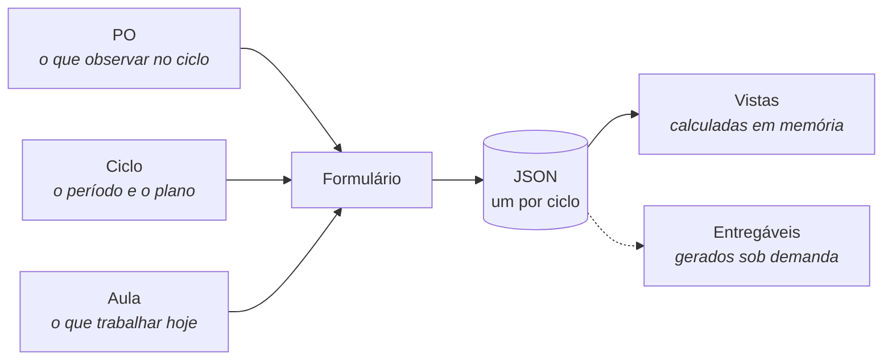
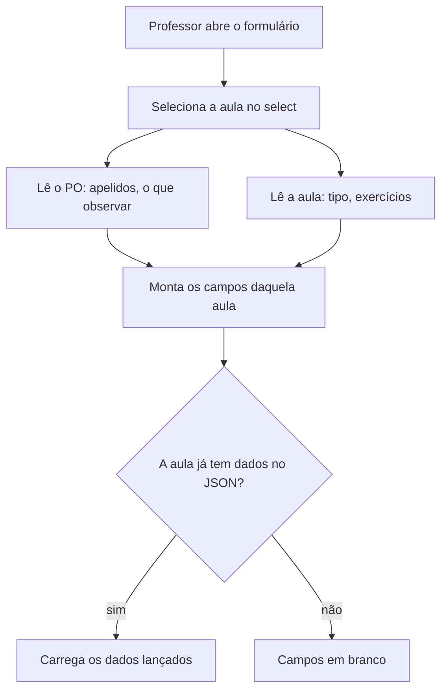
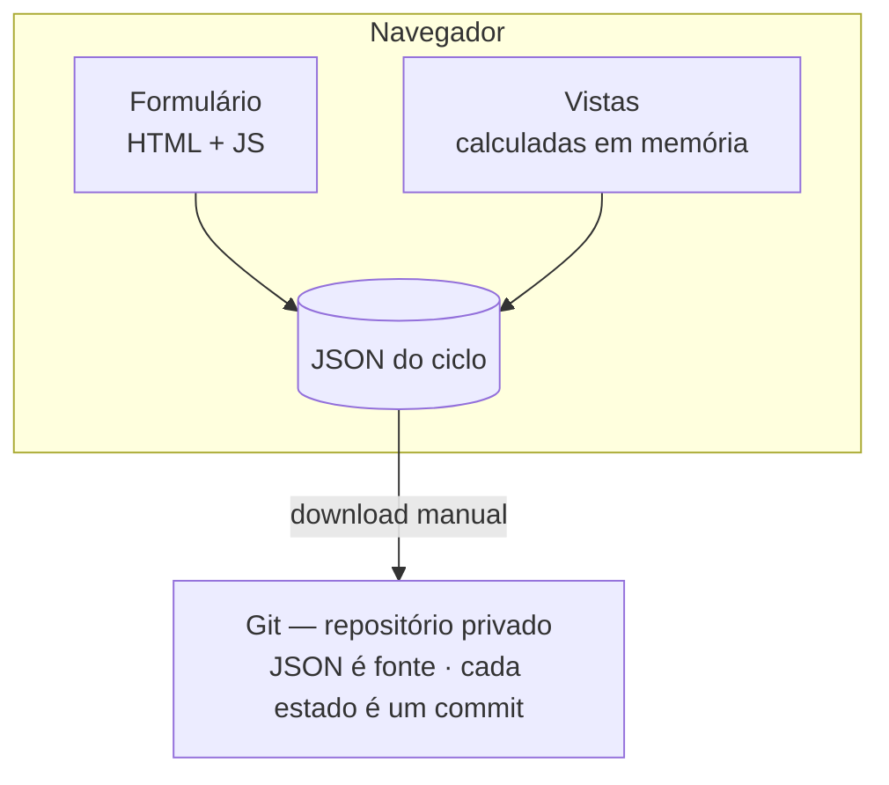

# Arquitetura — Formulário de captura em JSON

> **Resumo (para o HANDOFF):** arquitetura técnica do formulário dinâmico com
> JSON por ciclo — modelo de dados, schema, fluxo, segurança e perguntas em
> aberto. Não implementado.

> **Por que esta ideia existe.** O projeto não tem problema de **volume** (ver
> §6 — o limite físico de uma escola é ~230 MB em 10 anos). Tem problema de
> **navegação**: um menu com N capturas e N relatórios fica imenso na medida em
> que as aulas acontecem. Esta ideia resolve a navegação — não a escala.

> **Documento técnico.** Complementa o `IDEIA-CAPTURA.md` (conceito) com o
> desenho da arquitetura. Descreve o que **seria** implementado — não uma
> implementação atual. Os diagramas vêm em duas formas: **Mermaid** (renderiza no
> GitHub) e **ASCII** (para o PDF, onde o Mermaid não renderiza sem plugin).

## 1. Modelo de dados

### 1.1 Entidades

**Mermaid:**



**ASCII (mesma estrutura, para o PDF):**

```
PO ─────┐
        │
Ciclo ──┼───> Formulário ───> JSON (um por ciclo)
        │                       │
Aula ───┘                       ├──> Vistas (calculadas em memória)
                                │
                                └──> Entregáveis (gerados sob demanda):
                                     caderno · relatório · acompanhamento
```

**Descrição:**

- **PO** — define o que observar no ciclo (alunas, fenômeno, linha de base)
- **Ciclo** — define o período, o intervalo e a duração de referência (o manifesto)
- **Aula** — define o que trabalhar hoje (tipo, exercícios, objetivo)
- **Formulário** — combina PO + ciclo + aula para montar os campos daquela aula
- **JSON** — armazena os valores lançados (um por ciclo, com todas as aulas)
- **Vistas** — recortes calculados em memória (por aula, por aluna): o que se lê na tela
- **Entregáveis** — caderno, relatório pós-aula e acompanhamento por aluna: gerados
  **sob demanda**, quando há um arquivo a entregar (§3.5)

### 1.2 Relações

| Entidade | Fornece | Consome |
|:--|:--|:--|
| **PO** | Apelidos, fenômeno, linha de base | — |
| **Aula** | Tipo, exercícios, objetivo | PO (para saber o que observar) |
| **Formulário** | Campos (montados dinamicamente) | PO + Aula |
| **JSON** | Valores + textos | Formulário (grava) |
| **Vistas** | Recortes | JSON (lê) |
| **Entregáveis** | Caderno, relatório pós-aula e acompanhamento — **sob demanda** | JSON (lê) |

## 2. Schema do JSON

### 2.1 Estrutura geral

```json
{
  "ciclo": "01",
  "escola": "duo",
  "professor": "tiago",
  "criado_em": "2026-09-19",
  "aulas": {
    "01": { },
    "02": { }
  }
}
```

### 2.2 Estrutura de uma aula

```json
{
  "data": "2026-09-19",
  "presentes": ["ceci", "ana", "mel", "sofi"],
  "ausentes": [],
  "duracao_min": 120,
  "condicoes_contorno": {
    "plano_seguido": "sim",
    "animo": 5,
    "interesse": 5,
    "harmonia": 5,
    "mudou": ""
  },
  "tecnica": {
    "ceci": {
      "metatarsos": "ok",
      "tempo": "ok",
      "transferencia": "ok",
      "braco_perna": "parcial"
    }
  },
  "funcional": {
    "ceci": {
      "duracao_min": 120,
      "tonus": "parcial",
      "fadiga_antes": false
    }
  },
  "musicalidade": { },
  "linha_de_base": { },
  "relatorio": {
    "texto": "...",
    "surpresas": "...",
    "ajustes": "..."
  },
  "materiais": [],
  "ultimo_lancamento": "2026-09-20T14:30"
}
```

**Nota:** o schema é **por aula** dentro do JSON. As vistas não ficam
armazenadas — são calculadas pelo formulário. O `ultimo_lancamento` é o carimbo
de gravação **daquela aula**: é o que ancora o prazo do ajuste (§5.1).

E `plano_seguido` e `mudou` são **um par**, com regra declarada: se o plano **não**
foi seguido (`parcial`/`não`), `mudou` é **obrigatório** — é ali que a mudança se
registra, em uma linha (a estrutura executada e o que foi abandonado vão no
`relatorio` da aula, que é o lugar da execução diferente); se o plano **foi**
seguido (`sim`), `mudou` fica **vazio** — e vazio quer dizer *nada mudou*. Os
documentos gerados declaram os dois estados ("nada — o plano foi seguido"), em vez
de ficarem em silêncio.

O formulário **sugere** a data e a duração da aula a partir do plano do ciclo: a
aula N é a N-ésima do período declarado, no intervalo declarado (`intervalo_dias`),
e a duração de referência é a do ciclo (`duracao_min`). São valores **iniciais**,
editáveis — a aula pode ter acontecido em outro dia ou durado outro tempo.

## 3. Fluxo

### 3.1 Antes da aula

**Mermaid:**



**ASCII:**

```
Professor abre o formulário
    ↓
Seleciona a aula no <select>
    ↓
Formulário lê o PO (apelidos, o que observar)
    ↓
Formulário lê a aula (tipo, exercícios)
    ↓
Formulário monta os campos daquela aula
    ↓
Se a aula já tem dados no JSON → carrega
Se não → campos em branco
```

### 3.2 Durante a aula

```
Professor marca os valores no formulário
```

### 3.3 Depois da aula

```
Professor lança os dados → formulário atualiza o JSON em memória
    ↓
Escreve o texto do relatório → também vai para o JSON
    ↓
Cada gravação cria um ARQUIVO novo, com carimbo no nome, e o índice passa a
apontar para ele — o anterior permanece (ver §5.1)
    ↓
Baixa o JSON novo e o índice atualizado
    ↓
Commita no Git (repositório privado)
```

### 3.4 Visualizar

```
Professor abre o formulário
    ↓
Seleciona "Aula 03" → formulário carrega dados do JSON
    ↓
OU seleciona "Carol" no filtro → formulário calcula a vista por aluna
    ↓
OU o período do ciclo aparece como informação (não é filtro)
```

### 3.5 Gerar um entregável (sob demanda)

Os artefatos de saída — **caderno**, **relatório pós-aula** e **acompanhamento por
aluna** — são **vistas dos dados já lançados**: o professor clica em "Gerar" quando
precisa de um arquivo para entregar (enviar, imprimir, arquivar), com o filtro que
quiser. **Nada é mantido atualizado automaticamente.** O JSON é o armazenamento; os
`.md` são os entregáveis.

E não é escrever duas vezes: no modelo atual o caderno e o relatório são **escritos à
mão**; aqui eles são **lidos** do que já foi lançado.

Isso não muda o §3.3 — a gravação continua sendo lançar → baixar o JSON → commitar. O
que muda é que o documento entregue deixa de ser escrito à mão: ele é o espelho do
filtro, no momento em que se precisa dele.

## 4. Componentes

**Mermaid:**



**ASCII:**

```
┌─────────────────────────────────────────────┐
│              Navegador                       │
│  ┌─────────────────┐  ┌─────────────────┐   │
│  │   Formulário    │  │     Vistas      │   │
│  │   (HTML + JS)   │  │  (calculadas)   │   │
│  └────────┬────────┘  └────────┬────────┘   │
│           │                     │             │
│           └──────────┬──────────┘             │
│                      │                        │
│           ┌──────────┴──────────┐             │
│           │        JSON         │             │
│           │   (ciclo-XX.json)   │             │
│           └─────────────────────┘             │
└─────────────────────────────────────────────┘
              │
              │ download / commit manual
              ▼
┌─────────────────────────────────────────────┐
│        Git (repositório privado)             │
│  - JSON é a fonte (entra no hash)            │
│  - Cada estado do JSON é um commit           │
└─────────────────────────────────────────────┘
```

## 5. Segurança

Os dados do JSON são os mesmos dos acompanhamentos atuais — dados de menores.
As proteções são as mesmas (ver `CONGELAMENTO.md`):

| Camada | O que protege |
|:--|:--|
| **Repositório privado** (GitHub) | O JSON não é legível publicamente |
| **Fora do Git?** | Decisão pendente — ver seção 7 |
| **Criptografia no site** | Se o JSON for publicado, é criptografado como os acompanhamentos hoje |
| **Acesso** | Só o professor (com senha) |

**Onde o JSON vive:** decisão pendente — ver seção 7.

## 5.1 Ajuste com prazo

O JSON pode ser **ajustado** dentro de um prazo de **48 horas** — contadas a partir
da **última gravação daquela aula** (não do arquivo, nem do ciclo). Cada vez que a
aula é salva — no lançamento **ou** num ajuste — o contador **dela** reinicia; o das
outras não é tocado. **Lançar a aula 05 não reabre a janela da aula 01.** Cada aula
fecha quando **ela** fica 48h sem ser tocada.

**O que é um ajuste (não é edição):**

- O professor abre a aula já lançada (modo leitura) → botão **"Ajustar
  lançamento"** (só dentro do prazo)
- O formulário **reabre em modo captura** com os dados atuais carregados
- O professor corrige, preenche o **"Motivo do ajuste"** (obrigatório) e o
  **"Gerado por"** — o ajuste fica registrado com autor — e salva
- Cada gravação cria um **arquivo novo, com carimbo no nome**
  (`dados-exemplo-2026-09-20T1430.json`), e o índice (`ciclos.json`) passa a apontar
  para ele. O arquivo anterior **permanece** — acessível, e não é o vigente
- O novo arquivo declara: `ajuste_de` (de onde veio), `ajustado_em`, `ajustado_por`,
  `motivo` — e `ajustes`, a lista do que mudou, **gravada no ato do ajuste**. O
  documento gerado depois (§3.4) reproduz o que mudou sem depender de o arquivo
  anterior estar acessível: sem servidor, ele pode ter ido para a pasta de downloads
  do navegador, e não para a pasta do ciclo

**Por que o prazo:**

A memória do professor é uma edição da realidade. Dentro de 48h, o ajuste é
memória fresca — vale corrigir. Depois, é reconstrução — não vale.

**Depois do prazo:**

O botão fica **cinza**, com aviso: *"Prazo encerrado em [data] — o registro
é definitivo."* O professor vê que a possibilidade existiu, mas não está mais
disponível.

**A regra de proveniência se mantém:** o JSON antigo não é editado, e o novo
declara de onde veio. A cadeia é íntegra — só ganha um elo novo.

> **No experimento** (`experimentos/captura-json/`), o prazo fechado pode ser visto
> sem esperar 48h: a página aceita `#agora=2026-10-01T10:00` no endereço. A gravação
> usa o relógio de verdade, sempre — o carimbo do arquivo não se simula.

### Aviso para implementação — colisão de nomes

O campo `ajustes` (lista de mudanças do lançamento, na **raiz** do JSON)
**não pode colidir** com `relatorio.ajustes` (o "O que foi ajustado" do
relatório pós-aula, **dentro de cada aula**).

**O risco:** um merge que grave a chave `ajustes` em qualquer nível de
indentação sobrescreve o relatório da aula com a lista — e o JSON continua
**válido** (o `JSON.parse` não pega), o que torna o bug silencioso. Aconteceu
de verdade na primeira versão do experimento: o campo nasceu como lista e o
relatório da aula virou array, sem que nada acusasse.

**As opções:**

- **(a)** O merge é **ciente do nível** — só toca a raiz, nunca o interior
  das aulas
- **(b)** O campo de raiz recebe **outro nome** (`ajustes_do_lancamento`)

No experimento ficou **(a)**: a gravação ancora a indentação exata da raiz (dois
espaços), e o harness ganhou asserção de regressão — `relatorio.ajustes` de uma
aula tem de continuar texto. A decisão para o gerador continua em aberto.

## 6. Estimativas

### 6.1 Tamanho do JSON

Por aula, com os campos do schema:

- ~500 bytes por aluna × 4-5 alunas = ~2,5 KB
- Mais os textos do relatório: ~1-2 KB
- Total por aula: **~4 KB**

Em 21 aulas (Ritmos): **~80 KB**. Em 12 aulas (Duo): **~50 KB**.

**Conclusão:** o JSON é pequeno. Carrega instantaneamente no navegador, mesmo no
celular.

### 6.2 Performance dos filtros

Filtrar 21 aulas por aluna = operação em ~80 KB. Instantâneo em qualquer
dispositivo moderno.

**Otimização só faz sentido acima de ~500 aulas.** Não é o caso.

### 6.3 Cenário de escola grande

O cenário atual (1 professor, 2 escolas, ~21 aulas por ciclo) é pequeno. Mas
vale medir o **limite físico** do domínio — para saber se a ideia continua
viável em escala maior.

Uma escola tem limites físicos:

| Fator | Limite |
|:--|:--|
| Salas | 3 (raro ter mais) |
| Horas por dia por sala | 8 |
| Dias por semana | 6 |
| Semanas por ano | 40 (descontando férias) |
| Alunos por aula | 20 |

**Total de aulas/ano** (3 salas × 8 h × 6 dias × 40 semanas): **~5.760
aulas/ano**.

**Volume de dados (JSON):**

- ~80 KB por ciclo de 20 aulas
- 5.760 aulas ÷ 20 aulas por ciclo = ~288 ciclos/ano
- **~23 MB/ano**

**Volume de dados (`.md`, o formato atual):**

- ~10 KB por aula
- **~58 MB/ano**

**Em 10 anos:** ~230 MB (JSON) ou ~580 MB (`.md`).

### 6.4 O que isso significa

**Em qualquer formato, o volume é trivial.**

| Volume | Tecnologia que aguenta |
|:--|:--|
| 580 MB (10 anos, `.md`) | Git lida — repositório grande, mas funcional |
| 230 MB (10 anos, JSON) | Git lida com folga |
| 230 MB (SQLite) | Trivial (SQLite lida com TB) |
| 230 MB (PostgreSQL) | Ridiculamente pequeno |

**Nenhuma migração para banco de dados é necessária por volume.** Nem agora, nem
em 10 anos, nem em 20.

## 7. Perguntas em aberto

Estas são as decisões que **ainda não têm resposta** — e que o desenho revelou (é
o ponto do documento):

### 7.1 Como o formulário sabe quais campos montar para a aula 03?

**Hipótese A:** o formulário lê o plano da aula 03 (`.md`) e extrai os campos.

**Hipótese B:** existe um schema central (por tipo de aula — balé, PDD, barra)
que o formulário consulta.

**Hipótese C:** o formulário tem campos fixos (os mesmos para todas as aulas), e
o que muda é só o conteúdo.

**Não decidido.**

### 7.2 O que acontece se o PO mudar no meio do ciclo?

**Hipótese A:** o JSON é migrado (nova versão).

**Hipótese B:** o JSON fica na versão do PO que existia quando foi criado.

**Hipótese C:** o JSON tem uma versão do PO declarada, e a migração é manual.

**Não decidido.**

### 7.3 Onde o JSON vive no repositório?

**Hipótese A:** dentro do Git (repositório privado).

**Hipótese B:** fora do Git (como os `.md` de acompanhamento hoje), mas
commitado o JSON cifrado.

**Hipótese C:** no Git em claro (só protegido pelo repositório privado).

**Não decidido.** — **Esta é a pergunta mais importante da arquitetura.**

### 7.4 Como o Netlify serve um JSON criptografado?

**Hipótese A:** o JSON é servido cifrado e o formulário o descriptografa no
navegador (como o PageCrypt faz com os HTML hoje).

**Hipótese B:** o JSON não é servido publicamente — só existe localmente no
computador do professor.

**Não decidido.**

### 7.5 Durante a transição (JSON e `.md` coexistem), qual é a fonte?

**Hipótese A:** o `.md` continua sendo a fonte até o JSON estar completo.

**Hipótese B:** a partir de uma data, o JSON passa a ser a fonte.

**Hipótese C:** os dois coexistem — o JSON para as aulas novas, os `.md` para as
antigas.

**Não decidido.**

### 7.6 O formulário roda onde?

**Hipótese A:** no pacote publicado (site do ciclo), como parte dos HTML.

**Hipótese B:** fora do pacote — uma ferramenta separada do professor.

**Hipótese C:** no VS Code, como uma extensão ou app.

**Não decidido.**

## 8. O que isso revela

**Esta ideia não é sobre escala. É sobre navegação.**

O desenho da arquitetura mostrou que:

- A ideia **funciona** em qualquer volume (ver §6 — 10 anos de escola grande
  cabem em ~230 MB).
- O problema que ela resolve é **navegação**: o menu "Acompanhamento" fica imenso
  com N capturas e N relatórios; navegar entre aulas exige abrir arquivos
  separados.
- A migração para JSON **não é necessária por volume**. Se for feita, é para
  simplificar a interface.

Há **seis perguntas em aberto** (§7) — nenhuma delas bloqueia a ideia; todas
podem ser respondidas quando a implementação for decidida.

**A pergunta crítica:** §7.3 (onde o JSON vive) — define se a ideia mantém a
arquitetura atual (sem servidor) ou exige backend.

## Referências

- `IDEIA-CAPTURA.md` — conceito (o "por quê")
- `ARQUITETURA-CAPTURA.md` — este documento (o "como")
- `PROTOCOLO.md` — as 22 pétreas
- `REGRAS.md` — as 17 regras
- `METODO.md` — a visão de mundo
- `CONGELAMENTO.md` — o que está congelado

