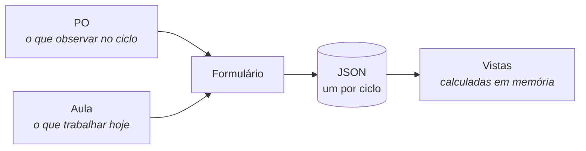
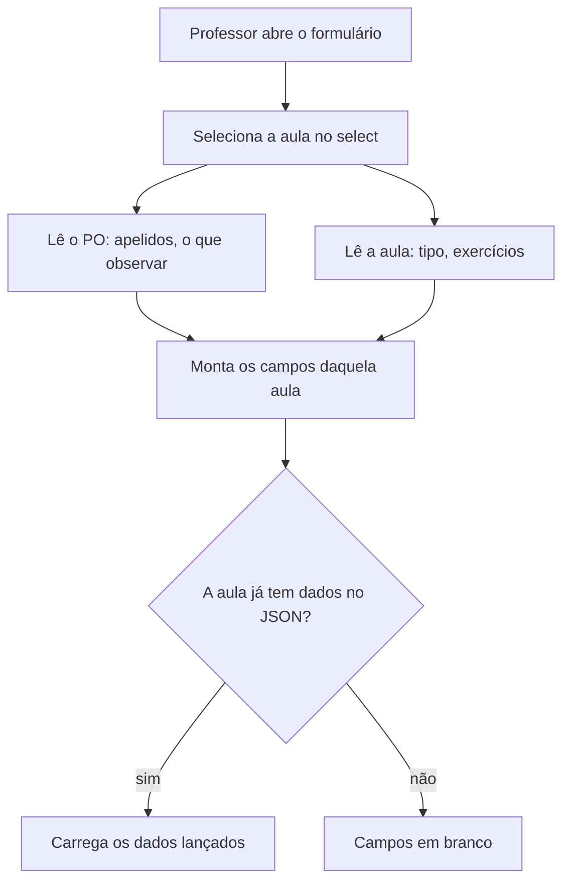
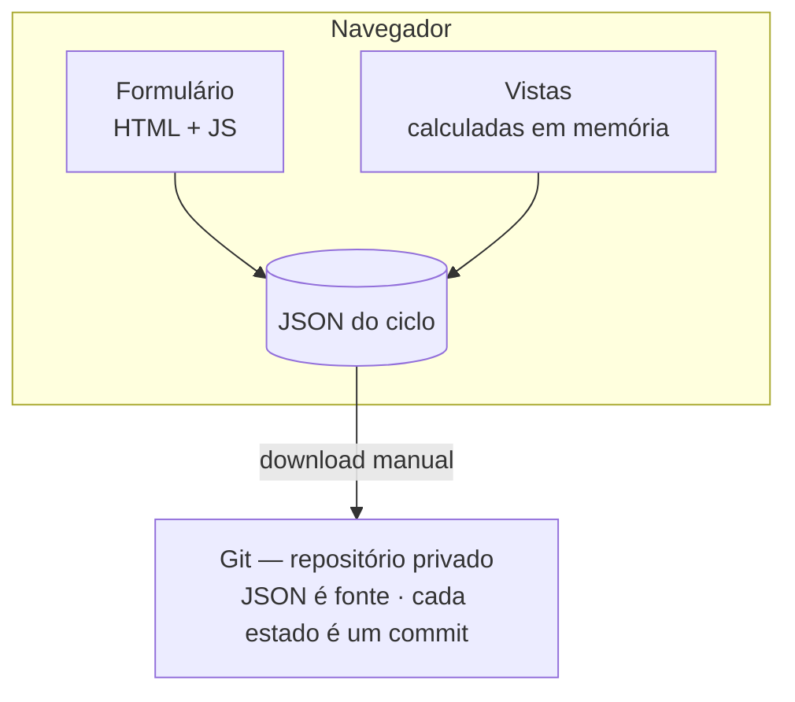

# Arquitetura — Formulário de captura em JSON

> **Resumo (para o HANDOFF):** arquitetura técnica do formulário dinâmico com
> JSON por ciclo — modelo de dados, schema, fluxo, segurança e perguntas em
> aberto. Não implementado.

> **Documento técnico.** Complementa o `IDEIA-CAPTURA.md` (conceito) com o
> desenho da arquitetura. Descreve o que **seria** implementado — não uma
> implementação atual. Os diagramas vêm em duas formas: **Mermaid** (renderiza no
> GitHub) e **ASCII** (para o PDF, onde o Mermaid não renderiza sem plugin).

## 1. Modelo de dados

### 1.1 Entidades

**Mermaid:**



**ASCII (mesma estrutura, para o PDF):**

```
PO ────┐
       │
       ├───> Formulário ───> JSON (por ciclo) ───> Vistas (calculadas)
       │
Aula ──┘
```

**Descrição:**

- **PO** — define o que observar no ciclo (alunas, fenômeno, linha de base)
- **Aula** — define o que trabalhar hoje (tipo, exercícios, objetivo)
- **Formulário** — combina PO + aula para montar os campos daquela aula
- **JSON** — armazena os valores lançados (um por ciclo, com todas as aulas)
- **Vistas** — recortes calculados em memória (por aluna, por período)

### 1.2 Relações

| Entidade | Fornece | Consome |
|:--|:--|:--|
| **PO** | Apelidos, fenômeno, linha de base | — |
| **Aula** | Tipo, exercícios, objetivo | PO (para saber o que observar) |
| **Formulário** | Campos (montados dinamicamente) | PO + Aula |
| **JSON** | Valores + textos | Formulário (grava) |
| **Vistas** | Recortes | JSON (lê) |

## 2. Schema do JSON

### 2.1 Estrutura geral

```json
{
  "ciclo": "01",
  "escola": "duo",
  "professor": "tiago",
  "criado_em": "2026-09-19",
  "aulas": {
    "01": { },
    "02": { }
  }
}
```

### 2.2 Estrutura de uma aula

```json
{
  "data": "2026-09-19",
  "presentes": ["ceci", "ana", "mel", "sofi"],
  "ausentes": [],
  "duracao_min": 120,
  "condicoes_contorno": {
    "plano_seguido": "sim",
    "animo": 5,
    "interesse": 5,
    "harmonia": 5,
    "mudou": ""
  },
  "tecnica": {
    "ceci": {
      "metatarsos": "ok",
      "tempo": "ok",
      "transferencia": "ok",
      "braco_perna": "parcial"
    }
  },
  "funcional": {
    "ceci": {
      "duracao_min": 120,
      "tonus": "parcial",
      "fadiga_antes": false
    }
  },
  "musicalidade": { },
  "linha_de_base": { },
  "relatorio": {
    "texto": "...",
    "surpresas": "...",
    "ajustes": "..."
  },
  "materiais": []
}
```

**Nota:** o schema é **por aula** dentro do JSON. As vistas não ficam
armazenadas — são calculadas pelo formulário.

## 3. Fluxo

### 3.1 Antes da aula

**Mermaid:**



**ASCII:**

```
Professor abre o formulário
    ↓
Seleciona a aula no <select>
    ↓
Formulário lê o PO (apelidos, o que observar)
    ↓
Formulário lê a aula (tipo, exercícios)
    ↓
Formulário monta os campos daquela aula
    ↓
Se a aula já tem dados no JSON → carrega
Se não → campos em branco
```

### 3.2 Durante a aula

```
Professor marca os valores no formulário
```

### 3.3 Depois da aula

```
Professor lança os dados → formulário atualiza o JSON em memória
    ↓
Escreve o texto do relatório → também vai para o JSON
    ↓
Baixa o JSON atualizado
    ↓
Commita no Git (repositório privado)
```

### 3.4 Visualizar

```
Professor abre o formulário
    ↓
Seleciona "Aula 03" → formulário carrega dados do JSON
    ↓
OU seleciona "Carol" no filtro → formulário calcula a vista por aluna
    ↓
OU seleciona um período → formulário calcula a evolução
```

## 4. Componentes

**Mermaid:**



**ASCII:**

```
┌─────────────────────────────────────────────┐
│              Navegador                       │
│  ┌─────────────────┐  ┌─────────────────┐   │
│  │   Formulário    │  │     Vistas      │   │
│  │   (HTML + JS)   │  │  (calculadas)   │   │
│  └────────┬────────┘  └────────┬────────┘   │
│           │                     │             │
│           └──────────┬──────────┘             │
│                      │                        │
│           ┌──────────┴──────────┐             │
│           │        JSON         │             │
│           │   (ciclo-XX.json)   │             │
│           └─────────────────────┘             │
└─────────────────────────────────────────────┘
              │
              │ download / commit manual
              ▼
┌─────────────────────────────────────────────┐
│        Git (repositório privado)             │
│  - JSON é a fonte (entra no hash)            │
│  - Cada estado do JSON é um commit           │
└─────────────────────────────────────────────┘
```

## 5. Segurança

Os dados do JSON são os mesmos dos acompanhamentos atuais — dados de menores.
As proteções são as mesmas (ver `CONGELAMENTO.md`):

| Camada | O que protege |
|:--|:--|
| **Repositório privado** (GitHub) | O JSON não é legível publicamente |
| **Fora do Git?** | Decisão pendente — ver seção 7 |
| **Criptografia no site** | Se o JSON for publicado, é criptografado como os acompanhamentos hoje |
| **Acesso** | Só o professor (com senha) |

**Onde o JSON vive:** decisão pendente — ver seção 7.

## 6. Estimativas

### 6.1 Tamanho do JSON

Por aula, com os campos do schema:

- ~500 bytes por aluna × 4-5 alunas = ~2,5 KB
- Mais os textos do relatório: ~1-2 KB
- Total por aula: **~4 KB**

Em 21 aulas (Ritmos): **~80 KB**. Em 12 aulas (Duo): **~50 KB**.

**Conclusão:** o JSON é pequeno. Carrega instantaneamente no navegador, mesmo no
celular.

### 6.2 Performance dos filtros

Filtrar 21 aulas por aluna = operação em ~80 KB. Instantâneo em qualquer
dispositivo moderno.

**Otimização só faz sentido acima de ~500 aulas.** Não é o caso.

## 7. Perguntas em aberto

Estas são as decisões que **ainda não têm resposta** — e que o desenho revelou (é
o ponto do documento):

### 7.1 Como o formulário sabe quais campos montar para a aula 03?

**Hipótese A:** o formulário lê o plano da aula 03 (`.md`) e extrai os campos.

**Hipótese B:** existe um schema central (por tipo de aula — balé, PDD, barra)
que o formulário consulta.

**Hipótese C:** o formulário tem campos fixos (os mesmos para todas as aulas), e
o que muda é só o conteúdo.

**Não decidido.**

### 7.2 O que acontece se o PO mudar no meio do ciclo?

**Hipótese A:** o JSON é migrado (nova versão).

**Hipótese B:** o JSON fica na versão do PO que existia quando foi criado.

**Hipótese C:** o JSON tem uma versão do PO declarada, e a migração é manual.

**Não decidido.**

### 7.3 Onde o JSON vive no repositório?

**Hipótese A:** dentro do Git (repositório privado).

**Hipótese B:** fora do Git (como os `.md` de acompanhamento hoje), mas
commitado o JSON cifrado.

**Hipótese C:** no Git em claro (só protegido pelo repositório privado).

**Não decidido.** — **Esta é a pergunta mais importante da arquitetura.**

### 7.4 Como o Netlify serve um JSON criptografado?

**Hipótese A:** o JSON é servido cifrado e o formulário o descriptografa no
navegador (como o PageCrypt faz com os HTML hoje).

**Hipótese B:** o JSON não é servido publicamente — só existe localmente no
computador do professor.

**Não decidido.**

### 7.5 Durante a transição (JSON e `.md` coexistem), qual é a fonte?

**Hipótese A:** o `.md` continua sendo a fonte até o JSON estar completo.

**Hipótese B:** a partir de uma data, o JSON passa a ser a fonte.

**Hipótese C:** os dois coexistem — o JSON para as aulas novas, os `.md` para as
antigas.

**Não decidido.**

### 7.6 O formulário roda onde?

**Hipótese A:** no pacote publicado (site do ciclo), como parte dos HTML.

**Hipótese B:** fora do pacote — uma ferramenta separada do professor.

**Hipótese C:** no VS Code, como uma extensão ou app.

**Não decidido.**

## 8. O que isso revela

O desenho da arquitetura mostrou que a ideia **funciona**, mas que há **seis
perguntas em aberto** — nenhuma delas é trivial.

**A boa notícia:** nenhuma das perguntas bloqueia a ideia. Todas podem ser
respondidas quando a implementação for decidida.

**A pergunta crítica:** **7.3** — onde o JSON vive. Isso define se a ideia mantém
a arquitetura atual (sem servidor) ou exige backend.

## Referências

- `IDEIA-CAPTURA.md` — conceito (o "por quê")
- `ARQUITETURA-CAPTURA.md` — este documento (o "como")
- `PROTOCOLO.md` — as 22 pétreas
- `REGRAS.md` — as 17 regras
- `METODO.md` — a visão de mundo
- `CONGELAMENTO.md` — o que está congelado

