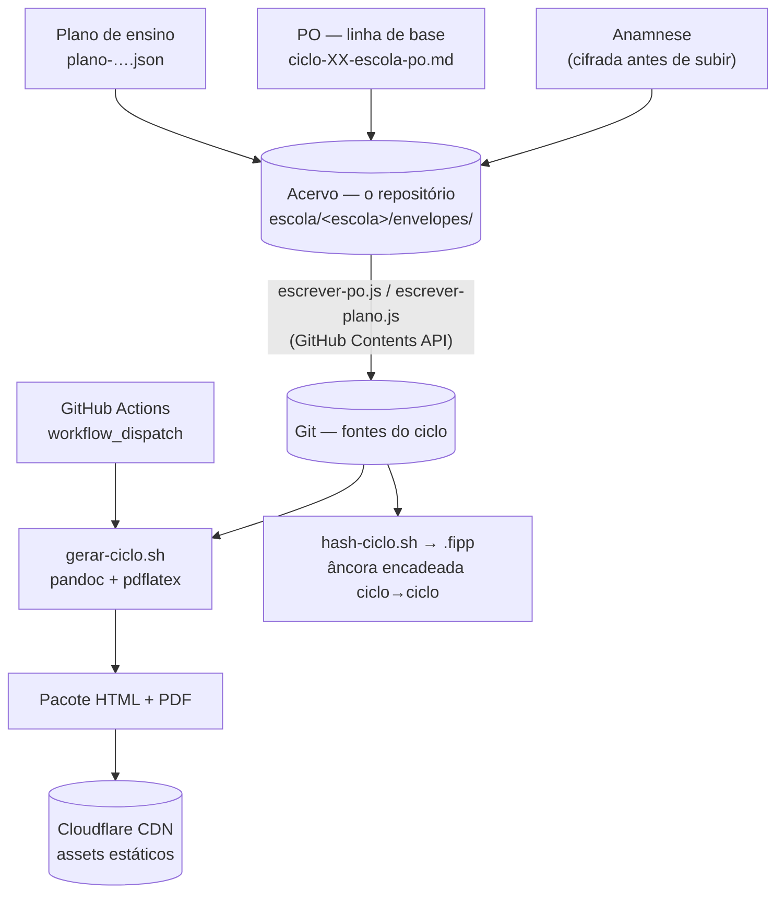
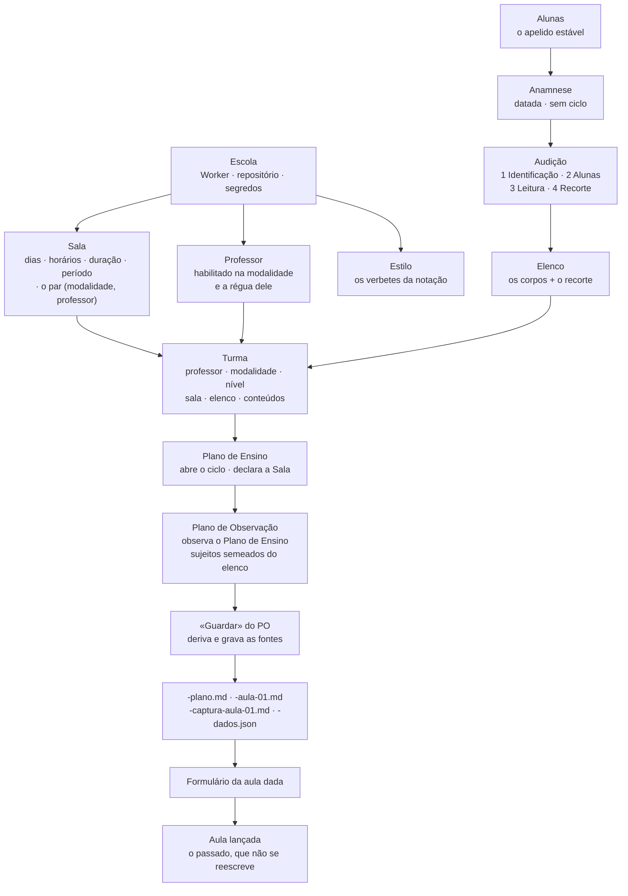

# Arquitetura geral — por que sistema de arquivos, e não um backend com banco

> **Para quem?** Material de apresentação técnica: explica, para um programador, **quais
> arquiteturas o Projeto Ciclo usa**, **por que a fonte de verdade é o sistema de arquivos
> (Git) e não um banco de dados**, e **por que isso é mais barato e mais rápido**.
>
> **Leia antes de citar.** Este documento é do **Projeto Ciclo** — a memória da aula dada,
> **protótipo testado no universo da dança** (não é agnóstico: o projeto agnóstico será criado
> a partir dele). O **FIPP não é implementado aqui**: a proveniência deste repositório é a
> **âncora encadeada** (`tools/hash-ciclo.sh` → `.fipp`), uma **aproximação** do framework do
> projeto de mestrado (outro diretório). Onde este documento disser "proveniência", entenda-se
> essa âncora, não o FIPP.
>
> Os documentos de detalhe são: [ARQUITETURA-CAPTURA.md](./ARQUITETURA-CAPTURA.md) (o JSON da
> captura), [ARQUITETURA-AULA.md](./ARQUITETURA-AULA.md) (o ciclo de vida da aula e a âncora por
> aula), [ARQUITETURA-ANAMNESE.md](./ARQUITETURA-ANAMNESE.md) (a anamnese),
> [IDEIA-PAINEL-ESCOLA.md](./IDEIA-PAINEL-ESCOLA.md) (os Bastidores), [PROTOCOLO.md](./PROTOCOLO.md)
> (as 22 pétreas) e [CONGELAMENTO.md](./CONGELAMENTO.md) (a infraestrutura congelada).
>
> **A §5 é medida, não desenhada** (04/11/2026): descreve o que o código faz quando duas escritas
> se cruzam, com o resultado das bancadas de `experimentos/`. Ela substitui a versão anterior
> deste documento, que dava o acervo como vivendo no KV e sob `professores/<professor>/escolas/`.

---

## 1. A ideia em uma frase

**As fontes de verdade são arquivos versionados no Git, e o Git é o banco de dados.** Isso vale
para as duas coisas que o sistema guarda, e é o ponto que a versão anterior deste documento errava:
as **fontes do ciclo** (`professores/<prof>/ciclos/`, Markdown e `.conf`) e o **acervo
operacional** (`escola/<escola>/envelopes/`, JSON — planos, POs, anamneses). O Cloudflare é a
vitrine e a borda: um Worker por escola para `/api/*`, e o CDN para o que já está pronto.

Não há `INSERT`/`UPDATE` num servidor de banco. Há um `commit` — e **um commit por gravação**, com
a referência do ramo como último passo. A cadeia de custódia do projeto **é** o histórico do Git,
e a "consulta" mais comum — abrir a página de um ciclo — **é um GET de arquivo estático no CDN**,
não uma query.

O **KV** ainda existe, e já não é onde o registro mora: é a reserva de leitura do que não migrou e
o estado que nunca foi registro (§7, §8).

---

## 2. Onde cada coisa vive (o mapa de componentes)

Cada caminho abaixo foi conferido na árvore do código; a coluna «verificado em» diz onde.

| Componente | Onde está | Tecnologia |
|:--|:--|:--|
| **Fontes de verdade do ciclo** | `professores/<prof>/ciclos/ciclo-NN-<escola>.md` e `.conf` | Markdown, `.conf` |
| **Schema de cada ciclo** | `ciclo-NN-schema.json` (P-08) | JSON versionado |
| **Âncora de proveniência** | `ciclo-NN-<escola>.fipp` | SHA-256 encadeado (`parentHash`) |
| **Acervo operacional — os envelopes** | `escola/<escola>/envelopes/<id>.json` | JSON versionado (planos, POs, anamneses) |
| **Acervo operacional — o índice** | `escola/<escola>/envelopes/.indice.json` | JSON derivado (`nomes` + `resumos`) |
| **Inventário da escola** | `escola/<escola>/indice.json` | JSON: `professor` (responsável) + `professores[]` |
| **Elo de expurgo** | `escola/<escola>/indice.json` → `expurgo[]` | JSON; a proveniência acrescenta |
| **Estados e vínculos dos envelopes** | derivados em `motor/nucleo/porta.js` | nenhum campo «estado» gravado |
| **Gerador de pacote** | `tools/gerar-ciclo.sh` | pandoc (MD→HTML) + pdflatex (MD→PDF) |
| **Validação** | `tools/validar-*.js`, `tools/check-pacote.js`, `tools/check-indices.js` | Node, nos hooks de commit |
| **Núcleo (lógica pura, sem IO)** | `motor/nucleo/*` | JavaScript: recebe e devolve dados |
| **Adaptadores de armazenamento** | `motor/adaptadores/*` (`node.js`, `cloudflare.js`) | `fs` ↔ KV/ASSETS |
| **Adaptador do acervo** | `motor/servidor/acervo-envelopes.js` | GitHub Contents API (Git como store) |
| **Servidor (rotas)** | `motor/servidor/*` | Web Standards (`Request`/`Response`), roteador único |
| **Worker da raiz** | `workers/raiz.js` | Cloudflare Worker (porta de entrada, Bastidores) |
| **Worker por escola** | `motor/servidor/producao.js` | Cloudflare Worker (assets + `/api/*`) |
| **Cifra de dados sensíveis** | `tools/lib-cifra.js` (uma definição: Node e navegador) | PBKDF2 + AES-GCM 256 |
| **Deploy e geração** | `.github/workflows/*.yml` | GitHub Actions |
| **KV (legado)** | binding `PADD_KV` | **só leitura** desde 19/10/2026 — ver §8 |

### 2.1 O acervo operacional: onde os documentos de facto vivem

> **Correção de premissa (04/11/2026).** Uma versão anterior deste documento dizia que planos, POs
> e anamneses viviam no KV e, noutra passagem, que viviam sob
> `professores/<professor>/escolas/<escola>/`. **Nenhuma das duas é verdade.**
> `professores/<professor>/escolas/` não existe na árvore. O acervo vive **no repositório**, no
> escopo da **escola**.

```
escola/<escola>/envelopes/<id>.json      ← plano-…, po-…, anamnese-…
escola/<escola>/envelopes/.indice.json   ← o rol: nomes + resumos (derivado)
escola/<escola>/indice.json              ← inventário: professor responsável + professores[]
professores/<prof>/ciclos/…              ← as FONTES do ciclo e o pacote gerado
professores/<prof>/perfil.json           ← a habilitação (a pessoa, não o tenant)
```

O caminho é montado por `caminhoDaChave(escola, chave)` em `motor/servidor/acervo-envelopes.js`:
`envelope/<nome>.json` → `escola/<escola>/envelopes/<nome>.json`. **O caminho não contém a
professora.**

**Qual é o isolamento, então — e qual não é.**

| Fronteira | Isolada? | Onde se vê |
|:--|:--|:--|
| Escola (subdomínio) | **Sim** | um Worker por escola, um `wrangler.<slug>.jsonc`, uma pasta `escola/<slug>/` |
| Professor, nas **fontes** do ciclo | **Sim** | `professores/<prof>/ciclos/` — nenhum caminho cruza professor |
| Professor, no **acervo** | **Não** | `escola/<escola>/envelopes/` é compartilhado pelos professores da escola |
| Professor, no **histórico** do ciclo | **Sim** | o `.fipp` é por ciclo e por variante, dentro de `professores/<prof>/` |

O `escola/<escola>/indice.json` declara **um** responsável (`professor`, no singular) e **uma
lista** de professores habilitados (`professores[]`, `comProfessor` em
`motor/servidor/repo-escola.js`, escrito por `registrarProfessorNaEscola`). Duas professoras da
mesma escola **escrevem os mesmos arquivos de envelope** — é por isso que a §5 existe.

### 2.2 A peça-chave: o núcleo não tem banco

O contrato — `motor/nucleo/armazenamento.js` — define os verbos e nada mais:

| Verbo | Contrato | Para quê |
|:--|:--|:--|
| `ler(chave)` | `string \| null` | `null` é «não existe», e nunca lança |
| `guardar(chave, valor)` | — | grava **por cima**; é a edição do mesmo documento |
| `criar(chave, valor)` | `{ criado }` | grava **só se não existir** — a corrida do nome (§5.1) |
| `anexar(chave, linha)` | — | acrescenta; o registro de custo da IA é um JSONL |
| `listar(prefixo)` | `string[]` | enumera |
| `existe(chave)` | `boolean` | — |
| `apagar(chave)` | `boolean` | idempotente: apagar o que não existe devolve `false` |

O **acervo** (`acervo-envelopes.js`) acrescenta dois verbos que só ele sabe fazer, porque precisa
de ler-modificar-gravar com o `sha` do Git: **`mutar(chave, mutacao)`** (o índice: relê e reaplica
a mutação sobre a versão que ganhou a corrida) e **`gravarComFusao(chave, base, novo, fundir)`**
(a edição que unifica duas escritas — §5.2).

O núcleo (validar, derivar, elicitar, fundir) **nunca lê nem escreve em lugar nenhum**: recebe o
que precisa e devolve o que produz. Quem persiste é o **adaptador**. Trocar de provedor é trocar de
adaptador, não reescrever o motor.

**O composto não tem lista de verbos — ele encaminha.** `combinar(acervo, resto)` — em
`acervo-envelopes.js`, montado por `criarArmazenamento` — decide por família de chave quem atende:
`envelope/*` vai ao acervo, o resto vai ao KV. A decisão de **quem** atende é dele; a de **quais
verbos existem** é do contrato, e o composto não a repete: é um `Proxy` que encaminha qualquer
verbo para quem atende aquela chave, de modo que **um verbo novo no contrato flui sozinho** (§5.7).

> **A armadilha que isto fecha, e ela foi medida.** Até 04/11/2026 o composto **enumerava** os
> verbos à mão, e o que ficava fora da lista desaparecia em silêncio: o `criar` (a escrita
> condicional da §5.1) e o `anexar` nunca chegavam ao motor, e as bancadas não o viam porque
> montavam o acervo **directo** em vez do composto que a produção monta. Hoje as bancadas que
> provam a escrita passam pelo `criarArmazenamento`, e a que lê os verbos lê-os **do ficheiro do
> contrato** (`experimentos/provar-verbos-do-armazenamento.js`).

### 2.3 A modalidade pertence ao professor — a escola a oferece por reflexo

> **DECIDIDO pela pesquisadora a 03/11/2026.** A pergunta era onde vive a modalidade — se na escola,
> que é a unidade que se vende, ou no professor. A resposta é o **professor**, e a razão é de domínio,
> não de conveniência: **a modalidade nasce da competência de quem ensina.** Uma escola só oferece
> balé clássico porque tem quem o saiba ensinar; a mesma escola oferece contemporâneo no dia em que
> contrata quem o ensine, e continua a ser a mesma escola. Pôr a modalidade na escola faria o
> contrário: a escola declararia uma competência que ninguém lá tem, e o balé clássico viraria um
> atributo do **edifício** em vez de um atributo do **ofício**.

**O que fica onde, depois desta decisão:**

| O quê | De quem é | Onde vive hoje |
|:--|:--|:--|
| **O conhecimento** — o alfabeto e o vocabulário de uma modalidade | da **modalidade**, não de pessoa nenhuma | `biblioteca/modalidades/<slug>/` (dado versionado, partilhado) |
| **A habilitação** — que modalidades este professor ensina | do **professor** | `professores/<slug>/perfil.json` → `modalidades` — **implementado** 03/11/2026 |
| **A oferta** — que modalidades esta escola tem à venda | **reflexo** das habilitações dos professores dela | **não existe**: nenhum registo de escola tem este campo, e é de propósito (ver consequência 1) |
| **A escolha, na aula** — que metodologia aquele ciclo segue | do **ciclo**, declarada no plano | `contexto-metodologia` no plano (P-16) |
| **A turma que perdeu quem a ensine** | da **escola** (é a turma dela) | campo `descontinuada` na turma — **implementado** 03/11/2026 |

**As três consequências que isto obriga a dizer:**

1. **A escola não herda um campo — herda uma derivação.** `modalidadesDaEscola(professores)` é a
   união das habilitações de quem lá dá aula. Escrito como campo, seria uma segunda declaração do
   mesmo facto, e a primeira contratação deixaria as duas a divergir — é a regra que esta casa já
   pagou com o vocabulário por escola (28/10) e com a conta dos tempos.
2. **O catálogo não muda de sítio.** O alfabeto continua em `biblioteca/modalidades/`, e continua
   **da modalidade** — nenhuma escola precisa de uma cópia dele. O que a decisão muda é **quem
   escolhe** qual se usa, não **onde ele mora**.
3. **A porta existe, e o dado passou a existir.** O núcleo tem `MODALIDADE_PADRAO` e os dois mapas
   (`ALFABETOS`, `VOCABULARIOS`), e a rota da Produção devolve `modalidade` na resposta. O que faltava
   era o dado lido do professor; desde 03/11/2026 ele existe em `professores/<slug>/perfil.json`, e
   nasce com a escola (`tools/criar-escola.sh`). O que ainda falta é **usá-lo**: a modalidade
   continua a ser uma constante em 10 sítios de `motor/` — é o acoplamento medido abaixo.

**O acoplamento, medido a 03/11/2026** (`experimentos/provar-sinais-da-modalidade.js`, §D): a
modalidade estava escrita **à mão em 10 sítios de `motor/`** — dois mapas e o padrão no núcleo, dois
no CLI dos produtos, e **cinco na página da Produção** (o `POST` do verbete, o `DELETE`, a rota que
serve o alfabeto e os dois corpos que a tela monta). Este número era a **linha de base**, e o
trabalho de médio prazo era levá-lo a zero.

> **CORRIGIDO a 04/11/2026 — e o número era maior do que o medido.** A varredura fina encontrou
> **29 ocorrências em 8 ficheiros**, das quais **6 eram literais de facto** que decidiam
> comportamento; as outras eram comentários, `require`s com o caminho da modalidade padrão (legítimos)
> e o próprio catálogo. A diferença importa: o número de 03/11 contava **sítios** (blocos de código),
> e um único sítio da página da Produção continha dois literais. Contar sítios subestima o
> acoplamento; contar literais não.
>
> **O acoplamento está a zero.** Nenhum literal de modalidade decide comportamento em `motor/` nem
> em `tools/`. Um único ponto de derivação, e todos os outros leem dele:

| Onde | O que faz agora | Antes |
|:--|:--|:--|
| `motor/nucleo/perfil-do-professor.js` → `modalidadePrincipal()` | **a única derivação**: a primeira modalidade do catálogo com `temConteudo`; sem catálogo, `''` | literal `'bale-classico'` |
| `… → MODALIDADE_PADRAO` | constante **derivada** de `modalidadePrincipal()`, não escrita | literal |
| `motor/servidor/bastidores.js` → `modalidadeDoCatalogo()` | lê o catálogo, cai no perfil, cai em `''`; serve as **6** chamadas da Produção (`TRADICOES_POR_MODALIDADE`, as 3 rotas do verbete, os 2 corpos de JS embebido) | 6 literais |
| `motor/produtos.js` | `--modalidade` do CLI, por omissão a derivada | 2 literais |
| `motor/servidor/termo-repo.js` | o caminho do verbete composto a partir de `MODALIDADE_PADRAO` | literal concatenado |
| `motor/servidor/catalogo-seed.js` | **reexporta** `MODALIDADE` do perfil, não a redeclara | alias literal |
| `motor/nucleo/notacao.js` | importa `MODALIDADE_PADRAO` (a segunda cópia saiu) | segunda cópia do literal |

**A regra que fica, e é a que impede a recaída:** um literal de modalidade **não se escreve em
`motor/`**. Quem precisa do padrão chama `MODALIDADE_PADRAO`; quem precisa de *outra* modalidade
recebe-a do perfil (`modalidades`), do plano (`contexto-metodologia`) ou da query — nunca de uma
constante. A direcção do `require` é segura: `perfil-do-professor.js` não importa `notacao.js`, pelo
que o `notacao.js → perfil-do-professor.js` não fecha ciclo.

**As três perguntas que ficaram abertas a 03/11/2026, e as respostas dela no mesmo dia:**

| A pergunta | A resposta dela |
|:--|:--|
| Onde vive a habilitação? | `professores/<slug>/perfil.json`, independente do tenant. Nasce com a escola (o professor que a cria já nasce habilitado na modalidade principal) e edita-se nos **Bastidores · Produção → Professores → Habilitações** |
| A turma cuja modalidade o professor deixou de ter? | **Não se apaga.** Fica `descontinuada`, com data e motivo, e o histórico intacto. A marca é **revogável**: quem volta a declarar a modalidade apaga-a |
| A habilitação tem níveis? | **Não** — a habilitação é sim/não por modalidade. O nível é do **enquadramento**, e o enquadramento é da **curadoria** (§2.3): `grau` + `nivel`, na forma da tradição, declarada em `tradicoes.json` → `estruturaDeNiveis` |

**E o expurgo, que é onde a decisão se prova.** O perfil **não** é dado do tenant: o expurgo
preserva-o (`repo-escola.js` → `ehPerfilDoProfessor`), nomeia-o no relatório do commit, e há uma
guarda (`semPerfisNaLista`) que **recusa antes de apagar** se alguma regra de caminho chegar até
lá. Sem essa guarda a preservação dependeria de o caminho não casar com um padrão alheio — e uma
garantia que depende de um acidente revoga-se sem avisar.

### 2.4 A turma é o ritmo, a curadoria é o ensino

> **DECIDIDO pela pesquisadora a 03/11/2026**, revendo a arrumação do mesmo dia. O nível, a
> modalidade, a tradição e o professor tinham sido postos na **turma** de manhã; à tarde ela
> reviu, e a razão é de operação: «se a escola precisar mover uma turma de nível ou reajustá-la
> para outra modalidade por razões estratégicas ou sazonais, ela não precisa destruir ou recriar a
> estrutura operacional da turma; basta ajustar a **curadoria**». E o ganho que ela nomeia:
> «a história operacional da turma (calendário, frequência, lançamentos) descola-se das mudanças
> de enquadramento de nível».

| A **turma** — infraestrutura operacional | A **curadoria** — direção pedagógica |
|:--|:--|
| dias da semana, horários, duração, frequência e período | vinculação ao **professor** habilitado |
| a **rubrica** de medição | **modalidade** e **tradição** de referência |
| as **alunas** (o vínculo operacional) | o **nível** (`grau` + `nivel`), na forma da tradição |
| — | os **conteúdos** que aquele grupo vai aprender |
| — | as **alunas** daquela entrega (o recorte) |

> **Correção de 03/11/2026 (mesmo dia).** A primeira redação desta tabela punha «os conteúdos que
> aquele grupo vai aprender» do lado da **turma**. **Está errado**: o conteúdo prático é «um ato
> pedagógico», e o sítio de um ato pedagógico é a curadoria — a turma é o **ritmo**. A associação
> saiu do passo 3 do cadastro e vive no formulário da curadoria (`#esc-conteudos`), e o mapa antigo
> (`turma-conteudos`) **continua a ser lido**: `motor/nucleo/conteudos.js` compõe-no com o
> `repertorio` de cada curadoria e normaliza os dois lados pelo mesmo `idDe`. A versão anterior não
> é apagada — fica como o elo que regista o que se pensou antes da correção.

**A turma tem três estados, e a edição pergunta antes.** É o mesmo desenho do professor, que já
tinha três (`livre` → `curado` → `vinculado`) e não tinha do lado da turma senão dois. A assimetria
custava caro: a rota recusava (409) a turma presa a um **plano de ensino**, mas a turma apenas
**curada** gravava tudo — inclusive o **nome**, e é o nome que a curadoria guarda. Renomear partia a
ligação **em silêncio**: sem erro, sem vínculo, a curadoria a apontar para um nome que já não
existia. Hoje há `motor/nucleo/estado-da-turma.js` com os três nomes e o motivo da recusa, lido por
três sítios (a rota `turma-editar`, o `DELETE` e o cartão). **A turma curada não se apaga nem se
trava**: edita-se no lugar o que não parte a ligação, e renomear pede sair da curadoria primeiro. A
derivação preserva a ligação porque mantém o nome.

**O PASSO COMPÕE; A GRAVAÇÃO É UMA SÓ, NO FIM (19/11/2026).** Um formulário com passos tem UM ponto
de escrita, e é o botão que conclui a sequência — nunca o «Avançar». A regra nasceu de um defeito
medido: o botão do passo 1 era `<button type="submit">` e o `submit` gravava, de modo que cada
passagem pelo passo 1 deixava um registo novo no KV. Compor a sala «Rosa», avançar, voltar, corrigir
o nome e avançar outra vez produzia **duas salas** — sem ninguém ter clicado em «Gravar». O mesmo se
passava no cadastro do professor, na Audição e (por outra via) no Estilo.

| Secção | O passo 1 compõe | Quem grava | O que leva |
|:--|:--|:--|:--|
| **Salas** | nome, dias, horários, duração, período | «Gravar sala» (passo 2) | a sala **e** o par (modalidade, professor), numa escrita quando a sala ainda não existe |
| **Professores** | a ficha (nome, CPF, contactos, senha) | «Gravar cadastrar professor» (passo 2) | a ficha (devolve o `slug`) **e** a régua desse slug |
| **Audição** | o nome, o professor e as alunas | «Concluir elenco» | a versão do elenco; a leitura das anamneses grava o registo de que precisa |
| **Estilo** | o exercício e os cinco passos do verbete | «Gravar verbete» | o verbete (o exercício do dicionário é uma entidade própria e não duplica) |

Duas consequências que não são óbvias e que o código tem de respeitar: (i) o passo 2 pode receber uma
sala que **ainda não existe** — é por isso que `POST /api/bastidores/turma-professor` sabe criar, com
as mesmas três regras do cadastro; (ii) o recado de um erro tem de ser escrito num `.res` **à vista** —
cada passo tem o seu, e o do passo 1 fica escondido quando o passo 2 abre.

**UMA SEQUÊNCIA, UMA ESCRITA — E QUEM ENCADEIA MANDA NA RECARGA (19/11/2026).** A conclusão de um
formulário com passos que compõem **duas** coisas (a sala, e o par modalidade × professor) era feita em
dois pedidos, o segundo no callback do primeiro. Não funciona: a página recarrega depois de gravar, e
a navegação derruba o segundo pedido a meio do voo — a sala fica gravada e o professor não, sem erro
nenhum. Pior na derivação, em que o segundo pedido levava o id **antigo** e escrevia a associação no
elo que já tinha descido ao histórico.

A regra, em duas metades: **(i)** o que se grava no mesmo acto vai na **mesma escrita** — as rotas da
sala aceitam o par no corpo e conferem-no com a mesma função que a rota do par (`conferirOParDaSala`);
**(ii)** quando houver mesmo uma cadeia, um callback que devolve uma promessa está a dizer «eu
continuo», e a recarga é dele — o `enviar` não recarrega por ele. Uma escrita que não existe não se
perde; uma cadeia, sim. Medido em `provar-associar-grava.js`, com as rotas a correr a sério: um POST
por gravação, e o par no elo certo.

**E UM RECADO QUE NINGUÉM VÊ É PIOR DO QUE NENHUM (19/11/2026).** Cada passo de um formulário precisa
do seu `.res`: `alvoDoRecado()` prefere o primeiro `.res` **à vista**, e sem nenhum cai no primeiro da
secção — que pode estar dentro do painel escondido. Foi assim que uma recusa («já existe uma sala com
o nome «Rosa» — abra-a em «Editar»») existiu no DOM, o trabalho não foi gravado, e a tela ficou igual,
três vezes. A regra: **o passo que age é o passo que responde**, e o recado dele vive dentro dele.

**E A SALA QUE JÁ EXISTE NÃO SE RECUSA — COMPLETA-SE (19/11/2026).** A sala não tem nome próprio: o
`id` é o slug do nome, e é por ele que a curadoria e o plano a referenciam. Quando o passo 1 compõe
uma sala com o nome **e o ritmo** de uma que já está gravada, é a mesma sala: o passo 2 acrescenta-lhe
o professor, numa escrita, e o ritmo dela não é tocado. Nome igual com ritmo diferente é outra coisa —
duas intenções a disputar um nome —, e aí a recusa é a resposta certa (e diz-se à vista).

**E A HISTÓRIA NÃO É O CADASTRO — O NOME PROCURA O ELO VIGENTE (19/11/2026).** `turmas` é uma lista
*append-only*: cada correcção de uma sala deixa o elo anterior **com o mesmo nome** e um
`substituidaPor`, e o nome só muda no dia em que alguém renomeia a sala de facto. Uma leitura
`lista.find(t => t.nome === 'Rosa')` devolve o elo **mais antigo** — e o mais antigo é, por
construção, o que foi gravado antes de a sala saber o que hoje sabe.

Foi assim que a Turma deixou de nascer, medido no ar da `breu` a 19/11/2026: ela compôs a sala,
associou o professor no «Associar» (o que **deriva** a sala, criando o oitavo elo «Rosa» com o par),
e o «Atribuir turma» respondeu «a sala «Rosa» ainda não diz o professor e a modalidade» — a procurar
no primeiro elo, o único que nunca teve par. No mesmo estado, o `curadoria-meta` oferecia **oito**
opções «Rosa» no `<select>`, todas com o mesmo rótulo.

**A regra**: quem procura uma sala **pelo nome** pergunta primeiro pelo vigente — `turmaVigentePorNome`
(no `bastidores.js`) e o mesmo filtro `!substituidaPor` (no `acharTurma`, no `compor-conf.js`, e na
ficha do plano). O arquivo só se lê quando não há vigente com aquele nome, e aí é a dizer «esta sala
já não vale», que é outra pergunta. Isto vale para o par que a Turma deriva, para a conferência do
ritmo, para a marca `descontinuada` e para o documento impresso — **quatro leitores do mesmo
cadastro, uma só resposta**. A bancada é `experimentos/provar-a-turma-le-a-sala-vigente.js`.

E a frase da recusa mudou com o par: os dois campos passaram ao passo **«Associar»** a 19/11 (o
passo 1 das Salas ficou com o nome, os dias, a duração e o período), e a frase que mandava «a
modalidade, no passo 1» mandava procurar um campo que já não está lá.

**E NINGUÉM EXCLUI COM UMA FICHA ABERTA (19/11/2026).** Excluir é o único gesto que destrói, e com um
registo aberto para correcção ele pode ser o próprio registo em edição: a lista recarrega, o
formulário fica a apontar para o que já não existe. A regra vale nas seis secções, é **por secção**,
e responde-se pelos sinais que cada uma já declara — uma tabela de sinais e uma função de pintura,
não seis regras escritas à mão. E a guarda vive em duas camadas que perguntam à mesma função: o
`disabled` (a aparência) e o ouvinte do clique (o gesto) — porque um `disabled` impede o rato, mas não
um `click()` programático.

**E O QUE NÃO VEIO DO FORMULÁRIO NÃO SE APAGA (19/11/2026).** `normalizarTurma` emite `modalidade` e
`professor` sempre — vazios quando o corpo não os manda —, e a edição copia os campos presentes: um
vazio copiado é um campo apagado. Como o passo 1 já não recolhe os dois, corrigir o ritmo de uma sala
(por um cliente que não os mande) apagava a associação em silêncio. Em branco significa «não mexi»,
como no contato do professor; e quando o par vem, é conferido antes de escrito.

E a lista de professores de um passo 2 **nasce vazia** até a modalidade ser escolhida: é a modalidade
que diz quem pode dar aquela sala, e oferecer a escola inteira antes disso deixava escolher quem talvez
não possa.

**O QUE O «GRAVAR» LEVA TEM DE SER TUDO O QUE O PASSO 1 RECOLHEU (19/11/2026).** O passo 1 compõe a
ficha inteira, e a escrita é uma só — mas a rota de CRIAÇÃO do professor gravava `{nome, slug, sal,
hash}` e deitava fora o CPF, o telefone, o e-mail e a modalidade. Os campos apareciam, viajavam no
corpo do pedido e não ficavam: a ficha do professor só existia se alguém voltasse a «Editar» e os
escrevesse outra vez — e o e-mail do vínculo da aluna, que lê `professores/<slug>/contato`, não
achava destino. **A regra**: um passo que recolhe um campo é um passo cuja gravação o leva. E a
conferência (CPF válido e não repetido, telefone, e-mail, modalidade do catálogo) vive numa função
só, chamada pelos dois caminhos: criar e editar.

**AS TRÊS ACÇÕES DE UM FORMULÁRIO COM PASSOS TÊM UM NOME CADA (19/11/2026).** «Avançar» é o gesto de
ir ao passo seguinte e não grava nada; «Voltar» recua; o de concluir diz o que conclui («Gravar
sala», «Gravar cadastrar professor», «Gravar verbete», «Concluir elenco»). «Seguir» era um quarto
nome para o primeiro gesto, e ficou: as cinco secções dizem «Avançar».

E o **«Cancelar» existe sempre que o formulário está aberto** — também a criar, que é o caminho mais
comum e era justamente o que não o tinha. Uma função só decide (`pintarCancelares`), a partir da
abertura do formulário: seis secções com seis regras diferentes davam cinco maneiras de não haver
botão. Clicá-lo descarta o que se escreveu e colapsa o acordeão que guarda o formulário — a mesma
coisa que ele já fazia em edição.

**A TURMA É UMA RELAÇÃO, E O CARTÃO DELA DIZ AS TRÊS PONTAS (12/11/2026).** Sala × elenco × conteúdo:
a sala dá o ritmo e a régua, o elenco traz o corpo e o recorte, o conteúdo é o que se ensina (e vive
no Estilo). Até aqui a relação estava numa **linha de prosa** (`.dono`), onde o nome da sala competia
com a modalidade, o nível e o professor — e uma Turma com cinco informações não se lê de relance.
O cartão passou a ter a **mesma peça das outras três listas**: `li.turma > .linha-turma > .nome +
.acoes`, `.dono`, e um `.trio` de três caixas que abrem um painel cada (`motor/nucleo/lista-html.js`
é a referência da forma; as peças são as da folha).

| Bloco | Fechado diz | Aberto diz | Leva a |
|:--|:--|:--|:--|
| **Sala** | o nome que a Turma declara | as quatro linhas do ritmo, a escala da régua e por que rubrica é medida | `#salas` (antes `#turmas`), com a linha da sala trazida à vista |
| **Elenco** | «2 alunas» | as alunas e os aspectos do recorte, em chips | `#audicao` (antes `#corpo`), com a linha do elenco trazida à vista |
| **Conteúdo** | «3 exercícios» | a tabela dos três resumos — música, direção e notação, uma linha por exercício | `#estilo` (antes `#verbetes`) |

**São DOIS NOMES PARA O MESMO SÍTIO (19/11/2026)** — «tem alguma coisa errada aqui com as URLs, com os
endereços, que está descompassado com relação ao nome de onde eu estou». O `<section>` continua a
chamar-se `sec-turmas`, `sec-corpo` e `sec-verbetes` (são os ids que as provas leem, e renomeá-los
partiria atalhos e bancadas sem mudar nada do que se lê), mas o endereço que aparece na barra passou a
ser o nome que está no menu: `#salas`, `#audicao`, `#estilo`. O mapa `APELIDOS_DE_SECAO`, no script da
página, aceita os dois — quem chega por um atalho antigo aterra no mesmo lugar. Ver
`provar-sala-e-portao.js`, secção D.

**O RESUMO DO CONTEÚDO É O DA LISTAGEM DO ESTILO**, e não um segundo cálculo: as três medidas saem de
`listarVerbetes` (`motor/servidor/verbete.js`), que é quem já as derivava das células do verbete. O
alfabeto vem do próprio bundle (`alfabetos()`), portanto a página não gasta KV nem rede. Somar tempos
de exercícios diferentes daria um número que não corresponde a nada que se dance — a escolha foi
contar exercícios e mostrar as três medidas de cada um (decisão dela, entre três formas).

**O LINK ABRE A LINHA CERTA.** Abrir a secção não era «direto»: as Salas e os Elencos são listas, e a
linha pode estar noutra página. O link traz `data-abrir="sala:<id>"` (ou `elenco:<id>`), o clique
guarda o alvo na memória da aba, a secção abre pelo `hash` de sempre, e o fim de `mostrarSecao` rola
até à linha e põe o foco na primeira caixa dela. A memória é **lida e apagada**: um alvo esquecido
voltaria a saltar numa navegação que ninguém pediu.

**A ETIQUETA «EM TURMA» DO ESTILO VEM DA TURMA, NÃO DO PLANO (12/11/2026).** Ela nasceu para dizer o
que muda no gesto seguinte — um exercício **livre** grava-se no lugar, um **em turma** deriva um
ajuste —, e a primeira versão perguntava-o aos **planos de ensino**. Errado por um dia de distância:
a pesquisadora incluiu o `Battement fondu` na Turma, gravou o ajuste, e o Estilo continuou a dizer
«livre», porque o último plano nascera às 08:37, antes de o exercício entrar. Medido nos dados do ar:
a Turma declarava **três**, o último plano **dois**.

A causa é de **fonte**, não de cálculo: quem declara o repertório é a **Turma** (a curadoria); o plano
**lê-o** dela no instante em que nasce. Perguntar ao plano «esta turma usa este exercício?» é
perguntar a uma fotografia se a pessoa ainda está na sala. `turmasPorTermo` passou a compor:

| Fonte | O que diz | Porque entra |
|:--|:--|:--|
| as **Turmas** — `conteudosDaEscola` | o **presente** | é quem declara o repertório, e é o que ela via a faltar |
| os **planos** | o **passado que ainda manda** | um exercício que a Turma já não declara mas que um documento cita continua a exigir **ajuste**: gravar por cima reescreveria o que está assinado |

A composição das Turmas **não se escreve ali**: `motor/nucleo/conteudos.js` é o dono da união entre o
mapa antigo (`turma-conteudos`) e o `repertorio` de cada curadoria, e aplica a regra de 07/11 («a
turma que declarou não herda a memória»). Uma segunda união dentro do `bastidores.js` seria a camada a
divergir da primeira — o defeito que aquele módulo existe para fechar.

E `null` só quando **nenhuma** das duas fontes se lê: não se afirma «livre» sobre um dado que não se
viu. Para isso, `jaLido` passou a distinguir **ausente** (manda ler) de **`null`** (tentei e não
consegui) — antes um `||` tratava-os como a mesma coisa.

**Três leituras ficariam ambíguas sem regra escrita** — e é para isso que existe
`motor/nucleo/enquadramento.js`, um módulo puro:

1. **Qual é o enquadramento de uma turma?** A curadoria que a referencia (pelo **nome** — é assim
   que a curadoria a encontra depois de ela ser derivada). Sem nenhuma, **não há**, e não se
   inventa: a listagem diz «sem curadoria atribuída», porque a ausência é um estado operacional e
   um espaço em branco lê-se como esquecimento.
2. **Qual é o nível efetivo?** O da curadoria; sem ele, o texto que a turma guardou **antes desta
   decisão** — com a origem dita (`de: 'curadoria' | 'turma' | 'nenhum'`). **A memória não se
   apaga** (P-03/P-04): o que sai da lista de campos que o `turma-editar` copia deixa de ser
   tocado, e fica onde está.
3. **Que turmas ficaram sem quem as ensine?** Lidas pelo enquadramento. Era por
   `t.modalidade`/`t.professor` — campos que o cadastro novo **já não tem** —, e um `undefined`
   numa comparação não dá erro: dá `false`, e a marca de `descontinuada` **deixava de acender em
   silêncio**. É o modo de falha que motivou o módulo.

**O que NÃO muda:** a forma do nível continua a vir da tradição (`tradicoes.json` →
`estruturaDeNiveis`), o rótulo continua a ser composto («Grade 3» na RAD, «Intermediário 2» nas
outras), e nenhum «N» é inventado. O nome do ficheiro mudou — `niveis-da-turma.js` → `niveis.js` —
porque dizia «da turma» e deixou de ser verdade.

---

## 3. O desenho de fluxo

### 3.1 O ciclo completo (da intenção ao artefato publicado)

**Mermaid** (renderiza no GitHub):



**ASCII** (mesma estrutura, para o PDF):

```
   anamnese (cifrada) ─┐
   plano de ensino ────┼─► acervo (escola/<escola>/envelopes/*.json) ─► escrever-*.js ─► Git
   PO ─────────────────┘                                        (um commit por gravação)

   Git ──► gerar-ciclo.sh (pandoc + pdflatex) ──► pacote HTML + PDF ──► Cloudflare CDN
   Git ──► hash-ciclo.sh ──► .fipp (âncora encadeada, ciclo → ciclo)
```

**A ordem de uma gravação de envelope**, e ela importa (§5.3):

```
1. o ÍNDICE  (escola/<escola>/envelopes/.indice.json) — o rol ganha o nome
2. o ENVELOPE (escola/<escola>/envelopes/<id>.json)   — o documento
```

O índice vem primeiro de propósito: se a segunda escrita falhar, sobra um **nome órfão**, e quem
lista salta os nomes cujo arquivo não abre. Na ordem contrária sobraria o pior dos dois mundos —
o documento gravado e invisível na estante.

### 3.2 O deploy (como o código vira página)

```
push para main ──► GitHub Actions
                        ├── derivados.yml       → a cadeia .fipp E indices/*.json (um job)
                        └── publicar.yml        → o Worker da raiz E os Workers das escolas (um job)
                        │
                        ▼
               Cloudflare — um Worker por escola + ASSETS no CDN
```

O Worker serve **primeiro o asset estático**; só o que não casa com um arquivo chega ao script.
A geração (pandoc/pdflatex) **não roda no Worker** — roda no GitHub Actions, porque o runtime
`workerd` não tem pandoc nem LaTeX. O Worker **dispara** a geração (`workflow_dispatch`).

**As quatro escritas de `main` que não passam por um worktree local** — e que fazem do «o meu
`git status` está limpo» uma frase que não responde à pergunta «o repositório mudou?»:

| Quem escreve | Como |
|:--|:--|
| `gerar-ciclo.yml` | Action, depois de um `workflow_dispatch` |
| `reancorar.yml` | Action, a cada push de `professores/**` |
| `regerar-indices.yml` | Action, a cada push das fontes do acervo |
| Bastidores · Produção | API do GitHub, direto (`motor/servidor/repo-escola.js`) |

### 3.3 O fluxo da escola — da fundação à aula dada, e as duas portas do elenco

> **Retrato medido em 08/11/2026 e revisto a 18 e 19/11/2026**, contra o código:
> `motor/servidor/bastidores.js` (as secções da Produção), `motor/servidor/rotas.js` (a porta),
> `motor/servidor/escrever-ciclo.js` (as fontes do ciclo) e `motor/nucleo/porta.js`
> (`revalidacaoPendente`, `vinculos`). Não é o desenho que se pretende: é o que cada gesto grava
> **hoje**. A revisão de 18/11/2026 é a da Sala que passou a declarar a modalidade e o professor, e a
> de 19/11/2026 é a da RÉGUA que passou a ser dele e do par que mudou de passo — ver as duas notas
> abaixo da tabela dos quatro nomes.

**A cadeia, em uma linha** — é a rotina de uma escola, e é a espinha do produto:

```
Escola + Sala + Estilo → Alunas (anamneses) → Audição (elenco) → Turma
   → Plano de Ensino → Plano de Observação → fontes do ciclo → formulário da aula dada
```

**Os quatro nomes que mudaram a 07/11/2026** — a coisa não mudou de sítio, o rótulo mudou. Quem lê
os documentos antigos encontra os nomes velhos; esta tabela é a tradução:

| Rótulo na Produção | Entidade (onde vive) | O que é | O que **não** é |
|:--|:--|:--|:--|
| **Sala** | `turmas` (KV da escola) | o **ritmo** (dias e horários, duração, período) e o **par que a dá** — a modalidade que aí acontece e o professor | não tem nível nem tradição (são da Turma) e **não tem régua**: a régua é do professor, e a sala lê-a dele |
| **Audição** (o ato) → **Elenco** (o que fica) | `linhas-de-base` (repositório, *append-only*) | os **corpos** escolhidos, a leitura que se fez deles e o **recorte** | não declara ciclo, nem sala, nem nível |
| **Turma** | `curadorias` (KV da escola) | a **relação**: professor × modalidade × tradição × nível × sala × elenco × conteúdos | não é o ritmo (é da Sala) e não é o elenco (é da Audição) |
| **Estilo** | `verbetes` (KV da escola) | os exercícios que conduzem o elenco ao domínio daquele estilo | não é a turma nem o elenco; entra no plano pela notação (P-15/P-16) |

**A 18/11/2026 a SALA passou a declarar quem a dá** — e isso mudou a origem de três campos da
Turma. Ela: «a sala já traz quem é o professor, qual é a modalidade que ele ensina e qual é a
tradição que ele ensina». O formulário da Turma deixou de os perguntar; a rota passou a **derivá-los
da Sala**, e o registo continua a guardá-los (o `enquadramento.js` lê-os, e as turmas sem
habilitação dependem deles).

O que essa mudança custou, e está fechado: derivar não é o mesmo que **ter**. Enquanto nada o
exigia, uma Sala sem professor produzia uma Turma com `professor: ""` e o `id` a acompanhar
(`-rosa`, a conta das duas partes vazias). Essa Turma não pertence a ninguém — a lista de turmas do
plano é filtrada por professor (`GET /api/bastidores/curadoria-professor`), e o resultado era o que
ela viu: «ele não reconhece a turma, a turma fica vazia». Hoje a rota **recusa** (400) e nomeia a
Sala e o que lhe falta; ver `faltaNaSalaParaATurma`. A bancada é
`experimentos/provar-turma-sem-professor.js`.

**A 19/11/2026 a RÉGUA mudou de dono** — e o formulário das Salas ficou com dois passos por causa
disso. Ela: «o step dois deixa de existir em salas. Todo o step dois, ele passa a ir para
professores […] na sala, o associar passa a ser associar o professor pela modalidade e o professor.
E aí que é assim que a sala sabe qual é a rubrica, pela associação ao professor.»

| Antes (até 18/11) | Agora (19/11) |
|:--|:--|
| a régua era da ESCOLA: uma lista (`bastidores/<escola>/rubricas`), criada uma vez e ligada a N salas por `turma.rubricaId` | a régua é do **PROFESSOR**: `professores/<slug>/rubrica` (e `dono.rubrica` no principal) |
| as Salas tinham **três passos**: Sala · Rubricas · Associar | as Salas têm **dois**: Sala · Associar |
| a régua editava-se no passo 2 das Salas | edita-se em **Professores**, no **passo 2 do cadastro** («Rubrica») |
| a sala escolhia a régua num `select` | a sala escolhe a **modalidade** e o **professor**, e a régua vem com ele |
| a modalidade era declarada no passo 1 da Sala | a modalidade é do **par (sala, professor)**, e declara-se no «Associar» |

**Os dois passos do cadastro do professor** (19/11/2026, e a correcção é dela): «vão ter só três abas,
cadastro do professor, habilitações e desligamento e vão ter dois steps, o cadastro e a rubrica». Aba
é o que se abre em qualquer ordem — quem é a pessoa, o que sabe ensinar, quando sai. Passo é o que
tem ordem: a régua é o que a pessoa APLICA, e só existe depois de a pessoa existir. A régua esteve
aqui como quarta aba por poucas horas.

A leitura resolve-se num sítio só — `reguaDaSala(turma, listaDaEscola, rubricasDosProfessores)` — e
por quatro degraus, nesta ordem: **régua do professor** → vínculo antigo (`turma.rubricaId`) → régua
própria da sala (`turma.rubrica`) → padrão da escola. Os três últimos existem para o passado
continuar a ler-se (P-03): nenhuma sala precisa de migração, e uma sala de ontem com
`rubricaId` continua medida pela régua que tinha.

E a recusa que fecha o caso: `POST /api/bastidores/turma-professor` **não deixa concluir** uma sala
cujo professor ainda não compôs a régua, e diz o nome dele e onde se compõe. Sem essa guarda a sala
cairia na régua padrão e o documento sairia medido contra uma escala que não é a de quem dá a aula —
em silêncio, porque a régua padrão também tem níveis. As bancadas são
`experimentos/provar-regua-do-professor.js` (37 asserções) e
`experimentos/provar-turma-sem-professor.js`.

**O desenho, com as setas que existem de facto** (Mermaid, renderiza no GitHub):



**ASCII** (mesma estrutura, para o PDF):

```
Escola — o Worker, o repositório e os segredos
   │      mais Sala (o ritmo, a modalidade e quem a dá) · Professor (o perfil e a régua) · Estilo
   ▼
Alunas — o apelido estável, e nada mais
   │
   ▼
Anamnese — datada, sem ciclo (uma por aluna)
   │
   ▼
Audição — 1 Identificação · 2 Alunas · 3 Leitura · 4 Recorte
   │
   ▼
Elenco — os corpos + o recorte (um arquivo por ato)
   │
   ▼
Turma — professor · modalidade · nível · sala · elenco · conteúdos
   │
   ▼
Plano de Ensino — abre o ciclo; declara a Sala
   │
   ▼
Plano de Observação — observa o Plano de Ensino; sujeitos semeados do elenco
   │
   ▼
«Guardar» do PO — deriva e grava as fontes do ciclo
   │
   ▼
Formulário da aula dada — oferece o elenco de hoje
   │
   ▼
Aula lançada — o passado, que não se reescreve
```

**O que cada passo grava, e quem lê** — a tabela que responde «onde é que isto ficou?»:

| # | Passo | Onde (Produção / porta) | O que fica gravado | Quem lê |
|:--|:--|:--|:--|:--|
| 0 | **Escola** | página `danca` → `provisionar-escola.js`; `tools/criar-escola.sh` | Worker, segredos, `escola/<slug>/indice.json`, professor já habilitado na modalidade, ciclo e pacote-zero | tudo o resto |
| 1 | **Sala** | Produção → **Salas** (`POST /api/bastidores/turma` e, no passo 2, `POST /api/bastidores/turma-professor`) | `turmas`: nome, dias com hora, duração, início e fim do período — e, no **Associar**, **modalidade** e **professor**. **Incompleta não grava** (400), e **sem o par não conclui** | a Turma (que do par deriva professor e modalidade), a régua (que vem do professor), o calendário, o prazo do lançamento |
| 2 | **Estilo** | Produção → **Estilo** (`POST /api/bastidores/verbete`) | `verbetes`: o exercício, a direção, o compasso, a contagem | o Plano de Ensino (notação) e a Aula 01 |
| 3 | **Alunas** | Produção → **Alunas** (`POST /api/bastidores/aluna`) | `alunas`: **só o apelido estável** — não há nome completo, contacto nem saúde | a Audição (passo 2), a lista de presentes |
| 4 | **Anamnese** | Área do Professor → `/anamnese/` (`POST /api/elicitar`, `fonte: anamnese`) | envelope `anamnese-<carimbo>.json`, cifrado, **datado e sem ciclo** (é da aluna, §5.4.2) | a Audição (passo 3), o PO, a §6 da Aula |
| 5 | **Audição → Elenco** | Produção → **Audição**, quatro passos | `escola/<escola>/linhas-de-base/<id>--<carimbo>.json` — **um arquivo por ato**, com `anterior` | a Turma, o Plano de Ensino, o PO, a geração |
| 6 | **Turma** | Produção → **Turmas** (`POST /api/bastidores/curadoria`) | `curadorias`: enquadramento (**professor, modalidade e tradição derivados da Sala**), nível, sala, elenco (`linhaDeBase`), conteúdos; o servidor **carimba `alunas`** a partir do elenco. **Recusa sem professor**: uma Turma sem dono não aparece no plano de ninguém (400) | o Plano de Ensino, o PO, a cascata |
| 7 | **Plano de Ensino** | `/plano-ensino/` | envelope `plano-<carimbo>.json`: ciclo, Sala (`contexto-turma`), objetivo, marcos, volume, condições | o PO, as fontes do ciclo |
| 8 | **Plano de Observação** | `/plano-observacao/` | envelope `po-<carimbo>.json`: o `plano-de-ensino` que observa, os sujeitos **semeados do elenco** (§5.20) | as fontes do ciclo, o lançamento |
| 9 | **«Guardar» do PO** | `/api/elicitar`, `fonte: po` | `-plano.md`, `-aula-01.md`, `-captura-aula-01.md`, `-dados.json`, `-harmonizacao.md`, `-notacao.md`, `-referencias.md`, `-glossario-*.md` — e a âncora `.fipp` | a página, o PDF, o formulário |
| 10 | **Aula dada** | `lancamento.html` (`POST /api/dados`) | `-dados.json` → `aulas[n]`: presentes, ausentes, marcas | a aula `lancada`, o caderno, o relatório |

**As duas portas do elenco.** A entrada e a saída de uma aluna são o **mesmo caminho com o sinal
trocado**, e a ordem não é arrumação de ecrã — é **dependência**:

```
Elenco (Audição) → Turma → Plano de Ensino → Plano de Observação
```

O elenco decide que corpos a turma observa; a Turma declara essa relação; o Plano de Ensino fixa
o que se ensina a esses corpos; o PO mede o que o plano fixou. Revalidar o PO antes do elenco é
consolidar uma observação sobre uma turma que já não é a dela.

**A aluna que ENTRA** — o gesto, na ordem em que o sistema o aceita:

1. **Alunas** — registar o apelido (se já existe, **409**).
2. **Anamnese** — um **registo novo** para ela. Não há «atualizar a anamnese da turma»: a anamnese
   é da aluna, é datada, e o gesto de a refazer é «Novo registo» (§5.4.2).
3. **Audição** — reabrir o elenco, recebê-la no passo 2, **reler** no passo 3 e ajustar o recorte
   no 4. A leitura anterior **é descartada** quando o conjunto de corpos muda («um número que já
   não corresponde ao que se mostra é pior do que nenhum»), e concluir grava uma **versão nova**
   no repositório, com `anterior` a dizer de qual veio.
4. **Turma** — a cascata diz «entrou *X*»; o professor reabre a Turma e grava. A derivação cria um
   **elo novo** (`curadoria-derivar`) e carimba `alunas` do elenco — é este o ato burocrático que
   a rotina chama «regerar a turma».
5. **Plano de Ensino** e **Plano de Observação** — marcados «a rever», nesta ordem; o PO, por
   último, porque observa o que o plano fixou.
6. **«Guardar» do PO** — as fontes do ciclo passam a descrever o elenco novo, e o formulário da
   aula dada passa a oferecê-la.

**A aluna que SAI** — o mesmo caminho, com três factos que o distinguem:

- **A pessoa é o último passo, e é opcional.** `DELETE /api/bastidores/aluna` responde **409**
  enquanto ela estiver numa Turma que já tem plano de ensino — «apagá-la romperia a proveniência».
  Logo a ordem real é **elenco → Turma → pessoa**, e o ato substantivo é o do elenco; apagar o
  apelido da lista é limpeza, não remoção.
- **A anamnese não se apaga.** Ela continua **vinculada** porque o PO a declarou em `sujeitos` —
  e as duas fontes **somam-se** (§5.24): o `sujeitos` é o registo do dia, o elenco é o presente.
  Um cadeado que se abrisse quando uma das fontes esquecesse um nome não seria cadeado.
- **O passado do ciclo fica inteiro.** No `-dados.json`, `aulas` é **preservado** na geração,
  `elenco` diz quem se oferece **hoje**, e `apelidos` é a **união** (o elenco de hoje mais quem
  aparece numa aula lançada). Numa aula já lançada, a lista é a **daquela** aula (P-03/P-04).

**A aluna DESLIGADA — o estado que diz «já fez parte» (08/11/2026).** A saída acima descreve onde
os registos ficam; não descrevia **o que a tela chama a essa aluna**. Ela leu-o na produção e o
defeito era o de sempre — dois selos que só sabem perguntar pelo presente:

| O que a tela dizia | Por que estava errado |
|:--|:--|
| **«vinculada»** (na anamnese) | é o estado do **documento** (um PO a declarou; não se edita), e continuava verdadeiro — mas respondia a outra pergunta |
| **«nova — sem turma e sem linha de base»** (na mesma linha) | o **presente** dela é vazio: saiu do elenco, a Turma foi regravada sem ela. Vazio lê-se «nunca esteve aqui», que é falso |
| **«livre»** (na lista de pessoas, com «Excluir» à vista) | «livre» quer dizer «podes apagar isto, não há história». Há |

O quarto estado é **desligada**, e não é mais um grau dos outros dois: é a **negação dos dois com
memória** — não está em elenco nenhum, não está em Turma nenhuma, **e já esteve**. O selo usa a
classe `legado` (o traço ponteado que a folha já tem), e a linha diz o que ele quer dizer: «já não
está em nenhum elenco · esteve na turma «…»».

**A derivação, e porque não é uma marca** (`motor/nucleo/desligamento.js` → `estadoDaAluna`). A
pergunta é refeita de cada vez, com o que a página já tem na mão:

| Condição | Fonte |
|:--|:--|
| **não** está em nenhum elenco vigente | as linhas de base que a lista lê |
| **não** está em nenhuma Turma vigente | as curadorias (as que não estão substituídas) |
| **já esteve** — um dos três rastos | um **PO** que a declarou em `sujeitos` · uma **Turma substituída** que a declarava · uma versão com `transferida`/`recebida` |

O estado **cai sozinho** no dia em que ela volta a um elenco — e é isso que o distingue do
desligamento do professor, que é um **ato** com data e motivo (§ abaixo). A aluna não tem ato
próprio a declarar: quem a tira do elenco é uma versão nova do elenco. Marcá-la obrigaria a
desmarcá-la à mão no regresso, e um sinal que se esquece de limpar é um sinal que mente.

**E O APELIDO NÃO É A PESSOA — a pergunta é feita ao `id` (19/11/2026).** «eu criei a aluna B e eu
fiz a anamnese da aluna B. E na listagem das alunas cadastradas, tá dizendo que a aluna B, ela tá
desligada. Essa aluna B, ela não é aquela aluna B antiga […] é um outro CPF, então é uma outra aluna
B. É o homônimo, apenas isso.»

A derivação perguntava às fontes só pelo **apelido**, e o apelido é rótulo desde 18/11. A aluna que
chegou herdava a memória da homónima que saiu e lia-se «desligada» no dia do cadastro. **O fio que
resolve já existia e estava a ser ignorado**: o elenco guarda em `lida` o carimbo da anamnese que
leu para cada apelido, e a anamnese declara `alunaId`. Elenco → anamnese → pessoa. Sem esse fio, o
apelido designa o **primeiro titular** — a única pessoa que ele podia designar quando o registo foi
escrito, que é a regra dos envelopes antigos. Uma Turma resolve-se pelo elenco que declara
(`linhaDeBase`), e o `id` viaja nas respostas (`turma`, por pessoa).

O PO fica de fora deste fio, e diz-se: o resumo dele declara os `sujeitos` por apelido e não diz de
que elenco os tirou. Para ele vale a regra do primeiro titular — o que erra para o lado da memória,
e é o que o dado permite sem inventar.

**O SELO DA ANAMNESE DIZ O ESTADO DO *REGISTO*, NAS PALAVRAS DO DOCUMENTO (19/11/2026).** «a
aluna A na anamnese de alunos tá dizendo que ela é uma aluna livre. Mas essa aluna, ela tá
diretamente ligada a um elenco que está ligado a uma turma. Então ela não é mais uma aluna livre.»

O incómodo era justo, e a correcção não é alargar o cadeado — é **mudar a palavra**. O selo dizia
`livre`, que é vocabulário da **Sala** («fora de turma»), para responder a outra pergunta: «posso
mexer neste retrato?». O estado do registo tem nome próprio, e está escrito em
`experimentos/po/README.md` §7 — «A proveniência da anamnese»:

| Estado | Quando | O que se pode fazer | Selo |
|:--|:--|:--|:--|
| **vinculada** | um **PO** a declara em `sujeitos`, **ou** observa a turma em cujo elenco ela está | não edita nem apaga; acrescenta elo | `vinculada` |
| **solta** | nenhum PO a referencia | edita e apaga | `solta` |
| **nova** | a aluna ainda não tem turma **nem** linha de base | (é a porta de entrada) | `nova` |
| **desligada** | a pessoa já não está em nada, e o registo é memória | edita e apaga (o cadastro é limpeza) | `desligada` |

**O cadeado é o PO, e não a turma.** Foi tentado o contrário — «vinculada» quando um elenco leu o
retrato ou quando a Turma declara a aluna — e está **errado por duas razões escritas**: o §5.24 e a
sua prova dizem que o vínculo se deriva do `sujeitos` do PO somado ao elenco da turma **que o PO
observa**; e a mesma prova mede a negativa — **«a aluna de um elenco sem PO continua livre»**. Sem
PO não há observação: fechar a edição de um retrato que nada observa seria a validação a recusar o
que a regra permite. Uma aluna numa turma sem PO lê `solta` — e a linha diz, ao lado, o facto da
pessoa: «turma Rosa · linha de base «Tami»» (o facto que ela sabe vai na **nota**, e não num segundo
selo — `IDENTIDADE-VISUAL.md`).

E a **linha continua a ser uma por sujeito**: duas anamneses do mesmo apelido são «duas versões do
mesmo sujeito», e a estante mostra o vigente e diz quantas guardou. Agrupar pelo `id` da pessoa
partia a história de quem tem retratos anteriores à existência do id — e foi o que se mediu: quatro
linhas onde havia duas, com «Aluna A» escrita duas vezes.

**O que NÃO muda, e é deliberado.** O «Excluir» do **cadastro** continua habilitado: apagar o
**apelido** é limpeza, e não remove o que ficou dela nos elencos, nos planos e na anamnese — o ato
substantivo é o do elenco. O «Novo registo» da anamnese continua disponível, que é o que ela pediu:
«se ela for entrar de novo ela é um novo registro». E a anamnese continua **travada** enquanto um
PO a declarar, porque o cadeado é da proveniência, não do vínculo de hoje.

> **O rasto que a derivação não vê, e sabe-se.** Uma versão de elenco anterior que nunca chegou a
> ser escolhida por uma Turma não deixa rasto em nenhum dos três — e nesse caso ela continua a
> ler-se «nova» até haver um ato novo. É a fronteira de toda a listagem: a derivação vale o que
> valem os dados que a página lê, e inventar o que não se leu seria pior.

**A TRANSFERÊNCIA — de um elenco para outro, num ato só (08/11/2026).** A entrada e a saída
acima descrevem uma aluna que chega ou que parte da escola. O caso mais frequente é outro: ela
**muda de elenco** — de horário, de turma, de professor — e continua na escola. Até 08/11/2026
isso eram **dois atos** (desmarcar em A, marcar em B), e a metade feita não avisava: a aluna
podia ficar **fora de todos os elencos** sem erro nenhum.

Hoje é **um ato** (`POST /api/bastidores/elenco-mover`), e o desenho tem três decisões que se
vêem no código:

| Decisão | Porquê |
|:--|:--|
| **Grava duas versões** — uma por elenco, cada uma com `anterior` | os elencos são *append-only*; a história de cada um continua a ser lida sozinha |
| **Cada versão diz o que aconteceu** — `transferida` (origem) e `recebida` (destino), com aluna, elenco, data e motivo | a mudança fica legível na proveniência sem abrir o outro ficheiro |
| **O DESTINO escreve primeiro** | se a segunda escrita falhar, ela está nos **dois** elencos — visível e corrigível. Ao contrário, ficaria em **nenhum**, que é o defeito que o ato fecha |

A `leitura` do passo 3 **cai nos dois lados** (descrevia os corpos que estavam juntos) e a `lida`
— proveniência, quem leu — **fica**. Depois do ato, a cascata abre-se como em qualquer mudança de
elenco: **Turma → Plano de Ensino → Plano de Observação**.

**A troca de aluna desfaz o passo 3 e o recorte — e o sistema sinaliza (12/11/2026).** A
transferência descarta a `leitura` dos dois elencos (descrevia os corpos que estavam juntos) e
**deixa o recorte (`campos`) intacto**. O segundo facto é o defeito: um aspecto escolhido *por
causa* de uma aluna que saiu continua marcado, e o documento continua a imprimi-lo. Repor a leitura
seria automático; **o recorte é decisão pedagógica**, e por isso o sistema **não decide — avisa**.

A marca («!») aparece nos **dois** cartões de elenco e nos **dois** cartões de Turma que os leem, com
a frase no `title`/`aria-label`. Ela é **derivada**, não guardada:

| Facto | Onde está | O que diz |
|:--|:--|:--|
| a troca | `transferida`/`recebida.em`, escrito pela transferência | houve mudança de corpo, e quando |
| o passo 3 refeito | `leitura.em > troca.em` | a leitura é de DEPOIS da troca |
| o recorte revisto | `atualizada_em > troca.em` | o recorte foi regravado depois (a troca grava `atualizada_em = em`, daí a comparação estrita) |

Só com os dois é que a marca sai — e nunca antes. Não há um campo «revisado» para alguém esquecer
de limpar: a marca apaga-se quando o trabalho está feito, e não quando alguém se lembra de a apagar.
O rascunho aberto herda as marcas do acto (`linhasDeBase`), senão a marca desaparecia exactamente
com o elenco aberto para editar.

**O elenco que ficaria sem ninguém (12/11/2026).** Um elenco que é o **corpo de uma turma** e fica
com **zero alunas** não é um elenco vazio — é uma turma sem corpo, e a contradição é do dado, não
do gosto. A regra tem duas metades, e a diferença é o vínculo:

| O elenco, depois da transferência | O que acontece | Porquê |
|:--|:--|:--|
| **É o corpo de uma turma** | a transferência é **recusada** (409), com o nome da Turma | esvaziá-lo deixaria a turma sem ninguém, e a turma não se desvincula por tabela — quem decide é o professor, na Turma |
| **É livre** | a transferência **passa**, e o elenco é **excluído** | «um elenco que não tem pessoas dentro do elenco é o mesmo que excluir um elenco» — a exclusão segue a **proveniência do apagar** (lápide no repositório, rascunho fora do KV), com **confirmação** antes do gesto |

O que se recusa é o **estado** «elenco zerado a aguardar»: a etiqueta «não escalado» foi proposta e
**descartada** — «não vamos deixar um elenco ali zerado com não escalado. Não faz sentido isso.» Ou
tem gente, ou não existe.

A confirmação é **do servidor** e não só do ecrã: sem `confirmarExclusao`, a rota responde 409 com
o aviso e **não escreve nada** — nem o destino, que é o primeiro a escrever. A ordem das escritas
não muda (destino → origem); o que muda é a **forma** da segunda: uma lápide, e não uma versão com
zero alunas — essa nunca existiu como facto pedagógico. O cliente faz a pergunta antes de partir e
o rótulo da origem diz «em turma», para o professor saber antes de tentar.

**O professor que deixa a escola (08/11/2026).** O `DELETE` de um professor recusava em cascata:
se ele estava numa curadoria, não saía; para sair, a curadoria tinha de ser apagada; e uma
curadoria que já gerou plano de ensino **não se apaga**. Conclusão: **um professor que deu uma
aula nunca podia deixar a escola**, por nenhuma rota — não era uma decisão, era um efeito
colateral de três guardas certas, cada uma a olhar só o próprio degrau.

A saída passou a ser um **desligamento** (`POST /api/bastidores/professor-desligar`), e a regra é
a decisão dela: **a Turma não pára**. A escola continua a operar, a sala continua no calendário, e
a **direção** decide o que fazer com uma turma que ficou sem quem a ensine — remanejar a
modalidade temporariamente, dar aula recreativa/ensaio, ou atribuir outro professor habilitado
(o `perfil.json` do professor é o filtro dessa escolha).

| O que o desligamento faz | O que **não** faz |
|:--|:--|
| marca o registo: `desligado_em`, `desligado_motivo` (obrigatório), `desligado_por` | **não apaga a pasta** `professores/<slug>/` nem o `perfil.json` — a habilitação é da **pessoa** (03/11/2026), e ele a leva consigo |
| **encerra** as curadorias dele com data e motivo (`encerrada_em`) — não as apaga | **não toca** nos envelopes, planos, POs, ciclos nem âncoras: o passado pertence à proveniência |
| **marca** as turmas que ficaram sem ele (`descontinuada`, com o motivo escrito) | **não escolhe o sucessor**: atribuir a turma é um ato da direção, com a habilitação como filtro |
| tira-o das listas de escolha (Turma, elenco, habilitações) e recusa atribuições novas | **não desliga o dono**: ele é a âncora da escola (decisão de 08/11/2026) |

O **enquadramento** passa a distinguir a direção **encerrada** da vigente: a turma diz «sem
professor — a direção de *X* foi encerrada em *data*», em vez de mostrar quem já saiu como se
ainda estivesse a ensinar. A marca é **revogável**: uma direção nova para a mesma turma limpa o
`descontinuada` — a mesma regra do lado do acender, que já existia para a perda de habilitação.
E o professor **pode voltar**: o cadastro do mesmo identificador **reactiva** o registo (o
vínculo institucional renasce), mas **não reabre** a direção encerrada — o intervalo em que ele
não estava é um facto da história da escola.

**O professor que passou a turma a outro — `sem turma` (08/11/2026).** O desligamento é sair da
**escola**; há um caso mais frequente que ficava sem nome: o professor que **deixa uma turma para
outro** e continua na escola. Ele media-se errado — e do mesmo modo que a aluna:

| O que a tela dizia | Por que estava errado |
|:--|:--|
| **«curado»** — para sempre | `professorCurado` perguntava a **todas** as curadorias, inclusive as **substituídas**. Quando outro assumia a turma, a anterior descia para o histórico com `substituidaPor`, e o que saiu ficava «curado» eternamente — sem turma nenhuma na coluna, com o «Excluir» travado por um trabalho que já não era dele |
| **«livre»** — se nunca tivesse curadoria | é o estado correcto de quem nunca fez nada aqui, e o errado de quem já deu turma |
| **«desligado»** | é sair da **escola**, com data e motivo. Passar uma turma a outro não desliga ninguém: ele continua disponível |

O quarto selo é **`sem turma`** — e o nome não é `desligado` de propósito: dizer a mesma palavra nos
dois casos mandaria a direção procurar um desligamento que não houve. A derivação é
`desligamento.estadoDoProfessor`: sem curadoria **vigente**, sem plano que o cite, **e** com uma
curadoria **substituída** que o nomeia (a data e a turma vêm dela). O selo usa a classe `legado`, e
o «Excluir» fica travado — porque a curadoria guarda o **slug** e o nome legível só existe no
registro: apagá-lo deixaria o histórico a apontar para um slug sem nome. (Na aluna é o contrário e
por isso a exclusão é permitida: a curadoria guarda o **apelido**, e o registo dela vive também no
elenco e na anamnese.)

**A TURMA QUE MUDA DE SALA — o ritmo muda, a ligação não (08/11/2026).** Numa escola a sala de uma
turma muda por mil razões — o horário do espaço, a troca de dias, o período que encurta, a duração
que passa de 60 para 75 minutos —, e a pergunta é o que o sistema faz com isso. Tem duas metades: o
**cadastro** (o ritmo) e a **cadeia** (o que foi decidido em cima dele).

*O caminho depende do estado da Sala, e é o mesmo dos três estados que a turma já tinha:*

| A Sala está | O gesto | O que o servidor faz |
|:--|:--|:--|
| **livre** (nenhuma Turma a declara, nenhum plano a usa) | `POST /api/bastidores/turma-editar` | edita **no lugar** — nome, dias, horários, duração, período. Nada a referencia, nada se reescreve |
| **curada** (uma Turma a declara) ou **vinculada** (um plano a usa) | `POST /api/bastidores/turma-derivar` | grava um **elo novo**, com o **mesmo nome**, `vigenteDe` (a data a partir da qual vale) e `substitui`; a anterior fica com `substituidaPor`/`substituidaEm`. A relação turma↔conteúdo é copiada para o id novo |

O NOME NÃO MUDA, e é a decisão que faz o resto funcionar: a Turma guarda o **nome** da Sala e o
Plano de Ensino declara-o em `contexto-turma`. Um elo novo com outro nome partiria as duas ligações
**em silêncio** — o plano impresso continuaria a dizer «Balé Nível 1» e nada no cadastro se chamaria
assim. É por isso que o «Editar» de uma Sala vinculada **deriva** em vez de corrigir.

**O SELO DO CARTÃO DIZ O PRESENTE (12/11/2026).** Os três estados acima são a regra da **escrita**, e
continuam a decidir quem edita e quem deriva. O que mudou é a **leitura**: o selo dizia `livre` /
`curada` / `vinculada`, e as três respondiam a «posso editar no lugar?» — a pergunta que a direção
faz ao cartão é outra, «**esta sala está em alguma turma?**». Pior: uma sala que nenhuma turma usava
dizia `vinculada` só porque um plano de ensino antigo a cita, e isso lê-se como «está em turma», que
é falso. Foi o que aconteceu às duas salas do ar: o `Piano`, da única turma da escola, e o `Rosa`,
que nenhuma turma usava, diziam a mesma palavra.

| O que o cartão diz | O que quer dizer |
|:--|:--|
| `em turma` | uma **curadoria activa** usa esta sala (`turmasCuradas`) |
| `livre` | nenhuma curadoria a usa hoje |

**O passado não se escreve na listagem.** A primeira versão punha uma nota «citada por N planos de
ensino» debaixo do nome, e ela cortou-a no mesmo dia: «isso é informação só para nós […] não cabe
aqui para o professor». É a mesma fronteira do histórico do ajuste (11/11/2026): a lista mostra o que
se precisa de saber para decidir; a contagem de planos é auditoria, e fica no `title` do botão — a
quem a procura. Uma sala `livre` **e** citada continua a ter o botão «Derivar» (quem decide a
escrita é `estadoDaTurma`, não a palavra do selo), e a razão está lá, no `title`, para quem perguntar.

> **A mesma régua desceu aos planos (13/11/2026).** O princípio não era só das salas: **a listagem
> não é a proveniência**. Uma cadeia de plano com **18 elos**, alternando dois professores na mesma
> turma, aparecia como cinco linhas — porque o `ajuste_de` esconde o elo que tem sucessor, e a regra
> de 12/11 impede-o quando o sucessor é de **outro autor** (é ela que mantém à vista o documento de
> quem escreveu). Sozinhas, as duas coisas estão certas; juntas, cada elo da alternância ficava
> visível. **A regra:** dentro de cada **cadeia**, fica o elo mais recente de **cada professor**; os
> outros são proveniência, contados na linha do vigente («N versões anteriores»). O grupo é a
> **raiz** da cadeia, e não o nome da turma — que muda no meio dela, e por isso a mesma cadeia não
> se parte em duas linhas quando a turma é renomeada. O que a decisão de 12/11 pediu continua a
> valer: o documento de quem escreveu **não** desaparece; ele é, na cadeia, o mais recente daquele
> autor.

Quando as curadorias não se conseguem ler, o selo fica no lado seguro (`em turma`): afirmar `livre`
convidaria a uma edição que a regra de proveniência recusa.

*A avaliação, contra o código de hoje:*

| O que a mudança de sala exige | Hoje |
|:--|:--|
| que o ritmo novo passe a valer sem reescrever o antigo | **atende** — `turma-derivar` grava um elo datado; a versão anterior fica na lista, marcada |
| que a Turma e o plano continuem a encontrar a Sala | **atende** — pelo **nome**, que não muda |
| que os conteúdos ligados à turma não se percam | **atende** — `turma-conteudos` migra para o id novo |
| que o plano impresso não minta sobre o ritmo | **atende por omissão** — o plano **não declara** dias, horas nem duração; a geração lê-os da Sala vigente (`compor-conf.js`, `acharTurma`). O que ele fixa é o **volume** e os **marcos** |
| que o professor saiba que o plano foi fixado para **outro** calendário | **atende desde 09/11/2026** — `revalidacaoPendente` recebe as Salas e marca o plano quando o `vigenteDe` do elo é **posterior** ao `gerado_em` do plano (a comparação é por dia, e estrita: o dia da mudança não se marca, para o sinal cair sozinho sobre o trabalho que a cadeia acabou de fazer) |
| que o elo novo do plano diga o ritmo **novo** | **atende desde 09/11/2026** — os quatro campos do ritmo (`contexto-frequencia`, `-duracao`, `-calendario`, `-total-aulas`) são `daTurma` no conteúdo, e a cadeia **relê-os da Sala vigente** no elo novo (`respostasDoRitmo`, em `compor-conf.js`). Reler não é reescrever: esses campos não são autoria do professor, são leitura do cadastro |
| que os desacordos entre plano e Sala cheguem a quem assina | **atende desde 09/11/2026** — o `comporConf` já os calculava (`conflitos`/`pendencias`); a porta passou a mostrá-los ao gravar o plano, sem bloquear: o ritmo é da Sala e o conteúdo é do plano |
| que a data declarada em `vigenteDe` seja respeitada | **não atende, por decisão** — `turmasVigentes` e `acharTurma` filtram por `substituidaPor`, não por data: uma vigência declarada para 01/12 já é a Sala de hoje. **DECIDIDO em 09/11/2026**: manter como está — respeitar a data é uma decisão de calendário da escola, e tomá-la sem a direção seria o motor a decidir quando é que a escola muda de horário |

**O veredito, revisto a 09/11/2026.** A mudança de sala **passou a atender ao registo e à cadeia**.
Até esta data valia o diagnóstico anterior — «atende ao registo e não atende à cadeia»: o elo estava
certo e a ligação sobrevivia, mas o professor não recebia o aviso que a **mesma** mudança dá quando
é o elenco que muda, porque nada comparava o calendário do plano com o calendário da Sala. Três
peças fecharam a assimetria, e uma quarta ficou decidida em contrário:

1. **A cascata vê a Sala.** `revalidacaoPendente` recebe as Salas e marca o plano quando o
   `vigenteDe` do elo é posterior ao `gerado_em` dele.
2. **O elo novo relê o ritmo.** Os quatro campos `daTurma` do plano são recompostos a partir da Sala
   vigente — o documento impresso deixa de dizer o horário antigo.
3. **Os desacordos aparecem.** O `comporConf` já os calculava; a porta passou a mostrá-los.
4. **A vigência futura continua a não ser respeitada — por decisão.** Ela é uma decisão de
   calendário da escola, e o motor não a toma sozinho.

**E a relação entre Sala e Turma ganhou uma regra explícita:** **uma sala recebe UMA Turma**. Sem
ela, duas curadorias activas podiam declarar a mesma Sala — e a Sala é o RITMO (dias, horas,
duração, período): duas Turmas nela são duas aulas no mesmo horário, no mesmo lugar. A guarda vive
nas duas rotas (`curadoria` e `curadoria-derivar`), ignora a versão substituída e a direção
**encerrada** (a sala de quem saiu está vaga), e a recusa nomeia quem ocupa e lista as salas livres.

**O que acontece sozinho, e o que exige o olhar do professor** — a fronteira, que é a pergunta
que qualquer automação futura vai ter de respeitar:

| Gesto | Acontece sozinho | Exige o professor |
|:--|:--|:--|
| **Concluir o elenco** | grava a versão no repositório e **regenera os ciclos** cuja Turma escolheu aquele elenco e que já têm Plano de Ensino (`gerarOsCiclosDoElenco`) | — |
| **Gravar o Plano de Ensino ajustado** | deriva um **elo novo do PO** que o observava, com a referência ao plano vigente — o PO é leitura do plano | — |
| **Mudar o elenco** | **percorre a cascata** `vínculos → plano-de-ensino → plano-de-observacao → pacote` (`motor/nucleo/cadeia.js` + `motor/servidor/cadeia.js`): sincroniza a Turma, deriva os elos novos e dispara a geração | decidir **se** o plano deve mudar no conteúdo — a cadeia preserva as respostas e corrige os vínculos, não interpreta a pedagogia |
| **Anamnese nova** | entra no índice e no cálculo do vínculo | decidir se o retrato da turma precisa de ser refeito — o sistema não julga validade nem periodicidade |
| **Ajustar o PE por causa do elenco** | o PO acompanha (novo elo) | decidir **o que muda no plano**: o sistema não compara necessidade individual com conteúdo |
| **Transferir uma aluna de elenco** | grava as **duas** versões, regenera os ciclos dos dois elencos e **percorre a cadeia** nas duas Turmas (`elenco-mover` → `cadeia.executar`) | — (a travessia é automática; o ajuste fino do conteúdo continua a ser um «derivar» manual) |
| **Desligar um professor** | encerra as curadorias com data e **marca** as turmas que ficaram sem ele (`descontinuada`) | decidir o que fazer com a turma: remanejar a modalidade, aula recreativa/ensaio, ou outro professor habilitado |
| **Atribuir a turma a outro professor** | limpa a marca `descontinuada` da turma; na **derivação** da curadoria, troca o par e **percorre a cadeia** (plano e PO com o professor e a modalidade que passam a valer) | escolher quem, entre os **habilitados** naquela modalidade — o `perfil.json` é o filtro |
| **Mudar a sala de uma turma** | deriva o elo novo (mesmo nome), **a cadeia relê o ritmo** no plano, deriva o PO e regenera; o plano fica marcado «a rever» | decidir se o **conteúdo** do plano acompanha o calendário novo: o sistema corrige o ritmo, não reinterpreta o que se ensina |
| **Uma aluna sair do elenco** | o selo dela passa a `desligada` — derivado, sem gesto nenhum | — |
| **Um professor passar a turma a outro** | o selo dele passa a `sem turma` — derivado da curadoria substituída | — |

**A cobertura de necessidades: o que o sistema exige e o que não verifica.** O princípio de que
«quem pode mais, pode menos» — a inclusão expande as necessidades e a remoção as reduz — é **regra
de conduta**, e hoje é o olhar de quem ensina que a garante. O que o código faz é o **piso**:

- **Exige**: anamnese para haver corpos a escolher; recorte para concluir o elenco; Sala com ritmo,
  enquadramento e elenco para haver Turma; Plano de Ensino do mesmo ciclo para haver PO; e a
  cascata marca o que ficou para trás.
- **Não verifica**: que o Plano de Ensino tenha **incorporado** as necessidades de quem entrou, nem
  que tenha deixado de **cobrar** as de quem saiu. O plano é da turma e os conteúdos são do
  professor; comparar necessidade individual com o plano seria o sistema a decidir pedagogia.

**O fluxo automático existe desde 09/11/2026 — e a decisão anterior foi revertida, por ela.**
Até esta data, a regra era *«a gente não vai deixar um botão automático que dispara tudo em cadeia
porque precisa do olhar do professor para tomar as decisões e as medidas que ele julga
pertinente»*, e `porta.revalidacaoPendente` apenas **marcava** o que ficou para trás («reveja a
Turma, depois o PE, depois o PO»). A pesquisadora pediu o contrário: *«eliminar a necessidade de o
professor realizar o processo manual («via crucis») passo a passo»* — a travessia passa a ser
automática nos três gestos que mudam o corpo ou a direção de uma turma.

O limite que ela fixou é o mesmo, e é o que a implementação respeita:

- a automação **preserva as respostas** do plano e do PO (nada é reinterpretado) e **acrescenta
  elos** com `ajuste_de` — a proveniência continua a valer (P-03/P-04);
- ela **não decide pedagogia**: não escolhe o que o plano passa a cobrir, não reescreve uma aula
  registada, e não julga a validade das anamneses;
- **só corre em registos com o fluxo completo** (elenco, Turma, plano e PO). Num registo
  incompleto, avança até onde é possível — os vínculos — e diz o que falta, com o link de cada
  etapa pendente;
- **pára na primeira etapa que não fecha**, e o professor pode sempre **derivar à mão** por cima
  do que a cadeia fez, para um ajuste específico.

O índice de etapas e a sua avaliação são de `motor/nucleo/cadeia.js`; a execução (os escritores, a
derivação e o log) é de `motor/servidor/cadeia.js`. O log das travessias lê-se em
`GET /api/bastidores/cadeia`.

**Onde a rotina descrita diverge do sistema** — os cinco pontos, para o retrato ficar certo:

| O que se descreveu | Como o sistema faz hoje |
|:--|:--|
| «Vai na pessoa e remove a aluna; depois vai à audição e tira do elenco» | A ordem é a inversa: a pessoa **só** se apaga depois de a Turma deixar de a declarar (senão 409), e apagar a pessoa é **opcional** — o ato é o do elenco |
| «Aluna sem elenco/turma → status **Livre**» | **Não.** Quem saiu continua **vinculada** enquanto um PO a declarar em `sujeitos` — o passado não devolve o registo ao estado livre (§5.25) |
| «Atualiza a anamnese das alunas que existem» | Não há atualização em grupo. A anamnese é **por aluna e datada**; refazê-la é «Novo registo», e editá-la é **409** quando vinculada |
| «Refaz o processo da turma» | Exato — mas é a **Turma** (a relação) que se grava de novo; a **Sala** (o ritmo) não se regenera |
| «A aluna vai para uma turma que já existe» | Ela entra no **elenco**, e é a **Turma** que se grava outra vez com esse elenco. Nada a coloca directamente numa turma: a Turma é a relação, e o elenco é o corpo — quem junta os dois é o ato de a gravar |
| «O professor sai da escola e a turma continua» | **Exato desde 08/11/2026.** O desligamento encerra a direção e marca a turma; a decisão sobre o que fazer com ela (remanejar, recreativa, outro professor) é da direção — o sistema não a toma |
| «Excluir o professor que já deu aula» | **Não se exclui, e não precisa.** O `DELETE` apenas apaga um registo sem trabalho nenhum; quem tem história **desliga-se**, e o registo fica como proveniência do que assinou |
| «Excluir a aluna que saiu» | **Pode-se, e é limpeza.** Apagar o apelido não apaga o que ficou dela nos elencos, nos planos e na anamnese; o selo dela passa a **desligada**, que é o que impede ler a saída como «nunca esteve aqui» |
| «Mudo o horário da turma e o plano acompanha» | **Sim, desde 09/11/2026** — a Sala deriva, o nome não muda, a cadeia relê o ritmo no elo novo do plano, deriva o PO e regenera, e o plano é marcado «a rever». O que o sistema **não** faz é decidir se o conteúdo muda |
| «Troco o professor da turma e o antigo fica livre» | O que fica é **`sem turma`**, não «livre»: ele já fez parte, e o nome dele continua nos documentos que assinou. Livre é quem nunca esteve aqui |

> **O que o fluxo automático faz, e o que continua a exigir o olhar.** Desde 09/11/2026, a
> transferência e a conclusão do elenco **percorrem a cadeia** (vínculos → plano → PO → pacote),
> e a derivação da curadoria faz o mesmo para a troca de professor ou modalidade. O que continua a
> exigir o professor é o **conteúdo**: que o plano de ensino incorpore quem entrou e deixe de
> cobrar quem saiu, e que a turma sem professor receba a decisão certa. A cadeia preserva as
> respostas e acrescenta elos; **não decide pedagogia**.

> **Nota de leitura.** O §4.1 do [`ARQUITETURA-PE.md`](ARQUITETURA-PE.md) desenha a integração
> PE ⇄ PO entre repositórios, com a elicitação a alimentar os dois documentos. No produto, a ordem
> de criação é a desta secção — **PE primeiro, PO depois** —, e a relação é imposta pelo servidor
> (§5.10: sem PE do mesmo ciclo, o PO responde 409). O §4.1 descreve a fronteira entre repositórios;
> este descreve o uso.

---

## 4. Por que sistema de arquivos e não banco de dados

### 4.1 Proveniência é história, não estado

A regra central do projeto (P-03/P-04) é: **o passado não é reescrito, é incorporado**. Um banco
de dados guarda o **estado final** de uma linha; para guardar a **história** é preciso montar à
mão um audit-log, triggers, tabelas `_audit`, soft-delete… O Git **já é** essa cadeia de custódia:
cada `commit` é um elo, `git log`/`blame`/`diff` são as consultas de auditoria, e uma mudança é
um *diff* — que é exatamente o dado que a escola quer ler ("que decisões o professor tomou, que
caminho seguiu").

Em cima do Git, o `hash-ciclo.sh` acrescenta a **âncora encadeada**: `SHA-256(id : tipo :
parentHash : hash_das_fontes)`. Cada ciclo carrega o hash do ciclo anterior na mesma escola.
O `.fipp` é **versionado** — é a âncora, não uma saída reconstruível.

**E a âncora não substitui o Git — ela faz outra pergunta.** `git log` responde «que versões este
documento teve e o que mudou entre elas»; o `.fipp` responde «este ciclo é a continuação legítima
do anterior desta escola, e o conteúdo dele mudou desde a última ancoragem». O encadeamento é
**ciclo → ciclo**, e não versão → versão: uma série de ajustes ao mesmo ciclo sobrescreve o mesmo
`.fipp`, e é o Git que guarda as versões intermédias (§5.6).

### 4.2 A imutabilidade é o requisito, não uma feature extra

Aula `planejada` pode ser editada; aula que já aconteceu só aceita **ajuste** (um elo novo, nunca
uma sobrescrita). Em arquivos + Git isso é estrutural: o commit novo não apaga o anterior. Num
banco, "não deixar sobrescrever" é algo que você tem que **implementar** (permissões, triggers,
append-only). Aqui é a consequência natural do meio.

### 4.3 Fontes legíveis e difáveis por humanos

O que se versiona é Markdown/JSON/`.conf` — texto plano. O professor lê o plano, o revisor lê o
diff, o auditor lê o histórico. Um banco esconde o dado atrás de schema e de um cliente SQL; o
arquivo é o próprio contrato, e o *diff* é revisável a olho.

### 4.4 Não há migração de schema

Mudar a estrutura de um ciclo é editar o `ciclo-XX-schema.json` versionado (P-08) e a validação
é um script (`validar-*.js`) que também é versionado e roda no commit. Não existe `ALTER TABLE`,
nem migração, nem "qual versão do schema está em produção". O schema de cada ciclo viaja **junto
com os dados dele**, no mesmo repositório, na mesma época.

### 4.5 Build no lugar de runtime

A página de um ciclo **não é montada a cada request**: ela é **pré-computada** pelo
`gerar-ciclo.sh` (pandoc → HTML, pdflatex → PDF) e servida como arquivo estático. O "backend que
renderiza" virou um **build de CI**. Isso elimina toda uma classe de custo e latência de
template-engine + consulta de banco por request.

### 4.6 Escala não é o problema — navegação é

O projeto não tem problema de **volume** (o limite físico de uma escola é ~230 MB em 10 anos —
`ARQUITETURA-CAPTURA.md` §6). Tem problema de **navegação**: um menu que cresce a cada aula.
Um banco resolveria escala que não existe; o sistema de arquivos resolve a organização e a
proveniência, que são os problemas reais.

---

## 5. Concorrência, corrida e integridade de dados

> **Esta secção é medição, não desenho** (04/11/2026). Cada linha foi verificada no código e, onde
> diz «medido», numa bancada que corre em `experimentos/`. O que não tem prova está dito como
> tal.

### 5.1 A corrida do NOME — fechada

O id de um envelope é um carimbo de minuto (`plano-20261104-1810`). Escolhê-lo perguntando
«existe?» e gravar depois é um `check-then-act`: entre a pergunta e a escrita há uma janela, e dois
pedidos que perguntem **antes de qualquer escrita** recebem o mesmo nome.

**Medido** (o defeito, antes da correção):

```
id do Ajuste A: plano-20261104-1810
id do Ajuste B: plano-20261104-1810     ← o mesmo nome
A gravou: true · B gravou: true          ← os dois dizem «gravado»
o que sobrou no arquivo: AJUSTE B        ← o Ajuste A não existe
```

**A correção adotada — e a que NÃO foi adotada.** A pergunta «existe?» passou a ser feita **pelo
próprio armazenamento, no instante da escrita**: `criar(chave, valor)` grava só se a chave não
existir. No repositório a escrita vai **sem `sha`**, e é o GitHub que responde pela existência —
**422 `"sha" wasn't supplied.`** significa «já existe» (medido contra a API real, num ramo
descartável). Perdida a corrida, o nome cede ao sufixo seguinte (`-2`, `-3`, …), que é **o mesmo
sufixo que a leitura daria** se tivesse visto a outra escrita.

**Um sufixo aleatório (entropia) NÃO foi adotado, e é decisão declarada.** Ele resolveria a
colisão com uma linha de código, mas pagaria três custos que o projeto não quer: o id deixaria de
ser **legível** (a estante mostra o carimbo, e o professor o reconhece); deixaria de ser
**derivável** (a reconstrução do índice e as provas que fixam nomes como
`anamnese-20261016-1351` deixariam de valer); e a unicidade passaria a depender de um gerador
aleatório em vez de uma **condição verificada pelo store**. O `-2` é determinístico e auditável;
a entropia não é nem uma coisa nem outra.

### 5.2 A corrida do CONTEÚDO — unificada por diff e recência (decisão 84)

Duas pessoas (ou duas abas) a gravar **o mesmo** documento é um problema diferente: o nome é um
só, e o que está em jogo é não perder o que a outra escreveu.

| Situação | O que acontece |
|:--|:--|
| A e B mexeram em **campos diferentes** | **As duas edições ficam.** A fusão preserva o campo de cada uma; nada se perde |
| A e B mexeram no **mesmo campo**, com valores diferentes | Vence a edição **mais recente**, comparada ao **milissegundo** (`escrito_em`) |
| Empate ao milissegundo | Vence a gravação que está a correr — o único desempate que não depende de relógios externos |
| Os dois gravaram **o mesmo valor** | Não há o que escolher: é a mesma edição |
| **Sem base** (não se sabe de onde o professor partiu) | **Não se adivinha**: grava-se como sempre se gravou |

**A unidade de «local» é a chave de `respostas`.** `objetivo-geral` é um local; o `valor` dentro
dele não é um segundo local, porque uma resposta é uma unidade — meio `valor` de um e meio
`origem` de outro não é uma resposta.

**As três versões.** Uma fusão a três vias precisa da base (o que o professor **leu**), da minha
(o que ele **gravou**) e da atual (o que **está no acervo**). A terceira o adaptador lê; a
primeira vem do cliente (`POST /api/elicitar` → `base`, só em edição) ou, quando ele não a manda,
do que o acervo tinha no início do pedido. **A fusão nunca é silenciosa**: a resposta da gravação
traz `fundido` e `fusao: { unidos, conflitos }`.

**Onde vive a regra:** `motor/nucleo/fusao.js` — função pura, sem IO. **Onde vive a repetição:**
`gravarComFusao` em `motor/servidor/acervo-envelopes.js` — lê, funde, grava com o `sha`, e repete
no 409. O adaptador não conhece a regra; o núcleo não conhece o `sha`.

### 5.3 A escrita: um commit por gravação, e a referência por último

Um envelope é gravado com **um** commit, e a ordem é sempre:

```
base (ref → commit → tree) → blobs → árvore sobre a base_tree → commit → PATCH da referência
```

A **referência é o último passo** — antes dele, nada existe. É o equivalente, num sistema sem
disco, do «arquivo temporário e depois `rename`»: o estado intermédio (com metade dos arquivos)
nunca é publicável, porque o `main` só avança quando o conjunto está completo. E há uma segunda
razão: com N commits, o repositório guardaria N estados em que o ciclo está **incompleto** — um
deles é «o `-dados.json` existe e o `.conf` ainda não o declara».

| Conflito | HTTP | O que o código faz |
|:--|:--|:--|
| O `sha` mudou entre a leitura e a escrita (`contents`) | **409** | relê o `sha` e grava de novo — até 3 tentativas, com espera crescente |
| A `base_tree` deixou de valer | **409** | refaz base, árvore e commit |
| A referência não é descendente do `main` | **422** *not a fast forward* | refaz o caminho inteiro sobre a base nova; os blobs já criados não ficam pendurados em nada |
| O caminho já existe, e a escrita foi sem `sha` | **422** *`"sha" wasn't supplied`* | «já existe»: é o `criar` a ceder o nome |

Nada disso usa `force: true`. A recusa do Git é o **mecanismo** de deteção de escrita
concorrente; forçá-la seria desligá-lo.

### 5.4 O expurgo — a mesma rotina de 3 tentativas

`apagarEscolaDoRepo` apaga 70–80 arquivos num commit só. Era o **único** escrito em lote sem
repetição: perdia a corrida e **lançava** — e chegava a esse ponto com a metade do Cloudflare
**já feita** (subdomínio, Worker e chaves apagados), deixando a escola fora do ar e dentro do
repositório. Hoje ele é embrulhado como o `apagarProfessorDoRepo` ao lado: a corrida refaz árvore
e commit, e a falha definitiva é **resultado** (`{ ok: false, erro }`), não excepção.

### 5.4.1 Apagar um ciclo — e porque só se apaga o último

Um ciclo é **o pacote gerado**: o menu, os planos, as aulas, os formulários, as fichas, o PDF, as
referências e as listagens. Apagá-lo leva tudo o que está em `ciclo-NN-<variante>` e os **POs** do
ciclo. **Não** leva a anamnese (é do sujeito, §5.4.2) nem o plano de ensino (é a declaração que deu
origem ao ciclo).

**E o plano fica livre sem se lhe tocar.** O vínculo PO ↔ PE é **derivado** — o PO declara o plano
no nó `plano-de-ensino`, e `poDoPlano` responde varrendo os POs. Apagados os POs, não há quem o
declare, e o plano volta a estar disponível. É o modelo da curadoria: *apagar o vínculo liberta o
que estava preso, e não reescreve o que ficou.* Um campo `livre: sim` no plano seria uma segunda
declaração do mesmo facto, e a primeira gravação de um PO novo deixaria as duas a divergir.

**A guarda: só o último ciclo da sequência.** O `parentHash` de um ciclo é o `hash` da âncora do
anterior (`tools/hash-ciclo.sh` §4). Apagar o 01 quando existem 02 e 03 deixa o `parentHash` do 02
a apontar para um hash que já não existe em sítio nenhum: a cadeia fica partida e nenhuma
regeneração a remenda — o `--check` do 03 falharia para sempre, e o elo perdido não se reconstitui
(P-03). Apagar o **último** não parte nada: o anterior volta a ser o topo.

| Gesture | Permitido | Porquê |
|:--|:--|:--|
| apagar o **último** (02 de 01, 02) | sim | não há posteriores a quem falte o pai |
| apagar um **intermédio** (01 de 01, 02) | **não — 409** | o `parentHash` do 02 apontaria para o vazio |
| apagar o **único** (01 de 01) | sim | é o último por definição |

A recusa **nomeia o que impede** e **diz o que fazer** («apague de trás para a frente: 02 e depois
01») — uma recusa sem nome obriga a adivinhar, e a adivinhação num gesto destrutivo é o pior
sítio para a deixar.

E a rotina é a mesma das outras exclusões: **três tentativas**, porque o `PATCH` da referência
recusa um commit que não descende do `main` actual (422), e a resposta certa é refazer base, árvore
e commit.

### 5.4.2 A anamnese é do sujeito, e é datada

Duas decisões que se sustentam uma à outra:

1. **A anamnese não tem ciclo.** Uma aluna que entra quando a turma está no ciclo 50 não passou
   pelos 49 anteriores: o documento é dela, e é consumido pelo PO de **qualquer** ciclo em que ela
   seja alocada. A chave da estante já o dizia (`aluna + escola`, sem ciclo); o envelope passou a
   não declarar um.
2. **A anamnese é imutável e não se «ajusta».** Se ela é o retrato físico do corpo num momento,
   ela é **historicamente datada**. Uma aluna que evoluiu — ou que se lesionou — não teve um
   «ajuste» do passado: tem um **novo estado no tempo**. O gesto é **Novo registo**: o formulário
   abre preenchido com o retrato anterior (só se altera o que mudou), e grava-se um documento
   **novo, com data nova e sem `ajuste_de`** — porque um retrato novo não *substitui* o anterior;
   os dois aconteceram. O «Ajustar» gravava um elo que marcava o anterior como substituído, e é
   essa a diferença que o gesto novo corrige.

**O que o sistema NÃO faz, e é decisão:** não julga se a anamnese está «velha». Não há
periodicidade, nem validade, nem prazo. Quando se refaz o retrato é **política da escola**, e um
motor que a impusesse estaria a decidir pedagogia por conta própria. O que existe são os **marcos
do ciclo** que o calendário já calcula — a avaliação formativa (aula N/2) e a somativa (última
aula) —, e são eles que a escola usa como referência natural, se quiser.

---

### 5.4.3 O que precisa de revalidação, depois de um retrato novo

Quando entra uma anamnese mais recente, o PE e o PO desse ciclo podem já não valer — e o sinal é
**derivado**, não um campo: *a anamnese de algum sujeito é mais recente do que este documento?*
(`revalidacaoPendente`). Não há nada a limpar, e o sinal cai sozinho na primeira gravação.

**A ordem é estrita: primeiro o Plano de Ensino, depois o Plano de Observação.** O PO observa o
que o PE fixou; revalidar o PO sobre um PE velho é consolidar uma linha de base sobre um plano que
já não vale. É por isso que os dois são marcados, e por isso a resposta traz a ordem.

A quem pertence o julgamento: **ao professor**. O sistema não altera nada sozinho — ele diz o que
está desactualizado e em que ordem se resolve.

### 5.5 Os pipelines não se atropelam

| Mecanismo | Onde | Efeito |
|:--|:--|:--|
| `concurrency` por (professor, ciclo, variante), `cancel-in-progress: false` | `gerar-ciclo.yml` | duas gerações do mesmo ciclo **enfileiram**; a segunda corre sobre o `main` novo |
| `concurrency: reancorar-<ref>`, `cancel-in-progress: true` | `reancorar.yml` | reancoragens se substituem — só interessa a última |
| `concurrency: regerar-indices`, `cancel-in-progress: true` | `regerar-indices.yml` | os índices são derivados: só vale o último |
| `concurrency: publicar`, `cancel-in-progress: false` | `publicar.yml` | deploys não se cancelam a meio — e a raiz e as escolas partilham o grupo desde 17/11/2026 |
| Rebase + reancoragem **depois** do rebase | `gerar-ciclo.yml`, `reancorar.yml` | a âncora é recomputada sobre as fontes que o rebase deixou |
| Conflito em **derivado** (`.fipp`, `indices/`) | idem | concilia-se e recompõe-se |
| Conflito em **material** | idem | **falha dita** — dois donos do mesmo arquivo não se adivinham |

### 5.6 A âncora `.fipp` NÃO é o histórico de versões — o Git é

Esta distinção é a que mais se presta a confusão, e é explícita:

| Pergunta | Quem responde |
|:--|:--|
| Qual foi a versão do plano de ontem, e o que mudou? | **o Git** (`git log`, `git diff`, `git blame` no envelope) |
| Este ciclo é a continuação legítima do anterior desta escola? | **a `.fipp`** |
| O conteúdo deste ciclo mudou desde a última ancoragem? | **a `.fipp`** (`hash_conteudo`) |
| O ciclo anterior mudou, partindo a cadeia? | **a `.fipp`** (`parentHash`) |

A fórmula é `SHA-256(id : type : parentHash : conteúdo)`, e o `parentHash` é o hash da âncora do
**ciclo anterior da mesma variante** — vazio no ciclo 01. Uma **série de ajustes** ao mesmo ciclo
sobrescreve o **mesmo** `.fipp`: não há cadeia a «absorver», porque a unidade do encadeamento é o
**ciclo**, não a versão do documento. Quem guarda as versões intermédias é o Git.

### 5.7 A composição dos verbos — o furo que existia por construção

O Worker não usa o acervo directamente: usa um **composto** (`combinar`, em
`motor/servidor/acervo-envelopes.js`), que decide quem atende pela **família da chave** —
`envelope/*` vai para o repositório, o resto (o lançamento cifrado, os cadastros dos Bastidores, o
cartão da geração) fica no KV. É uma linha de composição, e é ali que a fronteira «registro vs.
estado» se declara.

**O defeito, e ele era estrutural.** O composto **enumerava** os verbos um por um. Duas
consequências, as duas medidas em produção e nenhuma detectada por bancada:

| Verbo | O que acontecia | Gravidade |
|:--|:--|:--|
| `criar` | existia no acervo, **não** no composto → o motor via «não sei criar» e gravava por cima. **Toda a blindagem da §5.1 era inerte** | a corrida do nome voltava a ser silenciosa |
| `anexar` | existia no KV, **não** no composto → a rota do registro de custo da IA chamava «não é uma função» | erro em produção, não perda de dado |

**A correção certa não era acrescentar os dois que faltavam** — isso deixaria a armadilha armada
para o terceiro. O composto passou a ser um `Proxy` que **encaminha qualquer verbo** para quem
atende aquela família de chave; só `criar` (que tem uma degradação declarada para armazenamento de
bancada) e `gravarComFusao` (que exige o `sha`, e por isso responde `{semFusao:true}` fora do
acervo) têm regra própria. **Um verbo novo no contrato flui sozinho.**

**A regra que fica, e ela é verificável:** *verbo no contrato ⇒ verbo nos dois adaptadores de base
+ no acervo + no composto.* A bancada (`experimentos/provar-verbos-do-armazenamento.js`) **lê os
verbos do ficheiro do contrato** — não de uma lista escrita à mão — e testa os três adaptadores de
base, o acervo e o composto montado como o Worker o monta. E prova a propriedade, não só a
existência: um verbo inventado na hora atravessa o composto, e um que ninguém implementa é
**recusado** em vez de devolvido vazio.

> **A lição, e é de método.** As bancadas que existiam montavam o **acervo directo**, e a produção
> monta o **composto**. A distância entre os dois era exactamente o furo — e é o motivo de a bancada
> nova passar pelo `criarArmazenamento` e não pelo adaptador.

### 5.8 Duas cópias do mesmo dado são duas versões à espera de divergir

A duplicação é um defeito de **integridade**, e não de estética — e é o mais silencioso da família,
porque as duas cópias nascem certas. O caso medido: o **aspecto físico** da turma (o eixo do corpo,
o primeiro dos três do que se observa em dança) era impresso **duas vezes**, no plano do ciclo e na
aula 01, a partir da **mesma** chave do envelope (`aspecto-fisico`). Enquanto o envelope não mudasse,
as duas concordavam; mudando, uma delas ficava para trás — e a que se lê primeiro é a do plano, que
é o documento de leitura do ciclo.

A regra que fecha o caso:

| Onde | O que fica | Porquê |
|:--|:--|:--|
| **Aula 01**, secção «Corpo» do guia | a tabela dos aspectos, um por linha — chave/valor | é na aula que o corpo se observa, e é a Captura que o pede, aluna a aluna |
| **Plano do ciclo**, secção «Aspecto físico» | uma frase com a contagem, e **um link** para `aula-01.html#corpo` | o ciclo declara *que* o corpo é olhado; o detalhe tem um lugar só |
| **Plano de Observação** | o ponto de partida de cada aluna (`linha-de-base`) | é do **sujeito**, e é onde se declara |

**O que saiu da aula: a linha por aluna.** O guia listava «Aluna A — o que traz», «Aluna A — a
desenvolver» e as restrições. Com uma aluna é uma linha; com trinta são sessenta e uma, antes da
primeira marca — o documento quebra exactamente onde tem de ser operável. O retrato de cada sujeito
não se perdeu: ele vive no PO, e o §6 da aula aponta para lá (`Proveniência consolidada`).

**O link só existe quando a página existe** — a mesma regra de `tools/tabela-objetivos.js`, e a
mesma razão: âncora morta é pior do que âncora nenhuma. A aula 01 é um dos documentos que a geração
sempre produz (`DOCS`, em `motor/servidor/escrever-ciclo.js`), e o âncora `#corpo` nasce do título
`### Corpo` que `motor/nucleo/derivar-ciclo.js` emite para os três eixos. A bancada confere os dois
lados (`provar-eixos-e-tempo-da-aula`, secção I), e o controlo negativo é o que mede a escala: com
três alunas o documento tem de ter o **mesmo** número de linhas que com uma.

> **O título perdeu «força e flexibilidade».** A secção passou a chamar-se «Aspecto físico» porque o
> que ela declara é o **eixo**, e não a lista de capacidades que o compõem — essa lista é a da aula,
> e nomeá-la no plano prometia a tabela que saiu. O alias antigo fica em
> `tools/validar-plano-ciclo.js`: há plano escrito com o título comprido, e ele continua a extrair.

**O sentido do vínculo não mudou, e é a decisão (04/11/2026).** A aula deriva do plano, e não o
inverso: o **Plano de Ensino** e o **Plano de Observação** são a origem (é lá que o professor
escreve), e a aula é a vista que desce ao detalhe. O que a mudança arrumou foi **onde cada vista
mora**, não quem manda em quem:

| Nível | O que declara | Escala |
|:--|:--|:--|
| **Plano de Ensino** | a visão macro: *que* o corpo tem N aspectos de referência, e um link | O(1) — não cresce com o número de alunas |
| **Aula NN** | o detalhe: os N aspectos, um por linha, com o que esta turma mostra em cada um | O(N aspectos) — nunca O(alunas) |
| **Plano de Observação** | o ponto de partida de **cada** sujeito, e as restrições físicas | O(alunas) — é o documento do sujeito |

**A origem está provada, e não afirmada.** A bancada (`provar-eixos-e-tempo-da-aula`, secção J) lê o
**envelope real** do ciclo — está versionado em `escola/<slug>/envelopes/` — e exige três coisas:
(a) as linhas da aula são **exactamente** os rótulos do envelope, na ordem; (b) **trocado o
envelope**, a aula segue-o e nenhum dos quinze rótulos reais sobra — é o controlo negativo do
*hardcoded*, e um único aspecto inventado no código reprova em quatro asserções; (c) a contagem do
plano **bate** com as linhas da aula, porque as duas leem a mesma chave: duas vistas, um dado.

**A restrição física voltou, e não à tabela.** Ela saiu com as linhas por aluna, e a tabela ficou
com os aspectos e só eles. Mas o PO escreve, sobre este campo, que «a ausência também é informação»
e que a restrição é «lesão, dor, limitação médica»: um documento que o professor imprime e leva para
a sala não a pode omitir. Ela vem numa **citação** (`>`), depois da tabela — uma linha, escrita por
ele, não uma enumeração da máquina. A forma não é estética: o contrato de extracção lê **uma tabela
por bloco**, e o texto que vem depois dela num subcampo de lista **substitui o array pelo
parágrafo** — medido: o `guiaDeObservacao.Corpo` do `plano-aula-01.json` virava a frase das
restrições, e o cartão perdia os quinze. A citação é o que o contrato chama de comentário do
documento: fica visível para quem lê e não entra no dado.

### 5.9 Os dois planos, e os dois nomes

O pacote de um ciclo tem **dois documentos que são planos**, e até 04/11/2026 só um deles o dizia:
o do ciclo chamava-se «Plano do Ciclo 01», e o de cada aula chamava-se «Aula 01» — um nome que o
confundia com a **listagem** das aulas e não dizia que o documento é um plano. O pesquisador:
*«a nomenclatura genérica gera estranheza e sensação de sobreposição na navegação; os documentos
gerados dentro do plano devem ser explicitamente identificados por nó e aula: «Plano para a
Aula 1», «Plano para a Aula 2»…»*.

| Documento | Nome, depois | Escala do que publica |
|:--|:--|:--|
| `plano.md` / `plano.html` | **Plano do Ciclo NN** | o ciclo: contexto, objetivo geral, marcos, volume alvo, régua, horizonte, condições, proveniência |
| `aula-NN.md` / `aula-NN.html` | **Plano para a Aula NN — objetivo específico** | a entrega: o objetivo daquele dia, a fatia de tempo, a música, o guia de observação |

**O nome muda em três superfícies, e as três têm de dizer o mesmo** — o `<h1>` do documento, o
cartão da listagem e o registo da geração. Medir uma só deixaria viva a divergência entre a lista
e a página que ela abre, que era exactamente o defeito do cartão (dizia «Aula 01» e abria «Plano
para a Aula 01»). A bancada mede as três (`provar-cartao-da-aula`, secção 4b) e exige que o nome
do cartão seja **prefixo** do título da página.

**O nome do ARQUIVO não muda** — `aula-01.md`, `aula-01.html`. Ele é **endereço**, e o endereço
entra na âncora `.fipp` (o `DOCS` do `.conf`), nos links entre páginas, no PDF e no índice do
lançamento. Renomear o endereço por causa do rótulo partiria a cadeia e os 110 links internos do
PDF sem ganhar nada: o que se lia mal era o rótulo.

**O que NÃO se mexeu, e porquê.** A redundância que parecia haver entre o plano e a aula é, na
maior parte, **derivação** — a aula lê do plano a duração, a fatia de cada bloco, os exercícios da
sequência. Medido: das linhas com conteúdo em comum, **uma** era cópia literal (o *bullet* das
condições preliminares), e as outras são o mesmo dado lido de sítios diferentes com papéis
diferentes. Objectivos específicos, marcos, volume e repertório **ficam no plano**: são a régua
que a Regra 9, a Regra 10 e os validadores exigem, e o envelope é onde a curadoria os declara.

### 5.10 A relação PE → PO é do servidor, e não do menu

O **Plano de Ensino** é o documento macro do ciclo; o **Plano de Observação** observa uma aula que
tem plano. A regra dita pela pesquisadora: *«o PO só pode ser criado se houver estritamente um
Plano de Ensino pré-existente e válido para aquele mesmo ciclo… impedindo qualquer órfão ou
inconsistência relacional.»*

**A primeira entrega foi a metade de cima.** O campo do ciclo no PO passou a ser um **menu
suspenso** com os ciclos que têm plano (`GET /api/ciclos` → `comPlano`, derivado do índice de
envelopes). Um dropdown, porém, é **conveniência**: quem manda um `POST` à mão — ou quem tem a
página aberta de ontem — escreve o que quiser. Medido, com um `POST` direto à rota:

| Escrita | Antes | Depois |
|:--|:--|:--|
| PO no ciclo 07, a observar `plano-20990101-0000` (inventado) | **200** | **409** |
| PE no ciclo 07, sem 01..06 | **200** | **409** |

As duas escreveram documento no acervo. A primeira é o **órfão**: um PO que observa um plano que
não existe, num ciclo que não tem plano nenhum. A segunda é a **sequência quebrada**: a âncora do
ciclo N encadeia com a do N-1, e o ciclo 07 que aparece do nada não tem de onde encadear.

**A segunda entrega foi a metade de cima, e ela voltou a pedi-la (06/11/2026).** Palavras dela:
*«eu quero evitar que eu tenha um plano de ensino chamado ciclo um e aí eu esqueça o número e o
professor vá lá e coloque que então agora eu acho que é ciclo 20… Eu tenho que estar dentro do
mesmo ciclo o plano de ensino e o plano de observação.»* O menu suspenso oferecia o **leque** —
e um leque com uma opção não é escolha, mas com duas volta a ser. A recusa chegava **depois**, a
explicar um erro já escrito.

**O ciclo do PO deixou de ser um campo.** Ele não tem pergunta própria: é o ciclo do plano que o
PO observa, e essa já foi respondida quando o plano foi feito. A tela passou a mostrá-lo como
**inscrição** — a mesma peça da turma e da linha de base —, e o valor vem do plano escolhido:
`POST /api/elicitar` **sobrescreve** `corpo.contexto.ciclo` com o ciclo do plano antes de
conferir. Não há dois números a comparar porque há um só. A cadeia fica inteira, e na ordem:
**plano de ensino → ciclo → turma → linha de base → alunas**.

O que a conferência ainda guarda é o que a derivação **não** alcança: um plano que não declara
ciclo (documento antigo), ou o caso em que o acervo não se lê. Aí comparar continua a ser a única
coisa honesta a fazer, e a recusa volta a existir. O que ela deixou de fazer é recusar uma
discordância que já não pode acontecer.

**As três conferências**, em `motor/servidor/rotas.js` (`recusaDaRelacaoDoCiclo`), antes de
qualquer gravação:

1. o plano declarado pelo PO **existe** no acervo;
2. o ciclo do PO é o ciclo **do plano** (senão o documento diria «ciclo 02» e observaria o plano
   do 01);
3. sem plano declarado, o **ciclo tem de ter plano**.

E do lado do plano, a **sequência estrita**: um plano novo só pode ser do **próximo** ciclo ou de
um ciclo que já existe. A edição (`id`) e o elo novo (`ajuste_de`) não criam ciclo — continuam um,
e o `id` só isenta a conferência se o documento **existir de facto** (senão seria a porta de
serviço da regra).

**Duas disciplinas que a bancada mede, porque uma recusa a mais é um defeito:** sem leitor do
acervo (uma bancada, um adaptador sem índice) a rota **segue** em vez de acusar o professor por
uma limitação de quem mede; e a **simulação** passa — ela não escreve, e uma prévia não é um
documento.

**A prova:** `experimentos/provar-relacoes-do-ciclo.js` (**23 asserções**), com **controlo
negativo em cada secção** — a escrita válida da mesma família tem de continuar a entrar. Sem ele,
uma guarda que recusasse tudo passaria na primeira metade. A secção 2 **foi invertida e não
apagada** em 06/11/2026: onde exigia 409 («PO no ciclo 02 a observar o plano do ciclo 01 é
recusado»), passa a exigir 200 com o ciclo do documento em **01** — o pedido não é recusado, é
corrigido pela única fonte que o pode corrigir. E o controle negativo do derivador: um plano que
não declara ciclo não permite derivar, e aí o pedido entra como veio.

E a tela: `experimentos/provar-ciclo-herdado-do-plano.js` (**20 asserções**, jsdom sobre a página
de verdade) — o campo é uma inscrição e não há `<select>`, o PO deixou de pedir `api/ciclos`, o
valor chega do plano escolhido, **trocar o plano troca o ciclo**, sem plano não se inventa ciclo, e
a lacuna do plano antigo tem nome. Com `--controle-negativo` a mesma medida corre contra a porta
de HEAD e **reprova em 14 das 20** — incluindo a que mostra o defeito de origem: com a estante
vazia, a página antiga oferecia «01» mesmo sem plano nenhum.

#### 5.10.1 …e há DOIS sítios onde o ciclo se escrevia

A entrega acima mudou **um** sítio: o **formulário** (`porta/index.html`). Ficou o outro, e ela
encontrou-o no dia seguinte: *«O plano de observação ainda está com o campo ciclo livre. Eu posso
digitar qualquer ciclo ali. Você não fez o ajuste que eu pedi.»* Tinha razão.

O segundo sítio é o **painel do ato** — a caixinha «Contexto do ato» que abre dentro da **Área do
Professor** (`/area-do-professor/plano-de-observacao/`), e por onde ela **entra**. Ele é servido
por outro ficheiro (`motor/servidor/listas-do-acervo.js`), desenhado por outra função
(`painelDoAto`) e corre noutro script (`scriptDoPainel`). Nada no formulário o alcança: a correção
de ontem não podia tê-lo tocado, e foi por isso que a regra ficou cumprida num sítio e violada no
outro — o pior estado possível, porque um dos dois *parece* corrigido.

Aqui o ciclo era um `<input type="text">` ao lado do «plano de ensino observado»: escrever «20» e
escolher o plano do 01 dava um PO do ciclo 20 a observar o plano do 01 — no formulário o número era
sobrescrito pelo do plano e a divergência morria em silêncio, mas a lista já a tinha levado no
**endereço** e na **chave da memória**.

**A correção é a mesma regra, aplicada ao segundo sítio.** O plano escolhe-se primeiro; o ciclo
passa a ser **leitura** (`[data-ciclo-leitura]`, a peça da «turma observada» ao lado), e o `<input>`
fica **oculto** — porque é ele que a chave da memória, o endereço e o resumo leem. Uma regra, um
leitor. `pintarDoPlano()` pinta os dois (turma e ciclo) do plano escolhido, e é chamada **antes** de
`pintar()`: o estado do botão lê aquele valor, e pintar depois seria decidir sobre um quadro de
atraso.

**O plano de ensino não foi tocado**, e é de propósito: ali o ciclo **nasce**, e a regra não se
aplica. A anamnese continua sem ciclo nenhum. A bancada mede as três — se a mudança se espalhasse
por onde não devia, ela reprovaria.

**A lacuna tem nome, e não um beco.** Um plano antigo que não declara ciclo deixa a leitura em «—»,
o botão travado, e o recado diz *«O plano de ensino escolhido não declara ciclo — e é dele que este
Plano de Observação o herda»*. A alternativa — «falta o ciclo» — mandaria preencher um sítio onde
nada se pode escrever: o nome do beco sem a saída.

**A prova:** `experimentos/provar-ciclo-do-painel-do-po.js` (**27 asserções**) — a peça nas três
famílias, e depois a página a correr em jsdom: a leitura começa em «—», escolher o professor não
declara ciclo, escolher o plano do 01 declara 01 (leitura, valor guardado, resumo e turma), trocar
para o plano do 02 troca para 02, o plano antigo deixa a lacuna nomeada, voltar atrás não inventa
nada, a página não pede `api/ciclos`, e nenhum erro de JavaScript. Com `--controle-negativo` carrega
o `listas-do-acervo.js` **de HEAD** num sandbox e corre as mesmas asserções: **4 de 7 reprovam**,
e a primeira delas mostra o campo de texto que existia.

**A lição, escrita para não se repetir.** «O formulário» e «a página por onde se entra no
formulário» são **dois** sítios, com dois ficheiros e dois scripts. Uma regra de tela só está
cumprida quando se procura o **campo** em todos os sítios onde ele existe — e a pergunta certa não
é «corrigi o formulário?», é **«onde mais se escreve este número?»**.

### 5.11 Apagar um registo leva o que ele produziu — em cascata, e só o dele

A exclusão tem duas famílias, e a fronteira é a **posse**:

| O que se apaga | O que vai atrás | O que NÃO vai |
|:--|:--|:--|
| **Plano de Observação** (o vigente do ciclo) | o produto gerado do ciclo — pacote, plano, aula, lançamento, captura, PDF, referências, notação —, o `.conf` da variante, as âncoras `.fipp` e **os POs daquele ciclo** | a anamnese (é do sujeito) e o plano de ensino (é a declaração que originou o ciclo — fica **livre**) |
| **Plano de Ensino** livre | idem, quando o ciclo gerado ficou órfão | a anamnese |

**A cascata não é nova.** `apagarCicloDoRepo` já a fazia para a Produção, com a guarda do último
ciclo. O que faltava era estar ligada ao gesto da listagem: o `DELETE` do PO apagava o **envelope**
e mais nada, e o comentário da rota até o dizia («apagar o envelope não toca no que já foi gerado»).
O efeito medido na tela: o PO «não sumia» (a cadeia devolvia o elo anterior à lista), o menu
continuava a listar o ciclo, e as aulas, o lançamento, a captura e os PDF seguiam acessíveis.

**A ordem é a garantia, e são três passos:**

1. a **cascata do produto** — e, se ela recusar, **nada** é apagado. A guarda é a da cadeia de
   âncoras: o `parentHash` do ciclo N+1 aponta para a âncora do N, e apagar o N com o N+1 vivo
   partiria a cadeia (P-03). A recusa **nomeia o caminho** («apague de trás para a frente: 02 e
   depois 01»);
2. os **envelopes dos POs do ciclo**, pelo **acervo** — e só depois de a cascata ter passado. Quem
   mantém o `.indice.json` é o acervo; uma segunda escrita do mesmo índice divergiria. É por isso
   que a cascata corre em modo `soOProduto`;
3. o envelope pedido, idempotente.

**O ISOLAMENTO é medido nos dois sentidos**, e é o que a pesquisadora pediu por nome: apagar o 02
não deixa **nenhum** caminho do 01 na lista de apagados; e apagar o 01 com o 02 vivo é recusado
sem tocar em nada. A sequência é da **turma** (a variante) — dois ciclos de variantes diferentes
são sequências independentes, e a guarda não os vê um ao outro.

**Sem acesso ao repositório** a cascata não acontece, e a resposta **diz isso** (`ciclo.apagado:
false` com o motivo) em vez de prometer o que não fez. O envelope sai na mesma — é a parte do gesto
que não depende da rede.

**E a linha que reaparece.** Apagar o vigente de uma cadeia faz o elo de trás voltar a ser o
vigente: a linha da lista permanece, com outro carimbo, e o gesto lia-se como «não funcionou». A
resposta passou a dizer **qual** elo volta (`anteriorVigente`), e a lista mostra esse recado uma vez
(`sessionStorage`, que sobrevive ao recarregamento sem sujar o endereço).

**A prova:** `experimentos/provar-apagar-o-ciclo.js` (33 asserções), com um repositório falso
**inteiro** — Contents e Git, porque em produção o acervo mora nele. O A/B sem a cascata reprova em
17.

### 5.12 A linha de base do corpo é uma ESCOLHA, e não uma constante

**O que estava errado.** A anamnese recolhe **24** aspectos do corpo — estrutura óssea, flexibilidade,
complexo escapulo-umeral, pés e tornozelos, força, equilíbrio. O plano lia sempre os **mesmos
quinze**, escritos à mão dentro do conteúdo (`lidoDasAnamneses`, em `porta/plano/conteudo/plano.json`)
desde 02/11/2026. Era a mesma lista para todos os professores, todas as turmas e todos os ciclos, e
**não havia caminho na tela para a mudar**. Ficavam de fora, entre outros, «Formato anatômico dos
joelhos», «Arquitetura do arco plantar», «Impulsão e absorção (allegro)», «Mobilidade e estabilidade
da escápula» e «Mobilidade da coluna cervical» — que em balé clássico não são acessórios.

A decisão é dela, por escrito: «a definição do que compõe a Linha de Base do Corpo para um
determinado trabalho passa a ser uma **escolha ativa e customizada do professor**».

**O que passou a existir.** Uma entidade **Linha de Base**, guardada no KV da escola
(`bastidores/<escola>/linhas-de-base`, ao lado das turmas e das rubricas), com nome, professor e a
lista de campos escolhidos. A secção nova é **Bastidores → Pedagogia → Corpo — linha de base** (o rótulo do recorte diz
«aspectos **da anamnese**»: chamar-lhe «do corpo» era o mesmo erro que excluía a musicalidade).

O recorte não inventa campos: ele escolhe **entre** os da anamnese, que é norma — e são **todos os
trinta** dos blocos 2 a 9: nove de `tecnica`, quinze de `funcional` e seis de `musicalidade`.

**A musicalidade entra, e a primeira versão cortou-a — foi erro meu.** Eu li «o aspecto técnico e a
poiesis já são tratados nos verbetes da notação» e concluí que os seis campos musicais não pertenciam
ao recorte. Ela desmontou-o: *«a musicalidade não nasce por geração espontânea, ela é trabalhada, nem
tampouco acontece por osmose»*. O verbete é onde a musicalidade se **ensina**; a anamnese é onde ela
se **mede** — são complementares, não alternativas, e cortar a segunda por causa do primeiro é tirar
do professor a informação de que ele precisa para decidir o que ensinar. Uma lacuna musical é
exactamente o tipo de coisa que a linha de base tem de poder registar.

O que continua verdadeiro: a anamnese é a norma dos campos que **existem** (**não** se inventa
nenhum, e um id desconhecido é recusado na gravação), e a linha de base é um **recorte** — o professor
escolhe entre os trinta, e não é obrigado a querer todos. O que não se faz é cortar antes dele
escolher. A dimensão viaja com cada campo (é ela que diz em que eixo do que se observa o aspecto
cai), mas **não filtra**.

**Sobre QUEM é a linha de base: as ALUNAS, nunca a turma.** A primeira versão lia «turma», e ela
desmontou-a com um argumento de tempo: *«a turma não nasce com alunas; a turma só vai ter alunas
quando eu fizer isso na curadoria»*. O caso é concreto — um ciclo já em curso, com plano e PO, e
chega uma aluna nova na quinta aula. Ela precisa de entrar no corpo observado **antes** de a
curadoria a atribuir a uma turma; se a linha de base apontasse para a turma, não tinha onde caber.
O recorte guarda a lista de **apelidos** (`alunas`), é dela que a agregação lê as anamneses, e a
turma entra depois, na curadoria.

**De quem é a linha de base.** Do **professor** — «é o professor quem avalia o aluno, porque o corpo
do aluno se modifica a cada instante; a anamnese é uma fotografia». Mas a **leitura atravessa** os
professores: «quando um outro professor assume, é bom que ele possa olhar essa anamnese e ter uma
percepção de como era o corpo daquela pessoa no passado». Por isso a lista é da **escola** e cada
item declara o seu professor: quem chega vê o que estava, e **cria a sua** — não herda uma avaliação
que não fez. **Nada é herdado**: os POs antigos ficam com o que têm gravado no envelope, e um plano
novo sem escolha diz «escolha a linha de base», em vez de voltar aos quinze.

**O que o motor mudou, e o que não mudou.** O gerador **já não injetava** os quinze: lia a tabela
consolidada do envelope (`aspecto-fisico`), e essa parte fica. O que mudou é de onde vêm os CAMPOS
que o botão «Carregar das anamneses da turma» pede — antes do conteúdo (`lidoDasAnamneses`), agora
da linha de base apontada por um nó novo, `linha-de-base-alvo`, cujas opções vêm de
`api/linhas-de-base`. A declaração nova chama-se `lidoDaLinhaDeBase`, e o `aspecto-fisico` trocou
uma pela outra.

**A cascata passou a ter três passos.** A ordem é **Produção → Plano de Ensino → Plano de
Observação**, e é de dependência, não de arrumação: o PO observa o que o PE fixou, e o PE fixa um
recorte do corpo. `porta.revalidacaoPendente` ganhou o passo 1, com a mesma forma derivada do
passo 2 — «há alguma anamnese mais recente do que a decisão desta linha de base?». Sem linhas de
base, a cascata fica a de antes (duas), e é assim que as escolas que ainda não têm nenhuma não vêem
um aviso que não podem resolver.

**Porque a agregação é do servidor, e guardada.** Ela abre **uma anamnese por aluna da turma**. Feita
no navegador, seriam trinta pedidos por clique — e o KV tem cota **diária**: foi assim que, em
18/10/2026, as fichas ficaram sem nome. Aqui é um pedido, um cálculo, e o resultado vai **gravado**
na linha de base. Quem decidiu não relê: a data de decisão (`atualizada_em`) só muda no «Gravar» —
ler não é decidir —, e é ela que a cascata compara com as anamneses.

**Sem anamnese não há linha de base, e a tela diz isso em vez de fingir.** As caixas dos campos
só aparecem quando há pelo menos um retrato: antes disso a secção mostra o motivo («a linha de base é
um recorte do CORPO lido dos retratos das alunas — sem retrato não há o que recortar») e o «Gravar»
nasce `disabled` **no markup**, não por JavaScript depois de pintar — um botão que grava sobre nada
durante o instante entre o pintar e o primeiro `fetch` é um defeito que não se vê.

**A régua é a da anamnese, não um juízo do sistema.** «Ponto de atenção» é o que **não** está na
primeira opção declarada; **alguma** aluna no melhor nível já é **excelência** — o que cada uma tem
de bom —, e a distinção existe porque a pesquisadora deu ao professor autonomia para incluir um
aspecto excelente no escopo («quero vigiar para que todos mantenham a excelência neste ponto»).
*(Correção de 05/11/2026: a definição era «a turma toda no melhor nível». Ela leu a tela e disse o
que faltava — «é o que já é bom de cada aluna»; ver a entrada de hoje no `REGISTRO.md`. A redação
anterior não se apaga.)*

**O NÍVEL É A ESCALA, E O APOIO NÃO É UM NÍVEL (05/11/2026).** A observação inicial grava a resposta
como uma lista — `[escala, apoio]`, «Bom» e «com a barra como apoio» —, e a leitura da linha de base
juntava as duas com `join(' · ')` e tratava o resultado como nível. «Bom · com-barra» nunca é igual a
«Bom», e por isso um aspecto em que **todas** estavam no melhor nível entrava como ponto de atenção:
medido no `calango` com as duas alunas, «2ª posição — pés» dava «2 de 2 em «Bom ·
consciencia-propria»» e «o que já é bom» ficava vazio. A regra passou a ser a da `ficha.js` — a
escala é o elemento que não pertence ao pool de apoios —, o apoio aparece em português e entre
parênteses quando é um só, e não fragmenta a contagem. E o sentinel «não foi medido» deixou de ser
um nível: é abstenção declarada, contada à parte, e não um ponto de atenção.

**O que ficou de fora, e é declarado.** As *anotações textuais* das anamneses: nenhum dos campos
é texto livre — todos são lista de opções —, e por isso o pedido «exibir obrigatoriamente as
ressalvas registadas nas anamneses» não tem hoje de onde as ler. As ressalvas vivem no nó
`restricoes` do **PO**. Fica como pendência, por decisão dela («depois»).

**A prova:** `experimentos/provar-linha-de-base.js` (**103** asserções): o recorte (**45** — os 15 da
observação inicial e os 30 dos blocos —, nas três dimensões, e com o controle positivo dos campos do
bloco 9 que mistura duas delas), a recusa de um campo que a anamnese não tem, a agregação pela ordem
das opções, o apoio da observação inicial a não ser confundido com o nível, as rotas com KV falso, e
a cascata de três passos. O **A/B** desliga o passo 1 e a bancada reprova.

### 5.13 A linha de base em cinco passos, e a leitura que vem antes da escolha

A secção de Bastidores que gere a linha de base passou a ser um **fluxo de cinco passos** — a mesma
técnica dos verbetes da notação: `faltasDoPassoLb(n)` devolve o que **este** passo exige,
`podeIrPara(n)` fecha os passos à frente, e nenhum caminho chega a um passo com falta nos anteriores.

| Passo | O que faz | O que o trava |
|:--|:--|:--|
| 1 Identificação | o nome e o professor responsável | os dois campos |
| 2 Alunas | quem entra no recorte, **10 de cada vez** com rolagem | pelo menos uma aluna |
| 3 Leitura | o cruzamento das anamneses em **quatro eixos** | a leitura feita |
| 4 Recorte | o que **este ciclo** vai observar | pelo menos um aspecto |
| 5 Turma | para onde vão as alunas com esta linha de base | a turma escolhida |

**A leitura vem ANTES da escolha, e isso decidiu o desenho.** Ela lembrou que o professor lê o
panorama e só depois decide; uma leitura que lesse o recorte daria uma tabela vazia exactamente na
primeira vez, que é quando ela é necessária. `classificar` lê os **quarenta e cinco** campos e responde
a quatro perguntas **diferentes sobre o mesmo dado** — um aspecto pode estar em mais de uma, e não são
gavetas que se excluem:

- **o que precisa de ser trabalhado** — alguma aluna fora do melhor nível;
- **o que já é bom** — **alguma** no melhor nível: o que cada uma já tem de bom, e não só o que a
  turma inteira acertou (a autonomia que ela deu ao professor para manter um aspecto sob vigilância
  precisa desta lista separada — e ler só «todas» deixava de fora a aluna que já está bem num
  aspecto em que a outra ainda não chegou);
- **a musicalidade** — o eixo completo, porque a decisão pedagógica que ele informa é outra;
- **o que o grupo tem em comum** — a mesma resposta em todas, seja boa ou má. É o «todos têm o arco
  do pé semelhante», e não é um juízo: é o que o professor precisa de reconhecer na turma que vai ter
  à frente.

**O «melhor nível» passou a ser DECLARADO.** O código supunha que a primeira opção de cada campo era
o melhor estado, e supunha-o por escrito. É verdade em 29 dos 30 — e é falso em «Mobilidade da coluna
cervical e cabeça», cuja lista começa por «Rotação/flexão/extensão lateral limitada». Com a suposição,
uma aluna com a coluna perfeita entrava como ponto de atenção. O conteúdo passou a declarar
`referencia` nesse campo, e o núcleo lê a referência declarada antes de recorrer à posição: o que é
convenção declara-se, não se deduz.

**A etiqueta «novo» é derivada, como a revalidação.** Uma aluna é nova quando a anamnese vigente dela
é mais recente do que o carimbo que alguma linha de base registou ao lê-la. O carimbo vive no topo da
linha de base (`lida`), e não dentro da leitura: a leitura é descartada quando o recorte muda, mas o
que **se leu** é um facto do acto — corrigir uma vírgula não pode voltar a marcar todas as alunas como
novas.

**O passo 5 não escreve na turma.** «Estas alunas, com este recorte, foram para esta turma neste dia»
é um facto datado, e mora na **linha de base** (`turma`, `enviada_em`). A turma continua a ser o
ritmo — a decisão de 03/11 não se reverte —, e o elenco dela é **derivado** por `alunas-da-turma`. A
curadoria, ao escolher a turma, acrescenta as fichas que vieram e diz de que linha de base vieram; as
que o professor tinha posto à mão ficam, porque quem edita uma curadoria antiga não pode perder o que
lá estava.

**O elenco da turma é dela, e a cadeia vai da turma para o corpo (05/11/2026).** O passo 5 declarou
o elenco na linha de base, e a curadoria ficou com a atribuição — mas duas leituras continuaram a
perguntar à curadoria. A **listagem da anamnese** dizia «nova» e «sem turma» a alunas com linha de
base enviada (em `calango`, medido por API: `curadorias` vazio e a linha «teste» com a Aluna A e a
Aluna B), e a rota **`/api/anamneses?turma=`** devolvia recorte vazio — o nó `sujeitos` do PO oferecia
zero alunas. As duas passaram a ler a linha de base, com a curadoria como **recurso declarado** para a
escola que nunca usou o fluxo novo. A direcção é **`turma → linha de base → alunas → corpo`**, e é
factual e não estética: (a) a turma **já** está no PO pelo `plano-de-ensino`, que é obrigatório no
bloco 1 e traz `contexto-turma`; (b) a linha de base enviada para essa turma é que declara as alunas e
o recorte; (c) pedir a linha de base num campo próprio seria o **segundo lugar** a declarar o mesmo
facto — e o segundo lugar é o que diverge primeiro; (d) a alternativa sem a turma deixaria o professor
escolher uma linha de base enviada para **outra** turma, que é o vazamento que a decisão de 20/10/2026
fechou. Como consequência, **«nova» exige duas ausências** — não estar em curadoria **e** não ter linha
de base —, e a etiqueta da listagem diz o nome da linha («turma X · linha de base «…»»). A vinculação
**mostra-se**: o cabeçalho do PO tem a inscrição «linha de base» ao lado da turma, lida da mesma rota
que a curadoria usa (`alunas-da-turma`), uma vez por turma e não uma por pintura. Prova:
`provar-etiqueta-da-aluna` (20 asserções, com os três estados da etiqueta renderizados e o controle da
aluna nova) e a secção G de `provar-sujeitos-da-turma` (41), que é o caso de produção.

**A prova é a correr, e não só a marcação.** `provar-linha-de-base` (68 asserções) carrega a página
em **jsdom**, substitui o `fetch` e chama `mostrarPassoLb` de fora. Ela apanhou dois defeitos reais: a
falta do passo 1 estava declarada como «o que falta nos anteriores» — de modo que o passo 1 nunca
tinha falta e tudo passava —, e a tira era reaberta por `pintarTravasLb` depois de um `travarTudo` à
parte. **O A/B confirma-o:** reposta a exigência do passo 1, reprova 1; reposta a tira sem a trava,
reprova 2. A prova anterior, só de marcação, passava com a trava desligada — media a presença dos
elementos, não a regra.

**Sem anamnese, nada se abre.** A trava é de todos os passos, e a secção diz porquê em vez de mostrar
um formulário que não leva a lado nenhum.

**A secção é DONA do seu conteúdo, e a prova passou a perguntá-lo.** Na primeira montagem a tira, o
formulário e a lista ficaram **depois** do `</section>` das Curadorias: `#sec-corpo` era uma casca com
título e três `</div>` órfãos, os cinco passos apareciam soltos no `<main>`, e a seta mudava de glifo
sem esconder nada — `definirSecaoRecolhida` procura o `.col-form` **dentro** da secção e não encontrava
nenhum. As 63 asserções de então passavam porque todas perguntavam «está aqui?» por `getElementById`, que
**atravessa a árvore**; nenhuma perguntava «de quem é este elemento?». A secção passou à forma das
Turmas (`<section>` → `.turmas-corpo` → `.turmas-faixa` + `.col-form` + `.col-lista`), o recolhimento
ganhou duas regras próprias (o `.col-form` não é filho directo da `.secao`, e sem elas a coluna da
esquerda ficava vazia a ocupar metade da tela), e a prova ganhou um bloco de **pertença** (`contains`)
além das asserções de presença. É a mesma família do `if` que filtrava o título vazio no
`check-pacote.js`: **«está aqui?» e «existe?» não são a mesma pergunta.**

### 5.14 O Plano de Observação enxugou — o que saiu, e o que passou a alimentá-lo

A 06/11/2026 a pesquisadora percorreu o formulário campo a campo e pediu que saíssem sete nós.
A razão dela, por palavras próprias: *«o motivo da remoção é redundância, eles já estão
contemplados»* — o que o PO pedia à mão passou a ser decidido em três módulos anteriores (a
anamnese virou **linha de base do corpo**, o **verbete** fixou a notação, e o **plano de ensino**
fixou o ciclo e a turma). E a ordem que ela deu: *«quando você tira esses itens do PO, o que vai
substituí-los… está já contemplado na linha de base que a gente fez. Se não tiver, você me
sinaliza.»*

| Nó que saiu | Quem passou a responder | Onde se vê |
|:--|:--|:--|
| `campo-outro` (item 5) | o campo empírico, composto do PLANO — escola, turma, frequência, duração | `## Campo empírico` |
| `contexto-outro` (item 6) | idem: calendário, volume e condição de registro vêm do plano | `## Contexto` |
| `flutuantes` | o **elenco** da linha de base da turma (a turma inteira; não se observa 5% dela) | `## Sujeitos`, folha de captura |
| `linha-de-base` («Ponto de partida») | o **recorte do passo 4** da linha de base — os aspectos escolhidos, agrupados por bloco | `## Linha de base`, eixo Corpo, painel do formulário |
| `inclusao` | o mesmo recorte: **o que ele escolheu é o que entra** | `## Critérios de inclusão` |
| `exclusao` | o mesmo recorte, pelo avesso: o que a anamnese oferece e o recorte não escolheu | `## Critérios de exclusão` |
| `restricoes` | **NINGUÉM** — e por isso **não saiu** (ver abaixo) | `## Restrições físicas declaradas` |

**O que NÃO saiu, e a razão é factual.** As **restrições físicas** (P-22) continuam no PO. A
anamnese regista «Dor/desconforto» como um **estado da mobilidade do cambré** — uma observação,
não um impedimento — e **não tem campo para lesão, cirurgia ou limitação médica**; o recorte
escolhe o que se observa e não pergunta o que não se pode pedir. O `restricoes` é, hoje, o
**único** sítio do sistema onde «lesão, dor, limitação médica» se declara. Tirá-lo apagaria a
informação em vez de a tornar redundante — e é a diferença entre enxugar e perder. O nó fica com a
explicação escrita no conteúdo, para o próximo leitor não repetir a tentação.

**O número que ela vai notar.** O conteúdo do PO passou de **31 campos respondíveis (15
obrigatórios)** para **25 (11)** — seis perguntas a menos, e nenhuma delas sem quem responda. O
último a deixar de ser obrigatório foi o **«Itens de cada dimensão»** (06/11/2026): com o híbrido
da §5.15, os objetivos entram sozinhos, e o campo ficou para o que é só do professor.
O roteiro encolhe na mesma medida: os seis nós eram degraus, e o degrau que os seguia
renumera-se sozinho (`#roteiro` numera pela caminhada, não pelo `id`).

**O que ficou por decidir, e está sinalizado a ela.** Os **itens de cada dimensão**
(`itens-por-dimensao`) **não** são redundantes: são a única fonte das **colunas da folha de
captura** (`motor/nucleo/derivar-ciclo.js` → `dimensoesEItens` → `porVariante`). O que o plano
declara são *exercícios* (`aula-1-sequencia`) e *parâmetros por objetivo* (`aula-1-parametro`) —
não critérios de observação por bloco. Removê-lo deixaria a folha sem colunas.

**E a investigação que ela pediu, feita na §5.15, mudou o que esta secção dizia.** O campo
continua a não ser derivável — mas a razão deixou de ser uma opinião minha: a auditoria reversa
mostrou que **metade** do que ali se escreve já está no plano (os objetivos, os exercícios que os
medem, a justificativa do volume) e que a outra metade **não está em lado nenhum** (o critério, e
os blocos que objetivo nenhum marca). O que ficou por decidir é outra coisa, e continua a ser dela:
se o campo passa a **derivado** dos objetivos — o que apaga o critério e o bloco da Expressão — ou
se fica como está, agora com o plano à vista ao lado da caixa.

**Como o dado chega ao documento.** `porta.linhaDeBaseDaTurma(linhas, turma)` escolhe o **acto**
(a versão enviada, de `enviada_em` maior, sem lápide) e devolve `{id, nome, em, alunas, recorte}`.
A derivação recebe-o em `opcoes.linhaDeBase` e imprime o recorte em tabela (`| Grupo | Aspectos |`)
e nos critérios; o elenco vai para `## Sujeitos`. **Uma leitura, três leitores** — a mesma função
serve o documento, a escrita da fonte no repositório e o painel do formulário; se cada um
escolhesse a «vigente» à sua maneira, a mesma turma teria três linhas de base no mesmo dia.

**O que continua a valer para um PO antigo.** Um envelope gravado antes disto (com as chaves
todas) continua a derivar: os nós ausentes devolvem `undefined`, e o documento declara a lacuna
em vez de rebentar. A proveniência não se reescreve (P-03) — o que se apaga é a **pergunta**, não
o registo.

**O expurgo passou a levar a linha de base.** Os actos da linha de base moram em
`escola/<escola>/linhas-de-base/` desde 05/11/2026, e o expurgo de escola apagava só
`escola/<escola>/envelopes/`: uma escola expurgada deixava para trás o elenco e o recorte do corpo
de todas as suas turmas. `escolaDosCaminhos` passa a reconhecer a família pelo `lerCaminho` do
próprio store — quem sabe ler a família sabe reconhecê-la, e não há uma segunda regex a divergir.

**As provas.** `provar-po-completo` (20 verificações: o contrato nó→destino, o documento, a folha
de captura que passa no `validar-captura-ciclo`, e o PO no formato antigo a continuar lido);
`provar-eixos-do-po` (42 asserções: as secções A a D como antes, e a **E** — cada bloco da
repetição mostra o que o plano decide dele, recortado pelo bloco).

### 5.15 A auditoria reversa dos «itens de cada dimensão» — metade vem do plano, metade não vem de lado nenhum

A pesquisadora, 06/11/2026, com a intuição que valia uma auditoria: *«eu acho que tem que investigar
se esses valores já não estão definidos lá no plano de ensino… eu tenho a impressão que não, não é
uma escrita nova do professor.»* E deu o método: *«olha pelo fim, lá pelo documento que gera… e vai
andando para trás, passando pelo PO, passando pelo PE, passando pela linha de base.»*

**O caminho, na ordem dela.** O documento gerado imprime `## Itens de cada dimensão` numa tabela
`| Eixo | Dimensão | Itens |`, e a **folha de captura** usa os mesmos itens como **colunas**. Os
dois leem `dimensoesEItens(po)`, que lê `itens-por-dimensao` do envelope do PO — e para ali não há
derivação nenhuma: é texto escrito no formulário. A pergunta é se podia não ser.

**O que o plano de ensino tem, e o que a linha de base tem.** O PE declara quatro coisas que
interessam: os **objetivos específicos** (`marcos-por-aula`), **em que blocos cada um é trabalhado**
(`estrutura-de-cada-aula`), **o que mede cada um** (`aula-1-parametro` — e são os *exercícios* do
nível da turma: plié, battement tendu, port de bras), e **porque cada bloco tem o peso que tem**
(`distribuicao-de-volume[].Justificativa` — «Pulso e frase», «Transferência e sequência»). A linha
de base, no passo 4, dá o **recorte**: aspectos do **corpo** por aluna, agrupados por bloco da
anamnese — e esses já alimentam o eixo Corpo desde 06/11.

**A tabela que decide, com os dados reais da `batata`** (o plano dela marca Solo·Barra no objetivo
01, Barra·Centro no 02, Solo·Centro·Musicalidade no 03 — e **nenhum** marca a Expressão):

| Bloco | Objetivos que o plano ali trabalha | O que o plano marcou para medir | O que foi escrito no PO |
|:--|:--|:--|:--|
| Solo | 01 reconhecer o apoio e alinhar o eixo vertical (+03) | Plié · Battement tendu | «alinhamento do pé de apoio; eixo do corpo na preparação» |
| Barra | 01 · 02 transferir o peso sem perder o alinhamento | Plié · Battement tendu · Port de bras | «saída do calcanhar no tendu; quadril sem subir no dehors» |
| Centro | 02 · 03 sustentar a transferência com musicalidade | Plié · Port de bras · Rond de jambe | «transferência de peso sem perder a verticalidade; braço junto do movimento» |
| Musicalidade | 03 | Battement tendu · Rond de jambe | «resposta ao pulso na marcação; frase até o fim da música» |
| **Expressão** | **nenhum** | — | «olhar acompanha o braço; presença sem rigidez de rosto» |

**O que a tabela mostra, sem opinião.**

1. **A dimensão já é derivada** — não se pergunta. Vem dos blocos que o plano marca.
2. **O objetivo, por bloco, é derivável** — `marcos-por-aula` × `estrutura-de-cada-aula`. A
   Musicalidade tem **um** objetivo; a Barra tem **dois**. É um cruzamento, não uma escolha.
3. **O que mede cada objetivo também está lá** — e são exercícios, não critérios. É a confusão que
   fazia parecer que os itens vinham do plano: «saída do calcanhar **no tendu**» tem o *tendu* do
   parâmetro e o *calcanhar* de mais nenhum sítio.
4. **A justificativa do volume está a um passo do item** — «Pulso e frase» está no plano, e o item
   da Musicalidade é «resposta ao pulso na marcação; frase até o fim da música». É a mesma frase,
   escrita por extenso.
5. **O critério não está em lado nenhum.** Medido termo a termo contra o plano **e** a linha de
   base: dos **30 termos distintos** dos 10 itens, **16 não aparecem em nenhum campo a montante** —
   *verticalidade*, *braço*, *olhar*, *presença*, *rigidez*, *rosto*, *resposta*, *marcação*,
   *preparação*… Os 14 que aparecem são os que vêm do objetivo (*alinhamento*, *eixo*, *peso*,
   *pulso*, *frase*) e do parâmetro (*tendu*) — mais três (*calcanhar*, *quadril*, *saída*) que vêm
   da **prosa do «precisa desenvolver» por aluna**, um campo que o PO **deixou de pedir a 06/11** e
   que o recorte do passo 4 não substitui: o recorte dá nomes de aspectos anatómicos («formato
   anatômico dos joelhos»), não frases de critério.
6. **E há um bloco inteiro sem fonte** — a Expressão, que nenhum objetivo marca. Os dois itens dela
   são integralmente do professor.

**A conclusão, e é ela que decide a ação.** O campo é **redundante na origem e não derivável na
forma**. Derivá-lo dos objetivos faria o documento e a folha perderem o critério (o que se *vê*) e
fariam **desaparecer a Expressão** — apagar dado, não enxugar redundância. O que estava errado não
era o campo: era o professor **escrevê-lo sem ver o plano**. Palavras dela: a impressão de que «não
é uma escrita nova» era a meia-verdade de quem redigita de memória o que decidiu duas telas acima.

**O que se fez, então.** Cada repetição do campo passou a mostrar, **antes da caixa**, o que o plano
decide daquele bloco: os objetivos que ali se trabalham (com o número, recortados **pelo bloco** —
a Musicalidade mostra o 03 e não a lista toda), o que o plano marcou para os medir, e a
justificativa do volume quando existe. A caixa **não se pré-enche**: um texto pré-enchido envelhece
(o plano muda, o texto fica), e o que ali se escreve é o critério, que é outro objeto. E quando
**nenhum** objetivo marca o bloco, a tela di-lo — «o que você escrever aqui é seu: o plano não o
prevê» —, porque é esse o caso que prova que o campo não é redundante.

**Uma leitura, três leitores, e nenhuma requisição nova.** O envelope do plano já era buscado para
os blocos; `oQueOPlaoDizDeCadaBloco` lê dele os objetivos, os parâmetros e o volume. Pedir três
vezes o mesmo envelope seria a leitura a mais que este ficheiro evita desde a Frente 5.

**As provas.** `provar-eixos-do-po` **42** — a secção **E** mede: as cinco dimensões e o bloco de
leitura em cada uma; a Barra com os **dois** objetivos; a Musicalidade com **só** o 03 (a asserção
negativa é a que separa «leu» de «despejou»); os parâmetros de cada objetivo; a caixa **vazia**; e
a frase do bloco que nenhum objetivo marca.

**A decisão dela, e o híbrido é o que ficou.** Perguntada entre os três desenhos — manter, derivar,
ou híbrido —, escolheu o **híbrido**: *os objetivos entram derivados, e o campo passa a ser só o
critério, opcional.* É o único que não perde nada: o que o plano decide deixa de se reescrever (a
parte redundante), e o que é só do professor continua a ter onde ser escrito (a parte que não
existe em mais sítio nenhum — a Expressão da `batata` é o caso).

**Como está implementado.** `objetivosPorBlocoDoPlano(plano)` (`motor/nucleo/derivar-po.js`) lê
`marcos-por-aula` × `estrutura-de-cada-aula` e devolve, por bloco, os objetivos que ali se
perseguem — e **não** lê `aula-1-parametro`: um exercício («plié») não é um critério («o joelho
acompanha o pé»), e lê-lo encheria a folha de colunas que ninguém sabe marcar.
`itensComObjetivos(itens, plano)` põe-nos **à frente** do que o professor escreveu — a ordem é a da
autoridade —, resolve o prefixo do eixo na dimensão (`blocoDaDimensao`, senão todos os POs
anteriores a 04/11 perderiam os objetivos em silêncio) e **não duplica**: se o professor já escreveu
o objetivo com as mesmas palavras, ele entra uma vez.

O plano chega a **três** derivadores, que é o que faz o híbrido valer: ao documento
(`derivarPO`, que já o tinha), à **folha de captura** (`derivarCaptura`) e à **declaração
`porVariante`** (`declaracaoDeCaptura`). Os dois últimos não o recebiam — e sem ele a folha ficaria
com menos colunas do que o documento. As duas assinaturas ganharam `plano` **opcional**: sem ele, a
lista é a que o PO tem, e nada parte (é o que mantém as bancadas antigas e os POs já gravados).

O campo passou a **opcional** no conteúdo: quem não tem nada a acrescentar ao objetivo deixa-o em
branco, e o sistema não pede o que já sabe.

**As provas.** `provar-po-completo` **20** — as verificações 18 a 20 são o caminho inteiro: o
documento traz os objetivos à frente do que se escreveu; a folha ganha uma coluna por objetivo **e
mantém** o item escrito; e o objetivo que o professor já escreveu (com as mesmas palavras) não
aparece duas vezes. Cada uma tem a sua **negativa**: sem o plano, o mesmo PO fica como estava. E
`provar-eixos-do-po` **42** (secção E) mede o que a tela mostra antes da caixa — o que o plano
decide de cada bloco, recortado pelo bloco.

### 5.16 O que o professor escreve não se perde — e havia duas maneiras de o perder em silêncio

A pergunta dela, no mesmo dia em que aprovou o híbrido: *«eu preciso ter certeza de que quando o
professor escrever alguma observação aqui, ela vai ser acrescentada. […] É algo que não vai se
perder o que o professor escrever?»* A pergunta é a certa, e é mais exigente do que parece: ao
tornar o campo **opcional** (a §5.15), o sistema passou a ter uma caixa que ninguém é obrigado a
preencher — e um campo opcional que se perde em silêncio é pior do que um obrigatório, porque
ninguém dá pela falta.

**O caminho, e são cinco leitores do mesmo dado.** O texto escrito na dimensão entra em
`itens-por-dimensao` (a forma canónica `[{sujeito, itens}]`), e daí chega a cinco sítios:

| # | Onde | Quem escreve |
|:--|:--|:--|
| 1 | o documento `-po.md`, sob `## Itens de cada dimensão` | `derivarPO` |
| 2 | a **folha de captura** — a coluna que se marca em aula | `derivarCaptura` |
| 3 | a **declaração `porVariante`** — a chave com que a marca é guardada | `declaracaoDeCaptura` |
| 4 | o **guia da aula** — o que o professor leva para a sala | `derivarAula01` |
| 5 | o `po-01.json`, pela extração do `validar-po-ciclo.js` | `tools/lib-extracao-md.js` |

**Os dois modos de perder, os dois reais, os dois calados.**

1. **O filtro do gabarito comia texto dela.** O `GABARITO_VAZADO` existe para descartar o exemplo
   que o conteúdo escreve entre « » (`Ex.: «alinhamento da pelve…»`) e que não é dado nenhum. Mas o
   padrão casava com a **palavra** `Exemplo`/`Ex.:` no início da linha — e um critério escrito
   «Exemplo prático do apoio na barra» **desaparecia da folha e da declaração**, enquanto o
   documento continuava a mostrá-lo. O PO e a folha a discordar sem um erro em lado nenhum. A
   correção exige a **citação** (`Ex\.:\s*[«"“]`): o gabarito é sempre aspeado no conteúdo, o texto
   dela nunca é.
2. **A descrição depois dos dois pontos sumia do papel.** `rotuloDoItem` corta no primeiro `:`
   porque a frase inteira como cabeçalho de coluna estoura a margem do PDF — a decisão está certa e
   o silêncio não estava: «Alinhamento do pé: o arco não cede» virava a coluna «Alinhamento do pé», e
   a metade que o professor escreveu **não estava em lado nenhum da folha impressa**. Agora cada
   bloco leva, por baixo da tabela, uma legenda em prosa — `*O que cada critério pede:* **rótulo** —
   descrição` — e só quando há descrições: numa folha de rótulos secos não aparece nada. É prosa e
   não tabela de propósito: o `validar-captura-ciclo.js` lê as linhas `|` e os `###`, e uma frase
   entre eles não entra em nenhum dos dois.

**E um terceiro, que não era perda mas era mentira.** O `escrever-ciclo.js` derivava a folha **sem
o plano** e a declaração **com** ele. Resultado: a folha ficava com as colunas que o professor
escreveu, a declaração com essas **mais** as que os objetivos do plano acrescentam (§5.15) — e a
folha impressa deixava de pedir metade do que o sistema ia guardar. **Nenhum validador o via**, por
uma assimetria que vale a pena registar: o `validar-captura-ciclo.js` reprova a coluna que está na
folha e não está declarada, e **não** reprova a coluna declarada e ausente da folha. O sentido que
faltava era exactamente o que falhava. Corrigido na chamada (a folha passa a receber o plano), e a
invariante passou a ter prova própria — é a secção D da prova nova, com o contra-exemplo ao lado.

**A prova, e o que ela mede.** `provar-observacao-do-professor` **20**. A secção **A** mede o
**gesto**, não a função: o texto é escrito no `textarea` e o evento `input` corre, quem o lê é o
ouvinte delegado da página; depois lê-se o `pacoteParaEnviar()` e o **corpo do POST** do «Guardar»
(a bancada serve o `api/elicitar` e guarda o que passou pelo fio). Chamar `gravarRespostaDoNo` à mão
provaria a função e não a ligação — e a ligação é metade do que se quer guardar. A secção **B** lê os
cinco destinos **a partir do envelope que a própria página enviou**, e não de uma fixture; a extração
do `po-01.json` corre a ferramenta a sério. A secção **C** mede os dois modos de perder, cada um com
a sua **negativa**: um critério que começa por «Exemplo» sobrevive **e** o gabarito vazado continua
descartado; a descrição sai na legenda **e** a legenda não aparece quando não há descrição. A secção
**D** mede a invariante folha↔declaração e mostra, ao lado, que a folha derivada sem o plano perde a
coluna do objetivo.

**Contraprova.** Corrida contra a `porta` e o núcleo de `HEAD`, a prova **reprova 2 de 20** — as duas
que medem os dois modos de perder. É o que separa «acrescentei uma prova» de «acrescentei uma prova
que guarda alguma coisa».

### 5.17 O corpo da turma atravessa a cadeia — e o documento deixou de falar em nome do código

A pesquisadora gerou o PO do ciclo 01 da `calango` e leu os dois documentos. No plano, a secção
«Aspecto físico» dizia:

> `[Preencher: carregue a sugestão a partir das anamneses da turma, no bloco «Aspecto físico» do
> plano de ensino. O detalhe aparece então na Aula 01, secção «Corpo» do guia de observação.]`
>
> `[Aula 01 — Corpo](aula-01.html#corpo)`
>
> O que a turma mostra no corpo… Aqui fica o ponteiro — a tabela vive num lugar só, e o Plano de
> Observação é quem a mede aluna a aluna.

E na Aula 01, `### Corpo`, uma tabela de uma linha: «Aspecto físico — o que a turma mostra» →
`[Preencher: carregue a sugestão…]`. As palavras dela: *«por que que você colocou essa mensagem
aqui?»* e *«você não trouxe de onde deveria trazer… os aspectos escolhidos foram a primeira posição
de braço, a estabilidade vestibular e deslocamento, a resistência de MMSS e a sustentação ativa de
MMII… Esses são os elementos que estão escolhidos e não aparecem lá na aula um.»*

**Eram duas faltas, e nenhuma delas era de dado.**

1. **A língua.** O documento imprimia uma instrução de FORMULÁRIO («carregue a sugestão…») e um
   raciocínio de ARQUITECTURA («aqui fica o ponteiro — a tabela vive num lugar só»). Nenhuma das duas
   frases diz nada a quem lê o documento: a primeira manda fazer noutra tela o que o sistema devia
   fazer, a segunda explica ao leitor como o código está arrumado. Um documento derivado fala com
   quem o assina.
2. **A ligação.** O dado existia, e a montante: o passo 4 da linha de base escolheu os aspectos, o
   passo 3 leu o que a turma mostra em cada um. A cadeia é declarada — linha de base → turma → plano
   → PO → aula —, mas o motor só a andava até ao plano: o eixo do Corpo do guia lia
   `aspecto-fisico`, um campo do PLANO que se preenche à mão no formulário (o botão «Carregar das
   anamneses da turma»). Sem esse clique, o derivador declarava a lacuna **sobre um dado que já
   existia**. Um derivado que pede ao professor para copiar o que o sistema sabe não está derivado.

**O que passou a acontecer.** `linhaDeBaseDaTurma` transporta, além do `recorte` (os nomes
escolhidos no passo 4), o `mostra` — o que a turma tem em cada aspecto, **como o passo 3 o leu**
(`leitura.classificacao`), filtrado pelo recorte. Não é uma segunda conta: é a frase que a Produção
já gravou no acto, e por isso não há duas versões do mesmo número a divergir quando a anamnese for
corrigida.

| Documento | O que passa a dizer | Porquê assim |
|:--|:--|:--|
| **plano**, `## Aspecto físico` | **N aspectos do corpo em observação** + os nomes, e o link para a aula | macro, como decidido a 04/11: o detalhe é da aula e não se duplica |
| **aula 01**, `### Corpo` | uma linha por aspecto, com o que a turma mostra em cada um e a marca de **ponto de atenção** | é o documento que se leva para a sala |
| **sem linha de base** | `[A decidir: … A escolha faz-se na linha de base do Corpo…]` | a lacuna declara-se, com o caminho de volta — e em língua de professor |

O `aspecto-fisico` do plano **continua a mandar quando existe**: se o professor carregou a sugestão
e a corrigiu, é o trabalho dele que o documento imprime, e o recorte não se lhe sobrepõe. A ordem dos
pontos de atenção é a mesma da sugestão da tela (atenção primeiro, e dentro de cada metade a ordem do
recorte), para os dois sítios não arrumarem o mesmo dado de duas maneiras.

**A ligação no código**, e é toda opcional — um plano derivado fora do Worker (bancada, adaptador
local, `regerar-derivados` sem a pasta) continua a sair, com a lacuna declarada:

- `derivarPlano(envelope, opcoes)` e `derivarAula01({ …, linhaDeBase })` recebem a linha de base;
- `escrever-plano.js` e `escrever-ciclo.js` passam-na, e `rotas.js` faz **uma** leitura para os dois
  (`linhaDeBaseDaTurma`, a mesma que o PO já usava);
- `tools/regerar-derivados.js` lê-a do disco — sem isso, o `--escrever` **apagaria** a derivação ao
  regerar um ciclo, e o dano só apareceria no documento impresso.

**A prova.** `provar-corpo-da-linha-de-base` **31**. A secção **A** mede o transporte — e a negativa
que impede o documento de despejar a anamnese inteira: um aspecto classificado **fora** do recorte
não atravessa. A **B** mede o plano (contagem, nomes, link, e as duas frases recusadas ausentes) e
mostra que o campo do plano vence quando existe. A **C** mede a aula linha a linha, a ordem dos pontos
de atenção, o aspecto sem leitura a dizer-se em vez de ficar vazio, e a lacuna sem instrução de
formulário. A **D** mede a invariante que fecha a classe de defeito: **o plano e a aula têm de dizer
o mesmo conjunto de aspectos**. A **E** guarda o que já estava certo — a secção «Linha de base» do PO.

**Contraprova.** Contra o núcleo de `HEAD`, a prova **reprova 18 de 31** — e as que passam são as que
não dependem da ligação. E a asserção antiga de `provar-eixos-e-tempo-da-aula` que media a frase
`Preencher: carregue a sugestão…` foi **corrigida, não apagada**: o que ela guarda (o documento
declara a lacuna em vez de inventar, e diz onde se escolhe) continua a ser verdade; a frase que ela
media é a que foi retirada.

### 5.18 A turma no alto dos documentos, e a anamnese de cada aluna na proveniência

Dois pedidos na mesma mensagem (06/11/2026), e os dois são de LEITURA, não de dado novo:

> «Vamos acrescentar aqui no topo quando a gente abre o plano de ensino, aí qualquer plano de
> ensino, vai ter isso. Vamos dizer qual é a turma do qual se aplica esse plano de ensino. […]
> para o professor não se perder, para ele saber do que se trata se ele ficar muito tempo aqui.»
>
> «Aí em baixo a gente vai colocar proveniência. […] uma lista para o professor escolher de qual
> aluna da turma ele quer olhar a proveniência […] vai aparecer dois links para ele, um link de
> edição da anamnese da aluna e um outro link que é imprimir a anamnese da aluna.»

**A turma no alto.** O título do documento diz o ciclo e a ESCOLA («Plano do Ciclo 01 — calango»),
e a turma aparecia duas vezes lá em baixo — na tabela do `## Contexto`, entre sete outras linhas, e
dentro do objetivo. Quem abre o plano para trabalhar nele tem de o saber antes de o ler. A linha
passou a ser o `subtitle` do pandoc (`turmaDoDocumento`, em `derivar-po.js`): fica debaixo do `<h1>`
na página e no bloco de título do PDF, e é a peça que a folha de captura e a harmonização já usavam —
nenhuma classe nova, nenhum gancho a declarar. Duas turmas somam-se com ` · ` (um plano que vale para
duas não é o plano de uma delas), e sem turma declarada a linha **não existe**: «Turma: —» seria
prometer um dado inexistente.

A aula também a diz, e vai procurá-la ao **plano** — não ao PO. É o plano de ensino que declara a
turma, e o PO herda-a; ler os dois seria escolher entre duas respostas possíveis para a mesma
pergunta.

**A proveniência por sujeito, na §6.** A secção «6. Proveniência consolidada» apontava para os dois
documentos de que a aula deriva (o PO e o plano de ensino) e parava aí. Abaixo disso passa a haver a
**anamnese de cada aluna do elenco**, uma linha por aluna, com os dois gestos: abrir o formulário
(a senha é pedida lá) e abrir a folha dela para ler ou imprimir.

**E é uma lista, não um `select`, por uma razão de suporte.** O documento tem dois leitores: a página
e o PDF. O pandoc **descarta HTML cru ao gerar LaTeX** — um `<select>` desapareceria do PDF, e com
ele a secção inteira. Uma linha por aluna, com os dois links à vista, diz o mesmo nos dois leitores.

**O gesto é o que o servidor aceita.** A regra de 04/11/2026 — *uma anamnese consolidada e vinculada
nunca é editada retroativamente* — vale aqui como em toda a parte: `PUT /api/anamnese-editar/:id`
responde **409** quando a aluna aparece no elenco de um PO. Por isso a linha não diz «editar» sempre:
diz **«novo registo»** (`?novo=<carimbo>`, o mesmo gesto da lista da Área do Professor) quando a
anamnese está vinculada, e **«editar»** (`?editar=<carimbo>`) quando está solta. Um link que só falha
no fim é o pior dos dois.

**O carimbo vem do sítio certo, e uma vez só.** É `porta.anamneses` que diz qual é o vigente de cada
apelido (o carimbo mais recente) e se está vinculado — a mesma leitura que a listagem faz, para o
documento e a lista nunca discordarem. `rotas.js` faz essa leitura no «Guardar» e passa
`{aluna: {carimbo, vinculada}}` a `escreverCiclo`; o derivador é puro e recebe-o pronto. Sem o mapa
(ao derivar fora do Worker), a linha degrada para o único gesto que não precisa de carimbo — fazer a
anamnese — em vez de inventar um carimbo que não existe. E `tools/regerar-derivados.js` lê o mesmo do
disco: sem isso, o `--escrever` **apagaria** a lista ao regerar um ciclo.

**O modo de falha silencioso, e é ele que a prova fecha.** `proveniencia` é `string` no schema da
aula. Um `###` a mais dentro da §6 faria dela um **objeto** (`{subcampo: texto}`); uma tabela a mais
mudaria o texto. Nenhuma das duas mudanças se vê na página — quem as apanha é a validação. A secção
**F** da prova corre o `validar-aula-ciclo.js` a sério e exige `typeof proveniencia === 'string'`.

**A prova.** `provar-proveniencia-e-turma` **32**. **A**, o plano (a linha, depois do título, duas
turmas, a reserva do contexto, e sem turma nada); **B**, a aula, e a negativa que importa (o PO com
outra turma não sobrepõe a do plano); **C**, a §6 (uma linha por aluna, na ordem do elenco; «novo
registo» para a vinculada e «editar» para a solta; a folha com a rota da estante; a aluna sem anamnese
sem «imprimir»; a frase que explica o gesto, sem nomes de ficheiro nem de função); **D**, a degradação
sem o mapa; **E**, a regra do vigente lida do acervo (`porta.anamneses` com um armazenamento em
memória); **F**, o contrato de extração.

**Contraprova.** Contra o núcleo de `HEAD`, **reprova 18 de 32**.

> **Nota de 06/11/2026, 12h.** A §6 deixou de ser uma lista de linhas e passou a ser um **selector
> do elenco** — a lista, com cinquenta alunas, é uma parede. E o elenco passou a vir da **linha de
> base**, e não do PO. As duas coisas estão na §5.20; o que fica escrito acima é verdade quanto ao
> que a secção passou a CONTER (a anamnese de cada aluna, com os dois gestos), e é essa a parte que
> não mudou.

### 5.19 A turma entra na notação — e a §6 ganha a fileira das acções da aluna

Terceira volta do mesmo dia, e as duas correções são dela (06/11/2026):

> «Você colocou no documento plano para a aula um a turma logo acima do botão abrir notação e não
> colocou a turma dentro da notação, precisa colocar. […] Agora, tanto na página que é celular
> quanto na página do desktop, quando eu escolho a aluna, o botão novo registro e imprimir estão
> colados no dropdown na lista de seleção. Não pode, tem que ter um respiro ali.»

**A turma na notação.** Dois documentos já a diziam no `subtitle` (§5.18); a **notação** ficou de
fora — e é o documento que se abre **a partir do botão da aula**, a meio do trabalho. Quem segue o
«Abrir notação» chegava a uma página que não dizia de que turma era. `derivarNotacao` passou a
escrever a mesma linha, com a **mesma função** (`turmaDoDocumento` do envelope do plano): um valor,
uma fonte. Sem turma declarada, a linha não existe — a regra dos outros dois.

**O respiro da §6, e é um defeito de caixa.** Cada par de gestos vivia num `<div data-prov-par>`
**sem classe**, e um `<div>` nu não tem ar — medido no documento publicado, o `<select>` acabava em
3139,6px e o `<div>` começava em 3139,6px: **1px** entre o menu e o botão, em 1280 e em 390. O ar
que existe na folha para «campo → botão» (`:where(form) > campo + button.acao`, 16px) não serve
aqui: não há formulário, os dois gestos são ligações, e há um bloco **por aluna**. A peça nova é
`.acoes-da-aluna` (`gap: --esp-2`, `margin-top: --esp-3`), e o desenho dela vive na folha, no
catálogo (`IDENTIDADE-VISUAL.md`) e na prova (`provar-proveniencia-e-turma`, secção H, que **mede**
o vão em navegador nas duas larguras).

**Medido.** Vão do menu ao botão: **12px** em 1280 e em 390 (era 1px). Entre os dois botões: **8px**
(era 4,3px). A notação passa a mostrar `Turma: Balé Nível 1 — Teste 1` debaixo do título.

### 5.20 A §6 passa a ser um selector — e o elenco passa a vir da linha de base

Segunda volta da mesma secção, no mesmo dia, e as duas correções são dela:

> «O **dropdown** da Proveniência Consolidada (Item 6 da Aula 1) **só pode exibir as alunas que
> fazem parte do elenco oficial** daquela turma específica (definido na Linha de Base). Alunas avulsas
> ou de outras turmas são rigidamente ignoradas. […] Listar todas as alunas soltas na tela geraria
> uma poluição visual intransponível caso a turma possua dezenas de alunas (ex: 50 alunas).»

**A correção de dado, e era um defeito medido.** O elenco vinha de `po.sujeitos`, e o PO da
`calango` listava **três** alunas — A, B e **C** — quando a linha de base daquela turma tem **duas**.
O PO *declara* sujeitos, mas quem diz quem está na turma é o acto do passo 2 da linha de base; o PO
herda-a, e quando herda mal (um envelope anterior à regra, uma gravação antiga) é a linha de base que
está certa. O documento punha na §6 uma aluna de fora do elenco. A fonte passou a ser
`linhaDeBase.alunas`, com `po.sujeitos` como **reserva** — um ciclo sem linha de base legível
continua a derivar.

**A correção de forma, e é uma restrição do gerador.** O documento tem dois leitores, e o pandoc
trata-os de maneira diferente. Medido, com o pandoc 3.1.3 do ambiente:

| o que se escreve | no HTML | no PDF |
|:--|:--|:--|
| `<select>` em Markdown (HTML cru) | aparece | **as etiquetas caem e o texto fica** — «editar imprimir editar imprimir» |
| ` ```{=html} … ``` ` | aparece | **desaparece inteiro** |

Ou seja: HTML cru não serve — o PDF fica com o esqueleto das etiquetas como prosa. O bloco
`{=html}` é o único mecanismo que entrega a marcação a um escritor e a **descarta** no outro. Por
isso o selector vive lá, e por isso o PDF não perde proveniência: o que fica nos dois leitores é a
**frase** — *«A anamnese de cada uma das N alunas do elenco desta turma está na Área do Professor»* —,
e o selector é o conforto do ecrã.

**O que o ecrã faz.** Um `<select>` com uma `<option>` por aluna do elenco, e por baixo **um bloco de
acções por aluna**, todos escondidos menos o da escolhida. Sem JavaScript ficam todos à vista — é o
comportamento anterior, e é a degradação certa: a página perde o conforto, não a função. Medido em
jsdom (a secção **D** da prova): ao abrir, nenhuma acção à vista; escolher a B mostra as da B; trocar
para a A troca.

**As peças são as da folha.** O `<select>` não leva classe nenhuma — a folha já desenha
`:where(… select)` com a seta própria. As acções são `a.acao secundario pequena`, a mesma peça do
botão «Abrir notação» do cabeçalho da aula. E o aviso da aluna sem anamnese é **texto solto**: a
classe `sub` que a porta usa nasce no `<style>` da porta e não existe na folha dos pacotes — usá-la
aqui seria a classe inventada que o `IDENTIDADE-VISUAL.md` proíbe.

**E a extracção.** O bloco `{=html}` passou a ser saltado pelo contrato de extracção — um bloco
declarado para outro alvo não é conteúdo do campo —, em commit próprio, por o `tools/` estar
congelado (§ entrada do `REGISTRO.md` de 06/11/2026).

**A prova.** `provar-proveniencia-e-turma` passa de 32 para **42** asserções. **C**: há um
`<select>` com um `<option>` por aluna; **não** há lista markdown; com linha de base, a aluna de fora
**desaparece** do selector; sem linha de base, cai no PO; os dois gestos por aluna (a vinculada diz
«novo registo», a solta «editar»); a aluna sem anamnese não ganha «imprimir»; e nenhuma classe nova é
inventada. **D**: o selector corre num DOM a sério, escolhe, troca — e sem JavaScript ficam todas as
acções à vista. **E2**: sem o mapa de carimbos a secção degrada em vez de partir. **F**: o texto
extraído não traz marcação.

**Contraprova.** Contra o núcleo de `HEAD`, **reprova 21 de 42**.

### 5.21 O lançamento deixa de escrever prosa — e o validador do projecto recusava o lançamento do projecto

A §5.20 corrigiu o elenco no **documento**. Faltava o terceiro sítio: o **formulário**. Ela abriu-o e
disse «aqui diz que tem presentes aluno A, B e C. Não é verdade» — e o mesmo defeito estava em duas
derivações que ninguém tinha medido, `derivarDados` (os «Presentes» do formulário) e `derivarCaptura`
(as linhas das tabelas da folha). As duas liam `po.sujeitos` por sua conta. Passaram a ler
`elencoDoCiclo(po, linhaDeBase)` — a linha de base manda, o PO fica como reserva, e `alunas: []` não é
resposta (cai na reserva, porque *vazio* e *não sei* não são a mesma coisa).

**A forma do lançamento mudou, e mudou por instrução dela.** Eram três textos — relatório, o que
surpreendeu, o que foi ajustado. Passaram a ser **uma escrita e duas marcas**: «o que aconteceu de
novo» (obrigatório), «surpreendeu?» (`sim`/`nao`, em branco = não respondi) e «precisou de ajuste?»
(padrão **não**, e o texto só no «sim», aí obrigatório). O que se **marca** são os itens de cada
dimensão do PO, nos três eixos — corpo, técnica, poiesis —, e a lista vem do documento em vez de ser
recomposta no formulário. A forma do JSON está na nota de 06/11/2026 da §2.2 do
`ARQUITETURA-CAPTURA.md`, e a medida em `experimentos/provar-formulario-da-aula.js`.

**O achado de raspão, e é o mais grave.** O `tools/validar-dados-ciclo.js` exigia `tecnica` e
`funcional` em toda aula — os blocos do ciclo **Duo**. O ciclo da calango declara `solo`, `barra`,
`centro`, `musicalidade`, `expressao` e `linha_de_base`, e o formulário escreve esses: o lançamento de
um ciclo real era **reprovado pelo validador do próprio projecto**. A exigência contradizia a regra
escrita no mesmo ficheiro («as CHAVES DE BLOCO VARIAM por variante»). Os dois nomes saíram do
`required` e entrou a regra que eles garantiam só no Duo: **com gente presente, ao menos um bloco por
pessoa**.

**O que fica a guardar.** Duas provas novas — `provar-elenco-derivado` (12) e
`provar-formulario-da-aula` (27, em navegador, com o payload a passar no validador) —, e a página do
lançamento deixou de redeclarar a base da casa: o `body`, o `h1` e a medida das tabelas passaram a vir
da folha, e o cabeçalho é `<header class="doc">` como nas outras páginas. Foi esta a página que
mostrou o buraco da checagem **8 «Peça»**: ela olha **classes**, e o que escapava era a redeclaração
de **elementos**.

### 5.22 A matriz do lançamento — as alunas por linha, e o dado que o índice já exigia

A §5.15 fez o «Item 7» do PO herdar os objectivos do plano e o recorte da linha de base, e a §5.21
pôs o lançamento a escrever marcas em vez de prosa. Faltava o **por aluna**: ela viu o formulário
pronto e disse *«Eu não tenho essa linha de base orientada por aluno e eu preciso ter isso»*.

**O que estava errado era o desenho da tela, e o diagnóstico dela foi exacto.** As cinco tabelas da
folha repetiam as mesmas duas colunas do plano em cada dimensão — seis perguntas iguais por aluna —,
o bloco dos três eixos repetia os mesmos objectivos **sem aluna**, e o bloco da linha de base
revisitada **nunca funcionou** (procurava no PO uma lista por aluna, `precisaDesenvolver`, que o PO
não tem; o campo aparecia como «o PO não declara linha de base dela» para toda a gente). Resultado:
os quatro aspectos que ela escolheu no recorte do passo 4 não tinham coluna em lugar nenhum.

**A matriz, e porque é a forma certa e não uma preferência.** As linhas são as alunas, as colunas
são os aspectos, e cada coluna é uma coluna da folha de captura — no bloco da dimensão a que
pertence. É exactamente a tríade que o [§4.9 do `PLANO-INDICES.md`](/home/mti/bibTex/danca/PLANO-INDICES.md:560)
declarava antes de haver formulário que a produzisse: **aula, data, aluna, coluna, bloco, marca**.
E é o que `AL03`, `AL04` e `OB01` contam («contagem por coluna × aula»).

| Eixo | Forma | Por aluna |
|:--|:--|:--:|
| Corpo | uma tabela, colunas = os quatro aspectos do recorte | 4 |
| Técnica | uma tabela por objectivo, colunas = Solo · Barra · Centro | 6 |
| Poiesis | uma tabela por objectivo, colunas = Musicalidade · Expressão | 4 |

O objectivo, que era **coluna** em cinco tabelas, passa a ser o **título** de uma tabela; as
dimensões, que eram **títulos**, passam a ser as **colunas**. Nada se perde e nada se repete.

**A decisão dela, e a consequência que se diz em voz alta.** Ela escolheu manter os espaços como
colunas (a alternativa colapsava-os e perdia «alinhou na barra e não no centro»). Com essa escolha a
matriz **não reduz o número de marcas** — 14 por aluna em vez de 20 —; o que ela reduz é a repetição,
e o que ela acrescenta são os quatro do corpo, agora com dono. Em troca, 8 marcas que não tinham
aluna deixaram de existir.

**A forma da tela.** Cada eixo é um `<details>` cujo sumário diz quantas marcas tem lá dentro («0 de
12 marcados»), e abre quando já tem alguma — o Corpo abre sempre, porque é a âncora da aula. Um eixo
fechado não esconde trabalho feito nem trabalho por fazer. Altura: 3 876px → 2 209px.

**A pergunta que se fazia duas vezes.** «Plano seguido?» (com o campo do «o que mudou») e «Precisou
de ajuste?» (com outro campo) diziam a mesma coisa; ficou uma pergunta de três estados — `sim`,
`parcial`, `nao` — com um texto obrigatório fora do `sim`. O `condicoes_contorno.mudou` e o
`relatorio.ajustes` recebem o mesmo texto: dois leitores, um escritor.

**O que fica em aberto, e é a peça seguinte.** Os itens da linha de base são gravados pelo **texto**,
não por um slug. Sem uma chave estável, o índice de lançamentos não consegue encadear a mesma marca
em aulas diferentes — e a pergunta que ela fez («em quantas aulas ela demorou para estabilizar o
adágio?») fica sem resposta. É a Etapa 3.

**Contraprova.** Com o corpo a ler as linhas vazias da folha, o plano seguido a valor duro e o
validador sem olhar os blocos de itens, a `provar-formulario-da-aula` reprova **7 de 34**.

### 5.23 O índice de lançamentos — e a chave que faz a marca atravessar as aulas

A §5.22 pôs as marcas no lugar certo, por aluna e por aspecto. Faltava o que as torna **contáveis**:
a pergunta dela — *«Em quantas aulas ele demorou para conseguir fazer o adágio?»* — não se responde
com a marca guardada, e sim com a marca **encadeada**.

**O problema era o texto.** Os itens da linha de base iam pelo `item` verbatim, e o texto é
**redação**, que muda quando a redação muda. Duas aulas com o mesmo aspecto eram duas linhas sem
nada em comum.

**A chave, e porque não é uma regra nova.** `Vistas.helpers.chaveDoItem` — acento fora, caixa baixa,
o resto em `_` — aplicada aos rótulos que a **declaração do schema da captura** traz, reproduz as
**11 chaves declaradas à mão**, uma por uma. A declaração já dizia qual é a distinção: «a folha
continua sendo a fonte dos RÓTULOS; esta declaração é a autoridade sobre as CHAVES, porque o rótulo
é redação e a chave é contrato». A função vive no `lib-vistas`, que a página e o gerador partilham —
uma regra, dois consumidores.

**O leitor.** O §4.9 do [`PLANO-INDICES.md`](/home/mti/bibTex/danca/PLANO-INDICES.md:560) dizia, sem
rodeios, que «o lançamento é o dado que responde às perguntas da escola, e hoje **não tem leitor**».
`tools/indice-lancamentos.js` é esse leitor: as cinco famílias declaradas — `presenca`, `marcas`,
`condicoes`, `ajustes`, `rubrica` — mais `surpresas`, que entrou quando o campo deixou de ser prosa.

**A regra de privacidade, medida.** O índice guarda **que houve**, **quando** e **em que aula**. A
prosa — o registro, o ajuste, o que mudou, a surpresa em texto — fica no original autenticado:
copiá-la criaria uma segunda fonte de conteúdo pedagógico e o risco de vazar nome de aluna num
arquivo de metadados. A prova assere que nenhuma das quatro prosas do fixture aparece no índice.

**E a leitura que justifica o índice.** `--check <aluna>` responde ao `AL03`: as colunas onde
`parcial`/`nao` se repete, em que aulas e desde quando. Um índice que ninguém consulta é uma tabela
a mais.

**O que continua em aberto.** O índice é leitor de ficheiro. O §4.9 pede-o também **vivo**, servido
por `POST /api/bastidores/indice` com escopo por professor e por ciclo — e é a etapa seguinte.

**Contraprova.** Com a chave a deixar de ser slug e o índice a copiar a prosa do ajuste, a
`provar-indice-de-lancamentos` reprova **7 de 24**.

### 5.24 O vínculo da anamnese passa a ler o ELENCO — e a aluna que entra depois fica vinculada

O §5.20 já tinha decidido **quem é a turma**: a linha de base manda, e o `sujeitos` do PO é a
herança. Faltava o terceiro consumidor do mesmo facto — o **vínculo da anamnese**, que é o cadeado
que impede editar ou apagar o registo de uma aluna em observação. Ele derivava só de `po.sujeitos`,
a cópia do dia em que o PO foi gravado.

**O defeito, medido na `batata` e relatado por ela.** A Aluna B entrou no elenco da turma `tami`
(a linha de base de 01:05 do dia 08/11) depois de o `po-20261107-2211` existir (22:11 da véspera, com
`sujeitos: [Aluna A]`). O documento derivado passou a observá-la — o `## Sujeitos` e a §6 da Aula
listam as duas —, e a anamnese dela continuou «livre»: etiqueta «livre», botões «editar» e
«apagar», `PUT /api/anamnese-editar` e `DELETE /api/anamnese-vinculo` a responder **200**. Três
superfícies a dizer o contrário do documento sobre o mesmo facto, e duas delas a deixar apagar o
registo de uma aluna que já está a ser observada.

**A regra, e é a mesma do §5.20 aplicada uma terceira vez.** Uma aluna está vinculada quando o
**elenco da turma que o PO observa** a inclui, ou quando o PO a declara em `sujeitos`. As duas
fontes **somam-se**, e a soma é deliberada: `sujeitos` é o registo do dia (proveniência) e o elenco é
o presente. Quem sai do elenco continua vinculada porque o PO a observou — um cadeado que se abre
quando uma das duas fontes esquece um nome não é cadeado.

**Onde entrou, e por que no núcleo.** `porta.vinculos` recebe `{ linhas, curadorias }` — o elenco lê
a linha de base pela função que já existia (`alunasDaTurma`, §5.20), e a turma de cada PO vem do
plano que ele referencia, lido do **índice**: nenhum envelope é aberto. Quem chama passa o que já
tem em mãos: a listagem da Área do Professor recebe a curadoria e as linhas de base da ponte; as
rotas as leem uma vez por pedido (memoizadas); e sem leitor a derivação **degrada** para o
`sujeitos`, sem inventar vínculo.

**E a gravação, que era o outro lado e o único que apagava.** A política de persistência da anamnese
— *substitui enquanto não vinculada, empilha quando vinculada* — perguntava o mesmo estado. Sem o
elenco, o «Guardar» de uma anamnese nova da Aluna B **sobrescrevia** o registo dela: o único caminho
desta família que apaga em vez de acrescentar. Ele recebe o elenco pelo `dados` da elicitação e passa
a criar elo novo (`ajuste_de`).

**A prova.** `provar-vinculo-do-elenco` **26**, com os envelopes e a linha de base **reais** da
`batata` no A/B: sem o elenco, «solta» (o defeito reproduzido); com ele, «vinculada», com os três
POs. Mede as rotas (409 no `PUT` e no `DELETE`, e 200 para a aluna que ninguém observa), a gravação
(elo novo, e o A/B a mostrar que sem o elenco o mesmo gesto sobrescrevia), a listagem servida pelo
Worker (etiqueta «vinculada», sem «apagar» nem «editar»), e as negativas — a aluna de um elenco sem
PO continua livre, quem saiu do elenco continua vinculada, e sem linhas de base não se inventa
vínculo.

**Contraprova.** Contra o núcleo de `HEAD`, **reprova 15 de 26**.

### 5.25 A aluna que SAI do elenco — e o passado do ciclo, que a geração não reescreve

O §5.24 fechou o cadeado de quem **entra**. Este fecha o outro lado da mesma porta: a aluna que
**sai** da turma.

**O que já estava garantido.** A cascata, e ela existia antes desta secção: `porta.revalidacaoPendente`
compara o elenco que a Turma carimbou (`alunas`) com o da linha de base e, quando alguém sai, marca
`linha-de-base → curadoria → plano-de-ensino → plano-de-observacao`, nessa ordem, com `saiu: [...]` na
curadoria. Rever o plano e o PO depois de mexer no elenco é o caminho que a **inclusão** já percorria;
a remoção é o mesmo caminho com o sinal trocado.

**O que não estava, e era grave.** `derivarDados` escrevia `aulas: {}` em **toda** a geração — e a
geração é disparada pelo «Guardar» do Plano de Observação, que é exactamente o gesto que a cascata
exige. Tirar uma aluna do elenco e regravar o PO **apagava as aulas lançadas** da fonte
(`-dados.json`); elas sobreviviam apenas no elo de `historico/`, que ninguém lê. O passado do ciclo
desaparecia por causa de uma correcção do presente — o contrário do que a proveniência promete. O defeito não
tinha sintoma no dia em que nasceu: só apareceria na primeira remoção, e o primeiro a notá-lo seria o
professor à procura de uma aula que lançou.

Havia um segundo, mais silencioso: `apelidosDoCiclo` lia `dados.apelidos` — o mapa de **nomes** — como
se fosse a lista de quem marcar. Sem a aluna que saiu no mapa, os relatórios das aulas antigas
passariam a imprimir `aluna_a` no lugar do apelido.

**A regra, e são três campos que dizem três coisas.**

- **`elenco`** — quem a turma observa **agora**: é o que o formulário oferece para marcar. Derivado da
  linha de base pelo caminho que já existia (`elencoDoCiclo`, §5.20).
- **`apelidos`** — o mapa de nomes de hoje **mais** o de quem aparece numa aula lançada: o passado
  continua legível, com nome.
- **`aulas`** — **preservadas** na geração. Um derivado não reescreve o material; a regra vale para a
  fonte e para a cópia cifrada, que passam a sair do **mesmo texto** (é o que o `check-pacote` compara
  — antes comparava duas derivações independentes e podia passar com o conteúdo errado).

**Numa aula já lançada, a lista é a daquela aula.** `pessoasDaAula(dados, a)` é o elenco de hoje mais
quem aquela aula registou: a leitura de uma aula antiga não fica mais pobre porque a turma mudou. E um
`-dados.json` sem `elenco` — de antes desta regra — lista o mapa inteiro, como sempre foi: **degrada,
não inventa**.

**A prova.** `provar-remocao-do-elenco` **26**: a cascata no núcleo (o `saiu` na curadoria a descer ao
plano e ao PO); a geração com as aulas a sobreviverem a um «Guardar» de PO que rode com o elenco novo;
o formulário **num Chrome** (aula nova só com o elenco, aula lançada com quem lá esteve e o nome); a
compatibilidade sem `elenco`; e o acervo, com a anamnese de quem saiu a continuar **vinculada** — o que
impede o registo de ser apagado. **Contraprova:** no `HEAD`, **reprova 10 de 26**.

**Um achado, e o que NÃO se fez com ele.** O pacote da `batata-sala-rosa` está a misturar dois POs
(`-po.md` de `po-…-0956`, `-dados.json` de `po-…-2211`), porque o «Guardar» escreveu o `-po.md`
(`escreverPO`) e **não** escreveu as fontes do ciclo (`escrever-ciclo.js`) — o commit que faltava não
existe no histórico. Re-derivar o `-dados.json` do PO corrente faz o `check-pacote` passar, mas a
cópia cifrada é **derivada** e só quem tem a chave da escola a produz (o Worker, por `SENHA_CRIPTO`,
ou a máquina com `tools/.senhas-locais`). Escrever o envelope com a estrutura nova e a cifra velha
passaria a conferência — que compara a estrutura, não os bytes — e seria a mesma família de defeito
que esta entrega corrige. O pacote ficou como estava; o gesto que o destrava é um «Guardar» do PO com
este núcleo publicado, que reescreve fonte e cópia do **mesmo** texto.

**E uma prova deixou de congelar a contagem.** `provar-estante-do-po` afirmava «a estante traz os DOIS
planos»; em 08/11/2026 ela própria ajustou o plano outra vez e o elo que era o topo ganhou sucessor.
A prova passou a afirmar a **regra** — a cadeia inteira aparece, cada elo substituído vem marcado, e o
topo é um só, o único que ninguém declara ter ajustado. Uma prova que envelhece com o uso do sistema
não estava a medir a regra.

### 5.26 O orçamento de subpedidos — e por que o «Guardar» deixou de morrer a meio

O §4 argumenta por que não há banco e o §7.1 conta o que custa cada escrita; esta secção é o outro
lado dessa conta, e é o único limite desta arquitetura que **não se negocia**.

**O limite.** O Cloudflare conta cada `fetch` que o Worker faz para fora como um **subpedido**, e o
teto é **por invocação**: 50 no plano gratuito, 10.000 por omissão numa conta paga. O
`limits.subrequests` do wrangler **só pode subir numa conta paga** — no gratuito, 50 é o máximo.
Não é um número que se ajuste por gosto: é a fronteira do desenho.

**O que aconteceu (08/11/2026).** A pesquisadora percorreu a cadeia depressa — criar a aluna,
anamnese, elenco, turma, plano, PO — e o «Guardar» do PO respondeu «Too many subrequests by single
Worker invocation». O envelope entrou, o `-po.md` entrou, e **as fontes do ciclo não**: o Worker não
devolve erro quando o teto estoura, ele **aborta a invocação a meio**, e o repositório guarda o que
já tinha entrado. O pacote passou a ter o `-po.md` a apontar `po-…-0956` e o `-dados.json` a
descrever `po-…-2211` — dois documentos do mesmo ciclo a discordar, com uma âncora a certificar o
conjunto.

**O custo, medido.** O escritor do ciclo era **N+1 por construção**: um `POST /git/blobs` por
arquivo (sete) e um `GET` por nome de elo para saber se colidia (três). Com as fontes reais do
ciclo: **26 subpedidos só nele** — e a rota ainda gasta os seus antes de lá chegar.

**A regra, e são três partes.**

1. **O N+1 sai.** O `POST /git/trees` cria o blob da entrada que traz `content`: sete subpedidos
   passam a zero, e o commit continua a ser **um só** (o lote de 22/10/2026, intacto). A colisão do
   nome do elo pergunta-se **à pasta**, uma vez, em vez de arquivo a arquivo. Medido: **16**.
2. **O orçamento é UM por pedido, e é contado.** Um contador embrulha o `fetch` da invocação, e o
   mesmo embrulho é o `fetchImpl` de todos os escritores e do acervo. Um contador por módulo era a
   leitura que faltava: cada um julgava-se dentro do limite enquanto o conjunto já o tinha passado.
   O teto vem da `vars` `SUBPEDIDOS`, com o do plano gratuito por omissão — conservador de
   propósito, porque o custo de errar é assimétrico: por baixo, o «Guardar» recusa e diz porquê; por
   cima, ele morre a meio e mente sobre o que gravou.
3. **Não cabe? Não se começa.** O escritor recusa antes do primeiro subpedido, e a **rota** consulta
   a previsão antes do `-po.md` — a cadeia é atómica na prática: ou entram os dois, ou não entra
   nenhum. É esta parte que impede a repetição exata do defeito: o `-po.md` sozinho é um ciclo a
   mentir sobre si mesmo, e a geração seguinte recusa-o (é o que o `check-pacote` faz).

**E a tela, que é a outra metade.** O limite não se resolve só no servidor: um professor que clica
o passo seguinte antes de o anterior acabar põe duas escritas e duas gerações a competir pelo mesmo
`main`. A porta ganha o **véu da operação** (`.veu`, no catálogo da identidade visual): cobre, põe o
conteúdo `inert` — ponteiro, teclado e leitor de ecrã — e **diz** o passo. Dura até o trabalho
acabar, e não até a resposta chegar: quem sabe se a geração terminou é `/api/geracao`. Um `disabled`
no botão não bastava: a lista, o menu e os links são caminhos para o mesmo repositório.

**E o CI, que apanhava o resto.** Três gerações do mesmo ciclo em cinquenta segundos fizeram a
última perder a corrida com «CONFLICT (content)» nos dois PDFs, e o rebase morreu com «conflito de
MATERIAL». A regra do `.github/scripts/conflito-do-derivado.sh` só conhecia `indices/**` e `*.fipp`
como derivados; para o `gerar-ciclo.yml` **o pacote do ciclo também é derivado** — ele acabou de o
correr. O script aceita `DERIVADOS_DO_CHAMADOR` e diz quantos conciliou; o workflow regera o pacote
sobre o `main` novo quando esse número não é zero. É o mesmo princípio do §5.3 aplicado ao binário:
**o derivado refaz-se, não se escolhe.**

**A prova.** `provar-orcamento-do-guardar` **16** (zero blobs, uma listagem, um commit, 16
subpedidos, e a recusa sem escrita; **8 de 16** no `HEAD`) e `provar-trava-da-operacao` **19**, num
Chrome sobre a porta publicada (o véu cobre, diz, tranca e sai; **2 de 19** no `HEAD`).

**E o defeito que esta secção introduziu, no mesmo dia.** A ponte (`cloudflare.js`) exporta o seu
entrypoint com o nome `fetch` — e dentro daquele módulo `fetch` é **o entrypoint**, não a rede.
Embrulhar o nome para contar subpedidos embrulhou a função errada: cada leitura do acervo virou uma
chamada recursiva à própria ponte, que respondia o **500** do bootstrap («conteúdo ou esquema
ausentes no ASSETS»). O acervo reportava-o como `acervo: leitura de envelope/.indice.json: HTTP 500`
— e a escola criada nesse dia (`calango`) não gravou nada, com o sintoma a parecer permissão de
token. A regra que fica: **quem precisa da rede pede-a a `globalThis.fetch`**, explicitamente e em
tempo de chamada (`buscarNaRede`); um nome só para duas coisas é a armadilha. A prova
(`provar-ponte-do-worker`, **13**) mede o entrypoint **verdadeiro** com a rede substituída — o que as
bancadas anteriores não faziam, porque passavam o `fetch` falso directamente ao escritor e nunca
percorriam o caminho por onde a ponte o ia buscar.

### 5.27 A autoria não se reescreve — o documento que perde a turma fica «sem turma»

Esta secção fecha um ciclo de três dias, e é a correcção de uma decisão anterior desta mesma
arquitectura. Vale a pena contá-la pela ordem em que aconteceu, porque o erro estava numa boa
intenção.

**10/11/2026 — a intenção.** O cabeçalho do Plano de Observação imprimia o nome do professor antigo
depois de a Turma trocar de mãos («no cabeçalho do PO ainda aparecia o Pé Torto […] se eu mandar
gerar, ele vai gerar com aqueles valores»). A correcção foi fazer a cadeia derivar um elo novo com a
**direção corrigida**: `direcaoMudou` comparava o `contexto.professor` e o `contexto.turma` do
documento com o que a curadoria declara hoje, e — se fossem outros — derivava.

**12/11/2026 — a consequência.** A pesquisadora leu o resultado na listagem: «ele trocou o nome do
plano de ensino atual para quem fez sendo a Redinha Rosa e isso não é verdade. A Redinha Rosa não fez
o plano de ensino, quem fez foi o pé torto.» E o defeito está nos envelopes, não só no relato: quatro
elos do `calango` têm por autor um professor e por `ajuste_de` um documento de outro, com o texto do
primeiro intacto por dentro. A cadeia reatribuiu a autoria quatro vezes.

**A distinção que faltava.** «A sala mudou de nome» e «o professor mudou» não são a mesma pergunta, e
não têm a mesma resposta:

| O que mudou | O documento | A resposta certa |
|:--|:--|:--|
| a **sala** | continua a ser do MESMO professor; o nome da sala é a identidade dele | deriva um elo novo, com a sala de hoje — é a mesma mecânica de sempre, acrescentar |
| o **professor** | é o que um professor decidiu sobre uma turma | **não se deriva**: quem passou a dirigir escreve o dele |

Um plano é uma decisão pedagógica assinada. Corrigir-lhe o autor não é sincronizar uma leitura de
cadastro — é afirmar que alguém escreveu o que não escreveu, e isso é o contrário da cadeia de
custódia que o resto do sistema sustenta (§5.1, P-03/P-04).

**A regra, e são quatro partes.**

1. **A autoria não se deriva.** O elo novo herda o autor do anterior (`autorDoDocumento`), e a
   derivação **recusa** quando o autor do anterior não é o professor da curadoria (`autoriaIntacta`).
   A tela evita; o servidor garante.
2. **O plano da Turma é o plano de quem a dirige.** `planosVigentesDaSala` separa os vigentes de uma
   sala por autor. Sem isto, a cadeia tomava o plano do professor anterior como se fosse do novo — e
   era esse o passo que falsificava tudo o resto.
3. **O documento que perde a turma diz isso.** `perdeuATurma` compara o autor do documento com quem a
   curadoria declara hoje. Quando divergem, o documento fica **`sem turma`**: o selo muda, o nome da
   linha muda, e onde dizia a turma fica **um traço**. «Quem fez» continua a ser quem escreveu. A
   palavra é a que o professor já tem no mesmo caso, na mesma classe (`legado`) — a regra da casa é
   não inventar.
4. **O «!» chama quem tem de escrever.** No cabeçalho do plano de ensino, quando a Turma escolhida tem
   plano e nenhum é deste professor, o campo do professor ganha a marca `.selo.alerta` com o nome do
   autor no `title` e no `aria-label`. Sai sozinha quando o plano dele existir — «só vai sair essa
   exclamação […] quando ela já tiver plano».

**Os elos que já existem.** A regra nova fecha a torneira; o acervo do `calango` já tinha os elos
gravados — e um deles nasceu às 14:50 do mesmo dia, horas antes de esta correcção entrar. Apagá-los
seria reescrever o passado, que é o que o sistema inteiro recusa. A resposta é outra, e é derivada:
**um elo cujo autor não é o autor do seu `ajuste_de` trocou de mãos.** Um elo e o seu pai são o mesmo
documento, mais novo; autores diferentes só têm uma explicação. O campo `reatribuido` diz quais são,
e um elo assim **não conta como o plano da Turma**: não a ocupa, não cala o «!», e a cadeia não o
toma como sendo de quem a dirige hoje. A linha leva a marca `.selo.alerta` — a mesma peça do «!» —
com a frase que diz quem assinou e quem escreveu. E o documento verdadeiro, o do professor anterior,
fica `sem turma` **mesmo com sucessor**, porque o sucessor dele é justamente o elo trocado.

E um sucessor que trocou de mãos **não substitui nada**: `vigentesDaFamilia` deixa de o contar como
o sucessor do documento verdadeiro, e as duas linhas ficam à vista — a do autor que escreveu, com a
etiqueta `sem turma`, e a do elo que assinou por cima, com a marca. Sem isso, a substituição inválida
escondia o documento honesto e a etiqueta `sem turma` nunca chegava a ver-se.

A marca apanha a **primeira** troca de cada cadeia. No segundo elo de uma sequência já trocada, o
pai foi ele próprio reatribuído, e a comparação com o pai não distingue mais nada — fica declarado,
e não corrigido: uma regra que adivinhasse mais do que mede seria a segunda mentira.

**O que isto custa, e é honesto dizê-lo.** O plano antigo não desaparece nem se corrige: fica na
listagem, «sem turma», à espera de que o autor o reaproveite noutra turma (ajustar + vincular, à mão)
ou o apague. É mais trabalho do que a reatribuição automática — e é a diferença entre memória e
falsificação.

**O leitor morto que apareceu pelo caminho.** A porta carregava os estados dos planos numa função que
só era chamada pela estante de fichas — removida da página a 26/10. `ESTADOS` ficava vazio nesta
página para sempre, e com ele morriam duas regras já pedidas (a turma já planeada aparecer bloqueada
no cabeçalho, e o próprio «!»). Um leitor morto não dá erro: dá uma lista sempre vazia, que é o mesmo
que não haver lista. A chamada passou para o arranque, e a carga do plano custa **8 leituras** (o
orçamento é 9).

**A prova.** `provar-a-autoria-na-troca-de-professor` **41** (a listagem das duas famílias, o selo que
sai quando o plano dela existe, o «!» medido em `jsdom` sobre o servidor de rotas a sério, e o elo
já trocado a ser reconhecido sem ser aceite), com controlo negativo contra `7b92544a` — o commit
anterior à correcção, e não `HEAD`, que anda: **24 falhas**. E `provar-direcao-do-documento` foi **reescrita**
(32/32): ela nascera a 10/11 a exigir «o elo novo diz o professor que passou a dirigir», e agora exige
o contrário — a prova de uma regra e a prova da sua correcção não podem ser o mesmo texto sem que se
perceba qual está de pé.


### 5.28 O `sujeitos` do PO é cópia semeada — e o corpo não a escreve

«Eu criei o plano de observação e tem um erro. […] a aluna B está dizendo que ela está sem turma e
sem linha de base. […] Como é que você pode dizer que ela é uma aluna vinculada? Está errado isso.»

As duas frases estavam na mesma linha e eram **verdade sobre coisas diferentes** — o registo e a
pessoa — e, juntas, mentiam. A pergunta dela é melhor do que a resposta que existia, e a resposta
estava na origem do dado: o `sujeitos` gravado no `po-20261119-1233` da `breu` era
`["Aluna A","Aluna B","Aluna C"]`, e o elenco real da turma `Rosa` — lido em produção, em
`/api/bastidores/alunas-da-turma` — era `["Aluna A"]`. Os outros dois nomes vinham do **fixture** de
uma escola de teste, escritos pelo preenchedor automático.

**A regra, e é a do §5.20 levada à escrita.** O `sujeitos` não é uma pergunta: é a **cópia** do
elenco da turma do plano que o PO observa, e o §5.20 já o dizia — «o PO *declara* sujeitos, mas quem
diz quem está na turma é o acto do passo 2 da linha de base; o PO herda-a». Uma cópia que não veio
de elenco nenhum não é proveniência: é invenção, e como é dela que o §5.24 deriva o vínculo, inventa
**cadeado** — o registo da Aluna B passava a não se poder editar nem apagar por causa de uma aluna
que nunca esteve numa turma.

**Onde a regra passou a existir, e por que no servidor.** Uma regra que só existe no cliente não é
uma regra: quem manda um `POST` à mão escreveria o sujeito que quisesse. `porta.elicitar`, no ramo
`fonte === 'po'` e **só** para um PO novo (sem `id` e sem `ajuste_de`), repõe a lista a partir do
elenco — `elencoDoPlanoReferenciado` resolve `plano-de-ensino` → a turma do plano → `alunasDaTurma`,
que é a **mesma** leitura de `/api/bastidores/alunas-da-turma`. O que se tirou do corpo é **dito na
resposta** (`sujeitosDoElenco`), com o mesmo estatuto do `planoRetargetado`: uma substituição em
silêncio é a que ninguém audita depois. E degrada, não rebenta: sem elenco legível (uma bancada, uma
escola sem linha de base) fica o que veio no corpo — a reserva que o §5.20 já previa.

**A edição e a derivação NÃO re-semeiam**, e é o outro lado da regra: elas trazem o `sujeitos` do
envelope, e re-semeá-lo escreveria no documento de ontem a turma de hoje — a reescrita do passado
que o sistema inteiro existe para não fazer. O passado não se corrige por dentro; corrige-se por
fora, com um elo novo e o motivo declarado.

**O preenchedor, que era o autor do estrago.** `teste-cliente.js` escrevia o `sujeitos` do fixture —
primeiro numa linha própria, e depois pela cópia genérica das respostas, que também o levava. A
segunda era a que sobrevivia, e por um motivo que vale a pena ver: a semente do formulário só age
quando o campo está **vazio** (para não reescrever o que está gravado), portanto o valor do fixture
passava a valer como resposta **e ganhava à semente**. Passa a haver `semeadoPeloSistema(id)`: um nó
que o mapa declara `semeado` (o `sujeitos` é `"semeado": "turma"`) não é do professor, e o preenchedor
preenche o que o professor escreveria. Depois da estante carregada, ele chama a semente — que é quem
escreve a lista.

**A prova.** `provar-a-homonima` passou a **25** com a secção E: um PO novo com três nomes inventados
no corpo grava `["Aluna A"]` e diz que tirou dois; um PO **derivado** com o mesmo corpo mantém os
três — a negativa que garante que o passado não é re-semeado. Contra o núcleo de `HEAD`, **reprova 2
de 25**. E `provar-teste` passou a **42**: a asserção que existia («os sujeitos são as alunas do
fixture») passava nos dois mundos, porque no fixture da `batata` o elenco e o `sujeitos` são os mesmos
três nomes — e foi por isso que o defeito só apareceu na `breu`, onde o elenco verdadeiro tinha
**menos** nomes. A prova nova **estraga o fixture de propósito** (dois «Fantasma») e exige que o
formulário não mude: se o preenchedor escrevesse, os fantasmas apareciam.

**O cache que discorda do dado.** O resumo de cada envelope mora num índice
(`escola/<escola>/envelopes/.indice.json`), e é dele que o `vinculos` lê os `sujeitos` de cada PO —
sem abrir um envelope. O `lerIndice` reconstrói apenas o resumo que **falta**: um resumo que existe
nunca é refeito, nem quando o envelope muda. Corrigir o registo sem corrigir o resumo deixaria a
leitura a dizer o que o ficheiro já não diz — e não há sintoma: o índice *parece* atual. Passa a ser
medido em `provar-indice-de-envelopes` (secção 8), comparando, para cada envelope versionado, os
campos que o resumo **afirma** com os do ficheiro. É a mesma família do worktree que não sabe que o
remoto mudou: um cache limpo quer dizer «nada mudou *aqui*», não «nada mudou».

**A fixture não diz quem está na turma.** Os `teste/*.json` traziam `po[].sujeitos` e
`po[].respostas.sujeitos` — o campo que o sistema deriva. Um ficheiro de teste a declará-lo é um
ficheiro de teste a dizer quem está na turma, e foi assim que a `breu` ganhou duas alunas que nunca
estiveram em elenco nenhum. Saíram; e a prova passou a exigi-lo, com a distinção feita por nomes
impossíveis («Fantasma») em vez de por uma abertura de página que dependia do tempo.

**O que isto não resolve, e fica dito.** O `po-20261119-1233` que já está gravado continua a
declarar os três nomes — a regra nova impede a invenção seguinte, não reescreve a anterior. Corrigi-lo
é um acto a declarar: apagar o PO e criá-lo de novo (agora nasce certo), ou ajustá-lo com o motivo.
E é por isso que ele não foi tocado por conta própria.


### 5.29 O exercício nasce no DICIONÁRIO, e o Estilo escolhe dele

«A gente vai criar, irmão das salas, audição, estilo e turmas, o dicionário.» A secção nova não
inventa um conceito: separa dois que já viviam em ficheiros diferentes e estavam juntos na tela.

**O que já era verdade no dado, e não era na tela.** O vocabulário técnico
(`biblioteca/modalidades/…/vocabulario.json`, o conceito) e o verbete da notação (a decomposição do
exercício em música, direção, sinais e trechos) sempre foram dois registos. Mas o **passo 1 do
Estilo criava o termo** — nome, categoria, tradição, definição — antes de se saber se aquele
exercício ia ter verbete. Resultado: quem só queria declarar um exercício entrava pelo Estilo, e
quem estava no Estilo via dois cadastros no mesmo formulário.

**A regra.** O **Dicionário** declara o exercício (nome, categoria, tradição, **complexidade** e a
definição); o **Estilo** escolhe dele e decompõe-no. Uma direcção só, e é a do dado: o verbete aponta
para o exercício, e nunca o contrário. Os seis passos do verbete passam a **cinco** — o 1.º é a
escolha (com o método, que é do exercício), e os outros quatro são o que muda de trecho para trecho.

**A complexidade é nova, e é opcional.** «simples» ou «complexo», uma classificação de quem ensina —
o mesmo *battement tendu* é simples para quem já o tem e complexo para quem o aprende. Não há nada no
dado de onde a derivar sem inventar, e é por isso que é um campo de quem ensina. É opcional porque os
98 verbetes anteriores a ela existem: exigi-la recusaria a edição de todos até alguém os classificar.
Em branco é «ainda não classificado», e a listagem di-lo com um «—», não com um vazio.

**O que NÃO se mudou de sítio.** Os campos do cadastro continuam no DOM do Estilo, dentro de um bloco
`hidden`. Não é preguiça: `#vb-frase` é a frase com que os trechos nascem (cada célula guarda-a), e
`#vnnome`/`#vncategoria`/`#vntradicao` são a memória que `sincronizarPasso1ComExercicio` preenche a
partir do dicionário. O que mudou é que já não são o que a pessoa vê.

**O botão mudou de nome e de verbo.** «Carregar as turmas iniciais» chamava `semear-catalogo`, que
carrega **salas**. No Dicionário chama-se **«Carregar verbetes»** e chama `semear-verbetes`, que
adopta os exercícios da **progressão de referência** (`progressao.json` → `relacoes`) como termos da
escola. Adoptar o vocabulário inteiro criaria 98 cópias de escola que sombreariam o catálogo para
sempre — e o catálogo é o que se vende. É idempotente, e o segundo clique di-lo com números.

**O que a mudança podia matar, e matou por um instante.** Tirar o `#semear` da marcação sem tirar o
`getElementById("semear").addEventListener(...)` deu `null.addEventListener` — a excepção parou o
script inteiro e a página nasceu morta (os formulários a submeter por GET, a «URL imensa» de novo). É
a mesma família da armadilha de 19/11 que a `provar-pagina-do-professor` guarda: **um elemento que
sai leva o ouvinte com ele**.

**A prova.** `provar-dicionario` — **51 asserções** em seis secções (a secção e o menu; o formulário e
as listas que vêm do dado; os três nichos da listagem; os cinco passos e o cadastro oculto; a
complexidade e a edição que não rouba o dono; a carga idempotente). **Controle negativo contra o
`HEAD`: 36 falhas, e depois a prova aborta** — no estado anterior não existem `COMPLEXIDADES` nem
`editarTermo`, e é isso que ela mede.

## 6. Por que é mais barato


| # | Motivo | Detalhe |
|:--|:--|:--|
| 1 | **Sem servidor de banco** | Não há instância paga, nem licença, nem DBA, nem réplica de backup. O storage é o próprio Git. |
| 2 | **Static-first** | O HTML/PDF pronto é servido do CDN; a maior parte do tráfego **não aciona Worker**. |
| 3 | **Worker só para o dinâmico** | Cobrança por invocação real (`/api/*`, senha); o resto é asset estático. |
| 4 | **KV só como legado de leitura** | Desde 19/10/2026 o acervo é o repositório; o KV já não recebe escrita nova (§7). |
| 5 | **Geração é CI** | pandoc/pdflatex rodam no GitHub Actions, não num servidor de build pago. |
| 6 | **Deploy é push** | Publicar é `git push` + auto-deploy; não há pipeline paga nem servidor de entrega. |

O custo marginal de uma **escola nova** é um Worker a mais (ocioso quando ninguém acessa) + as
páginas estáticas no CDN — não uma instância de banco provisionada por cliente.

---

## 7. Por que é mais rápido

| # | Motivo | Detalhe |
|:--|:--|:--|
| 1 | **Latência de CDN** | A página já está pronta e distribuída na borda; baixa-se do edge mais próximo. |
| 2 | **Sem round-trip de banco** | A leitura mais comum é um `GET` de arquivo estático (cacheável), não uma query com join. |
| 3 | **Pré-computado** | O HTML não é renderizado por request; é gerado no build. |
| 4 | **Reancoragem cirúrgica** | A âncora **por aula** permite reancorar só a aula afetada (`ARQUITETURA-AULA.md` §5.2). |

### 7.1 O preço da escolha: a escrita vai à API do GitHub

O §4 argumenta por que não há banco. Esta secção é o outro lado, e ela é obrigatória: **a escrita
custa requisições a um serviço de terceiro**. Não é um risco teórico — é o que o código faz em
cada «Guardar», e é o número que decide se a decisão se sustenta.

**O que um «Guardar» custa** (medido, não estimado — `provar-corrida-da-escrita` e
`provar-um-commit-por-guardar` contam as chamadas contra o GitHub falso):

| Operação | Chamadas | Pontos |
|:--|:--|:--|
| Primeira gravação de um envelope | 3 `GET` (índice, existência) + 3 `PUT` (envelope, índice, `.fipp`) | **18** |
| Edição de um envelope que já existe | 2 `GET` (o documento, com o `sha`) + 1 `PUT` | **7** |
| Uma aula lançada (envelope + índice + carimbo) | ≈ 10 | **~30** |

**Os limites reais** (documentação do GitHub, conferida em 04/11/2026):

| Limite | Valor | Onde morde aqui |
|:--|:--|:--|
| Requisições autenticadas | **5 000/h** por utilizador | O tráfego de um `GITHUB_TOKEN` de Actions |
| Requisições com o `GITHUB_TOKEN` de Actions | **1 000/h** por repositório | O teto efectivo do pipeline |
| Criação de conteúdo (a `PUT` do Contents) | **500/h** e **80/min** | O gargalo real: são `PUT`, não `GET` |
| Pontuação por operação | 900 pontos/min | A `PUT` do Contents pesa mais que a leitura |
| Ligações simultâneas | 100 | Irrelevante a esta escala |

**O que isso quer dizer, em escolas.** A 7 pontos por edição, 500 `PUT`/h dão para ~**70 edições
por hora** — mais do que um professor faz num mês, e muito mais do que a segunda-feira de uma
secretaria. O gargalo não é a média: é a **rajada**. O `80/min` de criação de conteúdo é o que
importa quando o expurgo de uma escola apaga 76 arquivos num commit só (§5.4) — e é por isso que
o expurgo é **um** commit, e não 76 escritas.

**Os riscos, nomeados um por um:**

1. **Rate limit** → o adaptador recebe `403`/`429` com `X-RateLimit-Remaining: 0`. **Estado hoje:**
   a escrita devolve `{ok:false}` e a página mostra o erro; não há espera automática até à janela
   seguinte. É aceitável porque a cota se repõe em uma hora e a operação é repetível à mão — não
   há perda, porque **nada foi gravado**. Vira dívida no dia em que houver escrita em lote.
2. **Latência** → a `PUT` do Contents faz o commit do lado do servidor do GitHub: **centenas de
   milissegundos**, contra os ~10 ms de um `UPDATE` local. O §7 continua verdadeiro porque **a
   leitura** é que é o caminho quente, e ela é CDN. A escrita é rara por natureza: um professor
   grava dezenas de vezes por dia, não milhares.
3. **Falha do provedor externo** → o GitHub em baixo é o sistema em baixo, sem plano B. É o preço
   de não ter infraestrutura: **a disponibilidade é herdada**, não construída. Em contrapartida,
   não há um servidor nosso para cair às 3h da manhã, e o que existe publicado (as páginas
   estáticas) **continua a ser servido pelo CDN** mesmo com a API fora — o que quebra é a escrita,
   não a leitura. A própria memória da aula continua legível.
4. **Conflito de `sha` (`409`) e *non-fast-forward* (`422`)** → cobertos no §5.1–§5.3, com
   releitura, repetição e reconstrução de base/árvore/commit.

**E por que, apesar disto, um banco relacional seria pior.** Não é preferência: é aritmética de
requisitos.

- **A proveniência é o produto.** O que a escola compra é a cadeia — quem mudou, quando, e o que
  mudou. Num banco isso é uma tabela de auditoria que alguém tem de escrever, manter e **nunca
  deixar dessincronizar** da tabela principal. No Git a cadeia **é** o mecanismo de escrita: não há
  como gravar sem deixar rastro, porque gravar *é* commitar (§5.3).
- **O diff é a unidade de merge** (decisão 84). Um banco exigiria versionamento optimista com
  carimbo de milissegundos por **campo**, e a fusão por campo diferente seria código nosso a
  manter. Aqui o `409` do Git já é a detecção, e o `motor/nucleo/fusao.js` é a política.
- **Um banco teria de ser hospedado, pago e vigiado** — e é exactamente a linha de custo que o §6
  elimina. Trocar 500 `PUT`/h (que não se gastam) por uma instância 24/7 (que se paga sempre) é
  trocar um limite que não morde por uma factura que morde todos os meses.
- **O dado deixaria de ser legível.** A escola sai levando os arquivos (§9). Num banco, sair é um
  `pg_dump` que ninguém sabe ler.

**Conclusão, e ela é uma decisão e não um gosto:** o GitHub é o *store*, o custo é em requisições,
e o limite morde apenas a rajada — que o desenho já evita (um commit por gravação, um commit por
expurgo). **Não se adopta um backend com banco relacional tradicional**, e o critério para rever
isto não é conforto: é a escrita passar a ser *volume* (milhares de gravações por hora por escola)
ou o `80/min` de criação de conteúdo passar a ser tocado no uso normal. Enquanto nenhum dos dois
acontecer, o banco é custo sem requisito.

> **Não se mede no ar.** As bancadas correm sobre memória e sobre um GitHub falso
> (`experimentos/provar-*.js`), e o KV tem cota diária. Ir ao ar custa uma carga por escola, no
> fim — nunca durante a exploração.

### 7.2 Até onde isto aguenta: capacidade e número de escolas

A pergunta que se segue ao §7.1 é de aritmética: **quantas operações simultâneas** e **quantas
escolas** cabem nestes limites. A resposta é calculada, e a origem de cada número está dita — não
há aqui nenhuma medição de carga com centenas de escolas a correr.

> **O QUE ESTES NÚMEROS SÃO, E O QUE NÃO SÃO.** São **projecções matemáticas** derivadas de duas
> fontes: (a) o custo por operação **medido** nas bancadas (`experimentos/provar-corrida-da-escrita.js`
> e `provar-um-commit-por-guardar.js`, que contam as chamadas contra o GitHub falso), e (b) os
> limites **oficiais documentados** do GitHub (§7.1). **Não** são o resultado de um ensaio de
> carga: nada aqui foi provocado contra o ar, porque a cota é escassa e o teste é da pesquisadora.
> Quem quiser o número medido em vez do projectado tem de o pedir — e paga-o em cota.

**As três constantes** (todas já estabelecidas acima):

| Constante | Valor | De onde vem |
|:--|:--|:--|
| Custo de **criar** um envelope | 3 `PUT` + 3 `GET` | medido |
| Custo de **editar** um envelope | 1 `PUT` + 2 `GET` | medido |
| Tecto de **criação de conteúdo** | 500/h e **80/min** | documentação do GitHub |
| Tecto de **requisições** | 1 000/h (token de Actions) · 5 000/h (autenticado) | documentação do GitHub |

**O tecto que manda é o `PUT`, e não a requisição.** Um `PUT` é uma criação de conteúdo; um `GET`
é barato. Como criar custa 3 `PUT` e editar custa 1, a conta faz-se em `PUT`:

| Janela | Criações de envelope | Edições de envelope |
|:--|--:|--:|
| **por minuto** (o `80/min`) | **26** | **80** |
| **por hora** (o `500/h`) | **166** | **500** |
| por hora, pelo tecto de requisições (1 000/h) | 166 (6 req cada) | 333 (3 req cada) |

**Traduzido em simultaneidade.** «Simultâneo» aqui não é um número de utilizadores ligados — é
quantos podem **premir «Guardar» no mesmo minuto**. São **26 criações** ou **80 edições por
minuto**; acima disso o GitHub começa a responder `403`/`429`, e a escrita devolve `{ok:false}`
sem ter gravado nada (portanto sem perda — a operação repete-se). Duas escritas no **mesmo**
documento não se atropelam: o `409` sela a corrida e a fusão da §5.2 resolve o conteúdo.

**Traduzido em escolas.** O cenário operacional é uma escola com docentes a gravar, e a conta é
feita **com metade das gravações a serem criações** — a hipótese pessimista, porque criar custa o
triplo de editar:

| Cenário | Docentes | Gravações/h cada | Criações (×3 `PUT`) | Edições (×1 `PUT`) | `PUT`/h | Escolas nos 500/h |
|:--|--:|--:|--:|--:|--:|--:|
| **Hora de ponta** (a fechar planos) | 5 | 10 | 25 → 75 | 25 → 25 | **100** | **5** |
| **Uso corrente** | 5 | 3 | 7,5 → 22,5 | 7,5 → 7,5 | **30** | **17** |
| **Escola pequena** | 2 | 2 | 2 → 6 | 2 → 2 | **8** | **62** |

**Qual dos dois tectos morde depende de quem escreve.** As escritas do **Worker** usam o token da
pesquisadora (5 000 req/h) e é o `PUT` que as limita — 500/h. As escritas dos **workflows** usam o
`GITHUB_TOKEN` de Actions (1 000 req/h), e aí a requisição pode morder primeiro: na hora de ponta,
25 criações × 6 req + 25 edições × 3 req = **225 req/h**, o que dá ~4 escolas por essa via. É mais
um motivo para a geração ser **CI e não runtime**: ela é o caminho apertado, e é a única parte que
não precisa de ser interactiva.

E há uma folga que a tabela não mostra: **500 `PUT`/h não é um limite diário**. A janela repõe-se
de hora a hora, e o dia de um professor não é uma hora de ponta contínua — a média diária fica uma
ordem de grandeza abaixo do pico. O que a tabela mede são as **escolas activas na mesma hora de
ponta** (5 a 17); as escolas *existentes* podem ser muitas mais, porque nenhuma delas escreve
quando ninguém a usa.

**As três coisas que fariam estes números mudarem** — e é por elas que o critério do §7.1 é
verificável, e não retórico:

1. **A escrita passar a ser em lote.** Hoje o expurgo de uma escola é **um** commit; uma migração
   que escrevesse arquivo a arquivo gastaria 70 a 80 `PUT` de uma vez, e a rajada deixava de ser
   teórica.
2. **O `80/min` ser tocado no uso normal.** Não é: 26 criações por minuto é mais do que o
   «Guardar» de 26 pessoas ao mesmo tempo, e uma escola não tem 26 docentes a criar envelopes no
   mesmo minuto.
3. **O número de escolas crescer uma ordem de grandeza.** A 40 escolas em hora de ponta, a conta
   passa a apertar; a resposta então não é um banco, é **outro repositório** (o limite é por
   repositório), que é uma operação de configuração e não uma migração de dados.

> **A honestidade do método, dita uma vez.** Uma projecção não substitui um ensaio de carga, e este
> documento não finge que substitui. O que ela faz é dizer **onde** o sistema quebra primeiro
> (o `PUT` por minuto), **quanto** falta para lá (uma ordem de grandeza no uso corrente) e **o que**
> medir no dia em que a dúvida voltar, com um número concreto em vez de uma impressão.

---

### 7.3 A arquitetura de índices — seis famílias, e uma regra que as governa todas

O sistema não tem banco. Tem **índices derivados**: arquivos JSON que se geram do que está no Git,
com `--check` e teste de determinismo, e que nunca são fonte. O [`PLANO-INDICES.md`](./PLANO-INDICES.md)
é o desenho completo; esta secção é o mapa, e serve para quem chega agora.

| Família | Onde vive | O que é | Fonte | Regenera |
|:--|:--|:--|:--|:--|
| **Acervo** | `indices/acervo.json` | tudo o que existe: professores, escolas, ciclos, documentos | a árvore do Git | `gerar-indices.js`, no `pre-commit`, no `regerar-indices.yml` e dentro do `gerar-ciclo.yml` |
| **Escola** | `indices/escolas/<slug>.json` | as turmas, os ciclos e as âncoras de uma escola | a árvore + os `.fipp` | idem |
| **Ciclo** | `indices/ciclos/<prof>/<NN>-<escola>.json` | o documento a documento de um ciclo | o pacote | idem |
| **Publicado** | `publicacao/<escola>/nav.json` | o que o Worker serve | a montagem | `montar-publicacao.js` |
| **Vivo** | KV do Worker, autenticado | envelopes, anamneses, linha de base | escrita da professora | a própria escrita |
| **Lançamentos** | `tools/indice-lancamentos.js` | presença, marcas, condições, ajustes, rubrica | o `-dados.json` + o config da aula | a pedido (`--json`), e a rota viva é a etapa seguinte |

**A regra que governa todas: um índice não é fonte.** Ele é reconstruível (`--check` compara-o com o
que a árvore diz), é determinístico onde pode ser (o de lançamentos não leva carimbo por omissão), e
nunca guarda conteúdo — guarda **chave, tipo, data e vínculo**. A prosa fica no documento. É o que
permite apagar `indices/` inteiro e voltar a gerá-lo sem perder nada — e é o que faz dele um
derivado de verdade, e não uma segunda base de dados a manter em sincronia.

**E o que o índice NÃO faz, dito com clareza:** ele responde «onde está» e «quantos são». Não
responde «por onde se passa de A a B» — e é essa pergunta que a §7.4 vai medir.

### 7.4 Grafos ou índices? — a pergunta dela, medida

A pergunta, com a intuição que a gerou:

> «como a gente tem a proveniência e os nós são complexos, eu estava pensando se a gente tivesse de
> um nó ao outro nó que é complexo, passando por vários nós até chegar num objetivo específico, a
> gente precisa das arestas. Seria mais rápido se a gente tivesse uma estrutura como grafos […] Eu
> sei que o nosso próprio arquivo de index funciona assim, ele vai criando as arestas nó a nó. Mas
> poderia ser mais eficiente […] índices eu me lembro de um livro que existia nos anos 80 que se
> chamava Páginas Amarelas. Então eu tenho que consultar o índice e depois ir lá passar folha a
> folha, folha a folha até achar aquela página que o índice me disse. E grafos não, eu vou nó a nó,
> eu vou direto.»

**Primeiro, a metáfora, porque ela decide o resto.** Um índice de livro **não** é folhear: a entrada
«adágio → p. 214» é um salto directo, uma operação. O que se folheia é o que **não** tem índice. Um
grafo, por sua vez, também não salta: andar de nó em nó é uma operação por aresta. As duas coisas
são `O(1)` por passo — a diferença nunca está na velocidade do passo.

**Segundo, o tamanho real deste acervo** (medido hoje, no repositório):

| O que | Quanto |
|:--|:--|
| Fontes pedagógicas (`.md` + `.json` em `professores/`) | **137 ficheiros, 1,48 MB** |
| `indices/` inteiro | **136 KB** |
| `indices/acervo.json` | **15,8 KB** |
| Um PO | 5,7 KB · um plano, 3,4 KB |

Um varrimento linear de 137 ficheiros, em disco, é **milissegundos**. Nesta escala, «mais rápido»
não é um critério: qualquer das duas formas cabe inteira em memória, com folga de três ordens de
grandeza. **A escolha não se decide por desempenho** — decide-se pela **forma da pergunta**.

**Terceiro, e é o que decide: o que cada estrutura responde.**

| Pergunta | Índice | Grafo | Quem responde hoje |
|:--|:--|:--|:--|
| «onde está o PO deste ciclo?» | **1 salto** (chave → caminho) | precisa do mapa chave → nó **antes** de andar | índice (acervo/ciclo) |
| «quantas marcas `parcial` teve a aluna A?» | 1 leitura + filtro | 1 leitura + filtro | índice de lançamentos |
| «por que caminho se chega do recorte do passo 4 à marca da aula 07?» | **não responde**: não há onde guardar o caminho | **responde**: é travessia | ninguém, hoje |
| «em quantas aulas ela demorou a estabilizar o adágio?» | 1 leitura + agrupar por `coluna` | 1 leitura + seguir as arestas `aula→aula` | índice de lançamentos (§5.23) |

**E há um facto deste projecto que muda a conclusão: as arestas já existem, e são derivadas.** A
proveniência não é descoberta — é construída. A anamnese alimenta a leitura do passo 3, que alimenta
o recorte do passo 4, que entra na turma, que entra no plano de ensino, que entra no PO, que entra no
plano do ciclo, que entra na aula, que entra no lançamento. Cada uma dessas ligações é **um nome de
ficheiro e uma chave de JSON** (§5.9, §5.17). O sistema **já é um grafo** — guardado como árvore de
pastas e campos derivados, sem motor nenhum.

**A resposta, então, e ela é «os dois», mas não em partes iguais:**

1. **Não se substitui o índice.** Um grafo precisa de um mapa `chave → nó` para poder começar a
   andar; esse mapa **é** um índice. Trocar índice por grafo seria trocar o salto por uma caminhada
   que começa por perguntar onde está o primeiro nó.
2. **O que falta não é um motor de grafo: é a lista de arestas, materializada.** O
   [`PLANO-INDICES.md`](./PLANO-INDICES.md) já a prevê (`relacoes.json`, `L4`). Ela é **dado**, não
   tecnologia: um JSON com `{de, para, tipo, chave}`, gerado por um gerador irmão do dos índices,
   com `--check` como eles. Um banco orientado a grafos seria a resposta para um problema que este
   acervo não tem — 137 ficheiros — e cobraria o que este projecto recusa pagar: um serviço a mais,
   um segredo a mais, um sítio a mais onde o dado pode estar errado.
3. **O custo real de adoptar arestas é o de manter uma segunda verdade.** Uma aresta errada é pior
   do que uma aresta ausente: a ausente faz falhar a travessia, a errada leva a outro sítio e
   **mente**. Por isso a regra é a mesma dos índices: as arestas são **derivadas** do que já está
   no Git, nunca escritas à mão, e validadas por comparação com a árvore.
4. **Quando é que o grafo passa a valer a pena?** Quando a pergunta for de **explicabilidade**
   («mostra-me o caminho desta marca até à anamnese que a originou») ou quando houver mais de uma
   escola com percursos cruzados. Hoje há uma escola de teste e nenhum lançamento — a estrutura
   existe e é verificável, mas as arestas que dependem de marca ainda não têm dado.

**O que fica decidido, e com data:** o índice é a **porta de entrada** e continua a ser a fonte de
verdade dos derivados; o grafo é um **derivado a jusante**, com o mesmo regime (JSON versionado,
gerado, com `--check`). Não se adopta tecnologia de grafo — adopta-se a **forma** de grafo onde ela
responde ao que o índice não responde.

**E a decisão não ficou no papel (05/11/2026).** Ela respondeu às duas perguntas que estavam em
aberto — «agora» e «por ciclo» — e o gerador existe: `tools/gerar-relacoes.js` escreve
`indices/relacoes/<professor>/<NN>-<variante>.json`, um mapa por ciclo. O escopo é o ciclo porque a
travessia que ela descreveu é dentro de um ciclo: «de um nó ao outro até um objetivo» atravessa
aula, marco e captura, e todos os três vivem num ciclo. Medido em `01-calango-bale-nivel-1-teste-1`:
**50 nós, 59 arestas, 0 lacunas**, com a ponte entre os dois vocabulários a ligar **4 de 4** aspectos
pelo nome. No scaffold `01-calango` o mapa tem **6 nós, 5 arestas e 3 lacunas** — e é assim que se vê
que ele não mente: sem `contexto-turma` não há turma, sem turma não se escolhe linha de base, e sem
PO não há vocabulário de observação. As três lacunas são declaradas, não preenchidas por adivinhação.

Três coisas a reter do que o gerador obrigou a separar:

- **Um aspecto tem dois identificadores.** O campo da anamnese chama-se `cinco-posicoes-1a-bracos`
  (o id do universo, com hífenes); a marca do lançamento chama-se `1_posicao_bracos` (o slug do
  `chaveDoItem`, com sublinhados). São o mesmo aspecto escrito por duas máquinas diferentes. A
  aresta `mesmo_aspecto` liga-os **pelo nome**, e é a costura mais frágil da cadeia: mudar o nome de
  um lado não dá erro — faz a aresta **desaparecer**, e o que aparece no lugar é uma lacuna. É de
  propósito. Uma ponte que se recompõe por posição ligaria a coisa errada e mentiria em silêncio.
- **Cada aresta nomeia o campo que a produziu** (`chave`: `contexto.turmaObservada`,
  `leitura.alunas[]`, `recorte.campos[]`, `porNome`…). Uma aresta sem origem declarada é opinião
  guardada em JSON, e a prova reprova-a.
- **Nada do conteúdo entra no mapa.** Só tipo, rótulo, data e vínculo. As respostas da anamnese vão
  cifradas na fonte, e o mapa nem o bloco cifrado leva — a lista de chaves de cada nó é fechada, e a
  prova recusa uma chave a mais.

A prova é `experimentos/provar-relacoes.js` (**34 asserções**), com contraprova: inventar a turma
quando ela falta, e deixar de nomear a chave de cada aresta, reprovam **4 de 34**. A integração não é
um serviço nem um passo novo de operação: o mapa entra no mesmo commit dos índices, nos dois sítios
onde eles já entram (`regerar-indices.yml` e o commit do `gerar-ciclo.yml`), porque ambos são
derivados das mesmas fontes e um mapa atrasado aponta para um acervo que já mudou.

## 8. E onde ainda existe "banco"? (a parte honesta)

**Quase em lado nenhum — e o que sobrou é legado.**

1. **Os envelopes** (planos, POs, anamneses) **vivem no repositório**, em
   `escola/<escola>/envelopes/`. Não é o KV. O KV deixou de ser o destino da escrita em
   19/10/2026; hoje ele é **reserva de leitura** do que ainda não migrou — `legado` em
   `doAmbiente`, presente na `listar` (como **união**: um nome que só existe lá não desaparece) e
   ausente da escrita.
2. **O que continua no KV** é o **estado**, não o registro: o lançamento cifrado da aula, os
   cadastros dos Bastidores, o cartão da geração. A fronteira é a **família da chave**, e ela está
   numa linha de composição (`combinar`): `envelope/*` → acervo; o resto → KV.
3. **A anamnese é cifrada antes de subir** (`tools/lib-cifra.js`, no navegador). Quem a lê é o
   adaptador, que a decifra — o núcleo nunca soube que ela é cifrada.

E o ponto que fecha o argumento: **quando o dado vira conteúdo de verdade, ele já está no Git** —
o PO gravado é derivado para Markdown (`motor/servidor/escrever-po.js`) e o ciclo é gerado a
partir daí. O KV não é «o rascunho que vira arquivo»: é o que nunca foi registro.

---

## 9. O mesmo sistema, "se fosse um banco tradicional"

| Preocupação | Backend + banco tradicional | Aqui |
|:--|:--|:--|
| Fonte de verdade | linhas em tabelas | arquivos Markdown/JSON/`.conf` no Git |
| Onde vive o dado operacional | uma tabela `envelopes` | `escola/<escola>/envelopes/<id>.json` |
| Isolamento por cliente | coluna `tenant_id` + RLS | **uma pasta por escola** + um Worker por escola |
| Histórico / auditoria | trigger + audit-log | Git (`commit`, `blame`, `diff`) + âncora `.fipp` |
| Versionamento | coluna de versão / migração | Git (commit/branch) + `parentHash` entre ciclos |
| Escrita concorrente | transação + *row lock* | **`sha` do Git**: 409 → relê; 422 → refaz; `criar` condicional para o nome |
| Edição concorrente do mesmo documento | *last-write-wins* ou *optimistic lock* | **fusão a três vias** (campos diferentes unem; o mesmo campo decide pela recência) |
| Schema | DDL e migrações | `ciclo-NN-schema.json` versionado (P-08) |
| Renderização | template-engine no servidor | pandoc/pdflatex no build (CI) |
| Entrega | servidor que consulta o banco | CDN serve HTML/PDF estático |
| Custo | servidor + banco sempre ligados | CDN + Worker sob demanda + CI |

A diferença que a tabela esconde: no banco, cada uma dessas garantias é **código que se escreve e
se mantém**; aqui, as duas primeiras linhas (histórico e versionamento) são **propriedades do
meio**, e as garantias de escrita concorrente são **recusas do próprio Git** — não regras que
alguém possa esquecer de aplicar.

---

## 10. Resumo

- **Fonte de verdade = arquivos + Git.** A proveniência **é** o histórico do Git, reforçado pela
  âncora `.fipp` — que encadeia **ciclo a ciclo**, não versão a versão (§5.6).
- **O acervo operacional é o repositório**, em `escola/<escola>/envelopes/`. O isolamento estrito
  é por **escola**; por professor, existe nas fontes e no histórico do ciclo, não nos envelopes
  (§2.1).
- **Núcleo sem banco**: o armazenamento é um contrato de verbos, e o adaptador troca `fs` ↔ KV
  ↔ GitHub sem tocar a lógica.
- **Escrita é um commit, e a referência é o último passo** — o estado intermédio nunca é
  publicável (§5.3).
- **Duas corridas, duas respostas**: o **nome** cede o lugar (`criar` condicional + sufixo); o
  **conteúdo** unifica (fusão por diff, e recência ao milissegundo no mesmo campo) (§5.1, §5.2).
- **Build no lugar de runtime**: a página é pré-computada por pandoc/pdflatex e servida do CDN.
- **Runtime mínimo**: um Worker por escola, só para `/api/*` e assets não casados.
- **Mais barato** porque não há banco nem servidor sempre ligado; **mais rápido** na leitura porque
  é cache de CDN — e **mais caro na escrita**, que é uma chamada ao GitHub por arquivo (§7).

---

---

## 11. A licença — três camadas, e uma condição de conteúdo

> **Decidida em 02/11/2026.** A questão estava **aberta desde 18/09/2026**, onde o `REGISTRO.md`
> a registou pela primeira vez («Licença do repositório (a definir)», na entrada da publicação do
> repositório no GitHub). O que se segue é a decisão.
>
> **O texto que a formaliza já existe, e são dois ficheiros** (escritos a 02/11/2026): [`LICENSE.md`](LICENSE.md)
> na raiz para **a máquina** (§11.1, camada A) e [`biblioteca/LICENSE.md`](biblioteca/LICENSE.md)
> para **o catálogo** (§11.2, camada B). São dois porque as duas camadas dizem o contrário uma da
> outra — «não se licencia» e «licencia-se com limites» —, e um ficheiro só não consegue dizê-lo.
> A camada C (§11.3) fica dentro do `biblioteca/LICENSE.md` porque o regime dela **só existe** se o
> da B existir. O contrato com a escola **cita** estes ficheiros; não os substitui.
>
> **Nota de correção (02/11/2026).** Esta secção dizia «o texto que a formaliza é um `LICENSE.md` na
> raiz, que ainda não foi escrito». A primeira metade continua verdadeira e a segunda deixou de o
> ser no mesmo dia. E o nome tinha um erro de facto: o GitHub só reconhece a licença em ficheiros com
> nome reconhecido (`LICENSE.md`, `LICENSE`, `COPYING`) — `licenca.md`, que o
> `PLANO-PRODUTOS-DO-MOTOR` citava, seria um ficheiro comum, sem a licença aparecer no repositório.

### 11.1 Por que três camadas, e não uma

O repositório guarda três coisas de **donos diferentes**: a **máquina** (o motor e as ferramentas), o
**catálogo** (o que se vende) e o que **cada escola acrescenta** (que é dela). Uma licença só teria
de dar a mesma resposta às três — e as três respostas são opostas: a máquina **não** se entrega, o
catálogo **entrega-se com limites**, e o que a escola constrói **não é do projeto**.

| Camada | Onde vive | Regime | Porquê |
|:--|:--|:--|:--|
| **A máquina** | `motor/` · `tools/` · `porta/` · `raiz/` · `.github/` | **proprietário — todos os direitos reservados**, e **não licenciado** com os produtos | é o diferencial: a escola compra o **uso do produto**, não a máquina que o produz. Entregar o motor seria entregar o negócio |
| **O catálogo** | `biblioteca/modalidades/` | **licença comercial de uso, por escola** (§11.2) | é o que se vende — e é o que se **licencia**, não se vende em propriedade |
| **O que a escola acrescenta** | `biblioteca/escolas/<escola>/` | **é dela**; ela concede ao projeto o uso mínimo (§11.3) | ela construiu; o projeto só precisa de o poder servir de volta |

> **Nota de correção (02/11/2026) — onde a camada C vive HOJE.** A coluna «Onde vive» declara o
> **destino** da camada C (`biblioteca/escolas/<escola>/`), e o destino continua a ser esse. O que a
> implementação mediu é que **o ficheiro por escola não cabe no Worker**: o vocabulário chega ao
> bundle por `require` de um **caminho fixo** (`motor/servidor/catalogo-seed.js`), e o esbuild
> resolve o `require` em **tempo de build** — a escola só se sabe em tempo de execução. Enquanto
> isso não mudar, o **dono vive no termo**: `escola` ausente = termo do **catálogo**;
> `escola: '<slug>'` = termo **daquela escola**. O regime **não** muda (o termo da escola é dela);
> o que muda é **onde a marca está escrita** — e ela está num sítio só, lida pela mesma `compor`
> no gerador e na tela (`motor/nucleo/produtos/comum.js`).
>
> **E uma consequência que é preciso dizer.** `biblioteca/` **não** é do domínio do professor. É o
> **terceiro dono** — o que se vende —, e puxá-lo para dentro de `professores/<professor>/` faria
> uma cópia por professor, que divergiria ao primeiro termo novo. Foi exactamente essa cópia que o
> `termo-repo.js` matou em 28/10/2026 (havia uma por escola no KV). O que impede a contaminação
> entre escolas é o **dono no termo**, não o sítio do ficheiro.
>
> **Nota de correção (19/11/2026) — o dono estava escrito, e não estava a ser lido.** A frase acima
> descreve o **desenho**, e o desenho não estava a acontecer. `termos()` chama
> `separarPorEscola(CATALOGO.TERMOS, escola)`, e `CATALOGO.TERMOS` vinha de `catalogo-seed.js`
> montado **campo a campo**, numa lista de dez nomes onde o `escola` não estava: todos os termos
> chegavam ao filtro como «do catálogo», e os **5 termos de escola** que existem hoje (`breu` 2,
> `calango` 2, `batata` 1) apareciam em todas.
>
> A ponte passou a deixar o termo atravessar **inteiro** — foi ela, também, que perdia a
> `complexidade` que a pesquisadora classificou a 19/11/2026 («não grava», e gravava: o commit
> `d0eacdd1` foi feito com o campo lá dentro; era o bundle que não o tinha) — e o `escola`
> atravessa com ele: o filtro **está ligado**, e a escola que decide é a do Worker que serve a
> página (`ESCOLA_SLUG`, lido por `escolaDe`), não um campo da tela. Duas provas, ambas em
> `experimentos/provar-dicionario.js`: a secção **G** (o termo chega à tela campo a campo, sem
> perda) e a secção **H** (o termo de `breu` não aparece em `viva`, e o mesmo pedido com
> `ESCOLA_SLUG` diferente dá listas diferentes).

**O repositório é privado** (`tmenegaz/danca`, verificado a 02/11/2026). Não há hoje distribuição
pública de nada — logo não há obrigação criada por distribuição, e a decisão é de negócio, não de
compatibilidade.

**E não há conteúdo de terceiros a acomodar.** Medido: os SVGs são da marca do projeto
(`tools/templates/marca/`); a tipografia é **system-ui e Georgia**, sem ficheiro de fonte embutido
(`tools/templates/ciclo.css:76-77`); e a nomenclatura RAD/Vaganova que o catálogo usa são **nomes de
posições**, que não são obra — as descrições é que são, e essas têm `fonte` (ou deviam ter, §11.4).

### 11.2 O catálogo — a licença que a escola compra

Seis cláusulas, e cada uma existe por uma razão medida neste repositório:

1. **Vinculada à fotografia datada.** A licença nomeia o catálogo **como ele está na data**, não «o
   catálogo». É a **C5a**, já decidida: «todas as perguntas disponíveis na data de vigência», e o
   contrato congela `catalogo@AAAA-MM-DD`. Aqui o mesmo princípio, do lado do conteúdo.
2. **Perpétua para a versão contratada.** O que a escola pagou não lhe é retirado quando o catálogo
   evolui. É a mesma regra da **L9** («a trava não pode ser punição ao dado»), aplicada ao produto.
3. **Não exclusiva, não transferível, não sublicenciável.** Uma licença por escola, para aquela
   escola.
4. **Uso interno permitido, sem limite de cópias** — imprimir, projetar, derivar material de aula,
   incorporar no plano do ciclo. O produto só vale se circular **dentro** da escola.
5. **Redistribuição e revenda proibidas** — inclusive «republicar o dicionário como serviço», que é
   a forma de revenda que este produto torna fácil.
6. **Atribuição preservada.** Cada descrição mantém o seu `fonte`, e a licença proíbe removê-lo ou
   esvaziá-lo. É o que impede o produto de servir para apagar a origem do que não é de quem copia.

### 11.3 O que a escola acrescenta — dela, com uma concessão estreita

Os termos, turmas e descrições que a escola cria **são dela**. A «via inversa» da **L14 (e)** — a
escola propõe ao catálogo o que construiu — **exige** uma concessão explícita, senão o projeto fica
a usar conteúdo alheio com base numa boa intenção:

- a escola concede ao projeto uma licença **não exclusiva** para (a) **servir** o conteúdo de volta à
  própria escola e (b) **avaliar** a proposta de entrada no catálogo;
- a entrada no catálogo exige **aceitação explícita** da escola, com a atribuição nomeada — não é
  automática por ter sido proposta;
- se ela recusar, o conteúdo **continua a funcionar** para ela e **não** entra no catálogo.

Sem estas três linhas, a via inversa transforma o que é dela no que é do produto.

### 11.4 A condição de conteúdo — e ela trava a venda hoje

**Uma descrição sem `fonte` declarado não entra no catálogo que se vende.** A razão não é formal: não
se licencia o que não se declarou como seu, e um catálogo com origem omissa não tem como sustentar a
cláusula 6 (§11.2) nem a Regra 8.

**Medido a 02/11/2026, em `vocabulario.json` (93 termos, 59 com descrição):**

| `fonte` | Termos |
|:--|--:|
| «Dicionário Técnico Completo de Ballet Clássico v1.0.0 — fornecido pela pesquisadora (2026)» | **30** |
| «Redigida no projeto (31/10/2026)…» | **4** |
| **vazio** | **59** |

E o cruzamento que importa, e que não estava medido: dos **59 termos com descrição**, **25 têm `fonte`
vazio**. É o buraco — **25 descrições que a edição paga não pode levar** enquanto a origem não for
declarada. As duas saídas são dela: **declarar** as 25, ou **deixá-las fora** da edição paga e dentro
da edição interna.

> **Nota de correção (02/11/2026).** Esta secção existe porque a licença passou a ser uma decisão. Ao
> escrevê-la, medi a citação que os documentos faziam dela — «`ARQUITETURA-GERAL.md:109` diz «a
> definir»» — e **ela não existe**: a linha 109 deste documento é o diagrama do deploy, e a palavra
> «licença» só aparece aqui na §5 (e não sobre isto). A frase verdadeira é outra, e está no
> `REGISTRO.md:109`, na entrada de **18/09/2026**: «Licença do repositório (a definir)». O facto
> sobreviveu; a atribuição não. Corrigida nos sítios onde vivia, com nota datada no `REGISTRO.md`.
