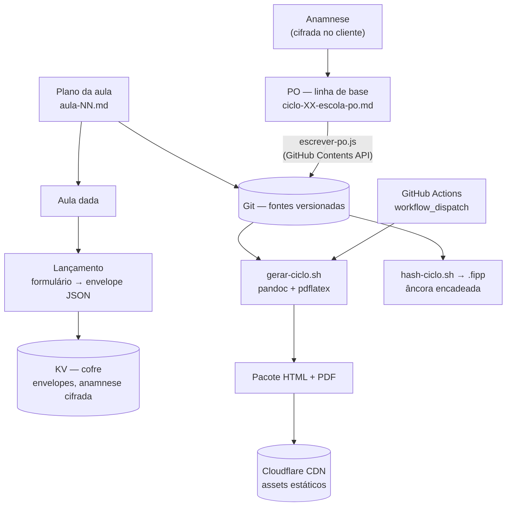

# Arquitetura geral — por que sistema de arquivos, e não um backend com banco

> **Para quem?** Material de apresentação técnica: explica, para um programador, **quais
> arquiteturas o Projeto Ciclo usa**, **por que a fonte de verdade é o sistema de arquivos
> (Git) e não um banco de dados**, e **por que isso é mais barato e mais rápido**.
>
> **Leia antes de citar.** Este documento é do **Projeto Ciclo** — a memória da aula dada,
> **protótipo testado no universo da dança** (não é agnóstico: o projeto agnóstico será criado
> a partir dele). O **FIPP não é implementado aqui**: a proveniência deste repositório é a
> **âncora encadeada** (`tools/hash-ciclo.sh` → `.fipp`), uma **aproximação** do framework do
> projeto de mestrado (outro diretório). Onde este documento disser "proveniência", entenda-se
> essa âncora, não o FIPP.
>
> Os documentos de detalhe são: [ARQUITETURA-CAPTURA.md](./ARQUITETURA-CAPTURA.md) (o JSON da
> captura), [ARQUITETURA-AULA.md](./ARQUITETURA-AULA.md) (o ciclo de vida da aula e a âncora por
> aula), [ARQUITETURA-ANAMNESE.md](./ARQUITETURA-ANAMNESE.md) (a anamnese),
> [IDEIA-PAINEL-ESCOLA.md](./IDEIA-PAINEL-ESCOLA.md) (os Bastidores), [PROTOCOLO.md](./PROTOCOLO.md)
> (as 22 pétreas) e [CONGELAMENTO.md](./CONGELAMENTO.md) (a infraestrutura congelada).

---

## 1. A ideia em uma frase

**As fontes de verdade são arquivos Markdown/JSON/`.conf` versionados no Git; o Git é o banco de
dados; o Cloudflare (Workers + KV + CDN) é só a vitrine que serve esses arquivos. O que é
dinâmico e precisa ser escrito em runtime é guardado num cofre chave-valor (KV) e, quando vira
conteúdo de verdade, **volta a ser arquivo no Git**.**

Não há `INSERT`/`UPDATE` num servidor de banco. Há um `commit`. A cadeia de custódia do projeto
**é** o histórico do Git, e a "consulta" mais comum — abrir a página de um ciclo — **é um GET de
arquivo estático no CDN**, não uma query.

---

## 2. Onde cada coisa vive (o mapa de componentes)

| Componente | Onde está | Tecnologia |
|:--|:--|:--|
| **Fontes de verdade** | `professores/*/ciclos/*.md`, `*.conf`, `*.json` | Markdown, `.conf`, JSON |
| **Schema de cada ciclo** | `ciclo-XX-schema.json` (P-08) | JSON versionado |
| **Âncora de proveniência** | `ciclo-XX-<escola>.fipp` | SHA-256 encadeado (`parentHash`) |
| **Gerador de pacote** | `tools/gerar-ciclo.sh` | pandoc (MD→HTML) + pdflatex (MD→PDF) |
| **Validação** | `tools/validar-*.js`, `tools/check-pacote.js` | Node, rodado nos hooks de commit |
| **Núcleo (lógica pura)** | `motor/nucleo/*` | JavaScript **sem IO** — recebe/ devolve dados |
| **Adaptadores de armazenamento** | `motor/adaptadores/*` | `fs` (Node) ↔ `cloudflare` (KV/ASSETS) |
| **Servidor (rotas)** | `motor/servidor/*` | Web Standards (`Request`/`Response`), roteador único |
| **Worker da raiz** | `workers/raiz.js` | Cloudflare Worker (porta de entrada) |
| **Worker por escola** | `workers/principal.js` / `motor/servidor/producao.js` | Cloudflare Worker (assets + API) |
| **Cofre de escrita em runtime** | KV `ciclos-escolas` (binding `PADD_KV`) | Cloudflare KV (key-value) |
| **Cifra de dados sensíveis** | `tools/lib-cifra.js` (uma definição só: Node + navegador) | PBKDF2 + AES-GCM 256 (mesmo esquema do PageCrypt dos acompanhamentos) |
| **Deploy e geração** | `.github/workflows/` (`gerar-ciclo.yml`, `reancorar.yml`) | GitHub Actions, disparado no push |

### 2.1 A peça-chave: o núcleo não tem banco

O contrato de armazenamento — `motor/nucleo/armazenamento.js` — define **seis verbos** e nada mais:

```
ler(chave) · guardar(chave, valor) · anexar(chave, linha)
listar(prefixo) · existe(chave) · apagar(chave)
```

O núcleo (validar, derivar, elicitar) **nunca lê nem escreve em lugar nenhum**: recebe o que
precisa e devolve o que produz. Quem persiste é o **adaptador** — em desenvolvimento é o sistema
de arquivos; no Worker é o KV. Trocar de provedor é trocar de adaptador, não reescrever o motor.
Ou seja: **"banco" é um detalhe de adaptador, não o centro do desenho.**

---

## 3. O desenho de fluxo

### 3.1 O ciclo completo (da intenção ao artefato publicado)

**Mermaid** (renderiza no GitHub):



**ASCII** (mesma estrutura, para o PDF):

```
   anamnese (cifrada no cliente) ──► PO ciclo-XX-escola-po.md ──► escrever-po.js ──► Git
   plano aula-NN.md ──► aula dada ──► lançamento (envelope JSON) ──► KV (cofre, em runtime)

   Git ──► gerar-ciclo.sh (pandoc + pdflatex) ──► pacote HTML + PDF ──► Cloudflare CDN
   Git ──► hash-ciclo.sh ──► .fipp (âncora encadeada)
```

### 3.2 O deploy (como o código vira página)

```
push para main ──► GitHub Actions (gerar-ciclo.yml / reancorar.yml)
                        │
                        ├── gerar/validar o pacote
                        ├── reancorar a âncora (.fipp)
                        │
                        ▼
               Cloudflare — um Worker por escola + ASSETS no CDN
               (deploy automático no push, ligado ao repositório pelo painel)
```

O Worker serve **primeiro o asset estático**; só o que não casa com um arquivo chega ao script.
Por isso a página sai do CDN (sem custo de Worker) e a rota `/api/*` é atendida pelo script. A
geração (pandoc/pdflatex) **não roda no Worker** — roda no GitHub Actions, porque o runtime
`workerd` não tem pandoc nem LaTeX. O Worker **dispara** a geração (`workflow_dispatch`) em vez
de gerar.

---

## 4. Por que sistema de arquivos e não banco de dados

### 4.1 Proveniência é história, não estado

A regra central do projeto (P-03/P-04) é: **o passado não é reescrito, é incorporado**. Um banco
de dados guarda o **estado final** de uma linha; para guardar a **história** é preciso montar à
mão um audit-log, triggers, tabelas `_audit`, soft-delete… O Git **já é** essa cadeia de custódia:
cada `commit` é um elo, `git log`/`blame`/`diff` são as consultas de auditoria, e uma mudança é
um *diff* — que é exatamente o dado que a escola quer ler ("que decisões o professor tomou, que
caminho seguiu").

Em cima do Git, o `hash-ciclo.sh` acrescenta a **âncora encadeada**: `SHA-256(id : tipo :
parentHash : hash_das_fontes)`. Cada ciclo carrega o hash do ciclo anterior na mesma escola.
O `.fipp` é **versionado** — é a âncora, não uma saída reconstruível.

### 4.2 A imutabilidade é o requisito, não uma feature extra

Aula `planejada` pode ser editada; aula que já aconteceu só aceita **ajuste** (um elo novo, nunca
uma sobrescrita). Em arquivos + Git isso é estrutural: o commit novo não apaga o anterior. Num
banco, "não deixar sobrescrever" é algo que você tem que **implementar** (permissões, triggers,
append-only). Aqui é a consequência natural do meio.

### 4.3 Fontes legíveis e difáveis por humanos

O que se versiona é Markdown/JSON/`.conf` — texto plano. O professor lê o plano, o revisor lê o
diff, o auditor lê o histórico. Um banco esconde o dado atrás de schema e de um cliente SQL; o
arquivo é o próprio contrato, e o *diff* é revisável a olho.

### 4.4 Não há migração de schema

Mudar a estrutura de um ciclo é editar o `ciclo-XX-schema.json` versionado (P-08) e a validação
é um script (`validar-*.js`) que também é versionado e roda no commit. Não existe `ALTER TABLE`,
nem migração, nem "qual versão do schema está em produção". O schema de cada ciclo viaja **junto
com os dados dele**, no mesmo repositório, na mesma época.

### 4.5 Build no lugar de runtime

A página de um ciclo **não é montada a cada request**: ela é **pré-computada** pelo
`gerar-ciclo.sh` (pandoc → HTML, pdflatex → PDF) e servida como arquivo estático. O "backend que
renderiza" virou um **build de CI**. Isso elimina toda uma classe de custo e latência de
template-engine + consulta de banco por request.

### 4.6 Escala não é o problema — navegação é

O projeto não tem problema de **volume** (o limite físico de uma escola é ~230 MB em 10 anos —
`ARQUITETURA-CAPTURA.md` §6). Tem problema de **navegação**: um menu que cresce a cada aula.
Um banco resolveria escala que não existe; o sistema de arquivos resolve a organização e a
proveniência, que são os problemas reais.

---

## 5. Por que é mais barato

| # | Motivo | Detalhe |
|:--|:--|:--|
| 1 | **Sem servidor de banco** | Não há instância paga, nem licença, nem DBA, nem replica de backup. O storage é o próprio Git. |
| 2 | **Static-first** | O HTML/PDF pronto é servido do CDN do Cloudflare; a maior parte do tráfego **não aciona Worker**. |
| 3 | **Worker só para o dinâmico** | Cobrança por invocação real (`/api/*`, senha); o resto é asset estático gratuito. |
| 4 | **KV é pay-per-op** | O cofre de escrita em runtime cobra por leitura/escrita, não um servidor sempre ligado. |
| 5 | **Geração é CI** | pandoc/pdflatex rodam no GitHub Actions (gratuito para este uso), não num servidor de build pago. |
| 6 | **Deploy é push** | Publicar é `git push` + auto-deploy do painel; não há pipeline paga nem servidor de entrega. |

O custo marginal de uma **escola nova** é um Worker a mais (que fica ocioso quando ninguém acessa)
+ as páginas estáticas no CDN — não uma instância de banco provisionada por cliente.

---

## 6. Por que é mais rápido

| # | Motivo | Detalhe |
|:--|:--|:--|
| 1 | **Latência de CDN** | A página já está pronta e distribuída na borda; o usuário baixa do edge mais próximo. |
| 2 | **Sem round-trip de banco** | A leitura mais comum é um `GET` de arquivo estático (cacheável), não uma query com join. |
| 3 | **Pré-computado** | O HTML não é renderizado por request; é gerado no build e servido como está. |
| 4 | **Reancoragem cirúrgica** | A âncora **por aula** permite reancorar só a aula afetada — lançar a aula 03 não reancora o ciclo inteiro (`ARQUITETURA-AULA.md` §5.2). |

---

## 7. E onde ainda existe "banco"? (a parte honesta)

O sistema **não é 100% sem persistência em runtime**. Há duas coisas que precisam ser escritas
**no navegador, no momento do uso**, e que ainda não viraram arquivo no Git:

1. **Os envelopes da elicitação** (o PO sendo respondido) e a **anamnese** — guardados no
   **Cloudflare KV**, que é um *key-value store*, não um banco relacional: não tem schema, não tem
   `JOIN`, não tem migração. É um "sistema de arquivos na nuvem" com `get`/`put`/`list`.
2. **A anamnese é cifrada no cliente** (`tools/lib-cifra.js`, no navegador) **antes** de subir —
   o cofre guarda o texto cifrado, e a chave nunca passa pelo servidor. O KV é só o cofre; a
   senha é do usuário.

E o ponto que fecha o argumento: **assim que esses dados viram conteúdo de verdade, eles voltam a
ser arquivo.** O PO, ao ser gravado, é derivado para Markdown e escrito **no repositório** via
GitHub Contents API (`motor/servidor/escrever-po.js`) — o que dispara a geração e a âncora. O KV é
o **rascunho/cofre de runtime**; o Git é a **fonte de verdade e o histórico**.

---

## 8. O mesmo sistema, "se fosse um banco tradicional"

| Preocupação | Backend + banco tradicional | Aqui |
|:--|:--|:--|
| Fonte de verdade | linhas em tabelas | arquivos Markdown/JSON/`.conf` no Git |
| Histórico / auditoria | trigger + log manual | Git (`commit`, `blame`, `diff`) + âncora `.fipp` |
| Versionamento | coluna de versão / migração | Git (branch/commit) + `parentHash` |
| Schema | DDL e migrações | `ciclo-XX-schema.json` versionado (P-08) |
| Renderização | template-engine no servidor | pandoc/pdflatex no build (CI) |
| Entrega | servidor que consulta o banco | CDN serve HTML/PDF estático |
| Escrita em runtime | `INSERT`/`UPDATE` | KV (`get`/`put`) → depois vira arquivo no Git |
| Custo | servidor + banco sempre ligados | CDN + Worker sob demanda + CI |

---

## 9. Resumo

- **Fonte de verdade = arquivos + Git** (a proveniência **é** o histórico do Git, reforçado pela
  âncora `.fipp`).
- **Núcleo sem banco** — o armazenamento é um contrato de seis verbos, e o adaptador troca
  `fs` ↔ `KV` sem tocar a lógica.
- **Build no lugar de runtime** — a página é pré-computada por pandoc/pdflatex e servida estática
  do CDN.
- **Runtime mínimo** — Cloudflare Worker (um por escola) só para a API e a senha; o resto é asset.
- **Cofre de runtime** — KV (key-value) para o que ainda não virou arquivo, e que **volta a ser
  arquivo no Git** quando vira conteúdo.
- **Mais barato** porque não há banco nem servidor sempre ligado; **mais rápido** porque a leitura
  é cache de CDN, não query.

---

## 10. A licença — três camadas, e uma condição de conteúdo

> **Decidida em 02/11/2026.** A questão estava **aberta desde 18/09/2026**, onde o `REGISTRO.md`
> a registou pela primeira vez («Licença do repositório (a definir)», na entrada da publicação do
> repositório no GitHub). O que se segue é a decisão; o **texto** que a formaliza é um `LICENSE.md`
> na raiz, que **ainda não foi escrito** — e que o contrato com a escola **cita**, não substitui.

### 10.1 Por que três camadas, e não uma

O repositório guarda três coisas de **donos diferentes**: a **máquina** (o motor e as ferramentas), o
**catálogo** (o que se vende) e o que **cada escola acrescenta** (que é dela). Uma licença só teria
de dar a mesma resposta às três — e as três respostas são opostas: a máquina **não** se entrega, o
catálogo **entrega-se com limites**, e o que a escola constrói **não é do projeto**.

| Camada | Onde vive | Regime | Porquê |
|:--|:--|:--|:--|
| **A máquina** | `motor/` · `tools/` · `porta/` · `raiz/` · `.github/` | **proprietário — todos os direitos reservados**, e **não licenciado** com os produtos | é o diferencial: a escola compra o **uso do produto**, não a máquina que o produz. Entregar o motor seria entregar o negócio |
| **O catálogo** | `biblioteca/modalidades/` | **licença comercial de uso, por escola** (§10.2) | é o que se vende — e é o que se **licencia**, não se vende em propriedade |
| **O que a escola acrescenta** | `biblioteca/escolas/<escola>/` | **é dela**; ela concede ao projeto o uso mínimo (§10.3) | ela construiu; o projeto só precisa de o poder servir de volta |

**O repositório é privado** (`tmenegaz/danca`, verificado a 02/11/2026). Não há hoje distribuição
pública de nada — logo não há obrigação criada por distribuição, e a decisão é de negócio, não de
compatibilidade.

**E não há conteúdo de terceiros a acomodar.** Medido: os SVGs são da marca do projeto
(`tools/templates/marca/`); a tipografia é **system-ui e Georgia**, sem ficheiro de fonte embutido
(`tools/templates/ciclo.css:76-77`); e a nomenclatura RAD/Vaganova que o catálogo usa são **nomes de
posições**, que não são obra — as descrições é que são, e essas têm `fonte` (ou deviam ter, §10.4).

### 10.2 O catálogo — a licença que a escola compra

Seis cláusulas, e cada uma existe por uma razão medida neste repositório:

1. **Vinculada à fotografia datada.** A licença nomeia o catálogo **como ele está na data**, não «o
   catálogo». É a **C5a**, já decidida: «todas as perguntas disponíveis na data de vigência», e o
   contrato congela `catalogo@AAAA-MM-DD`. Aqui o mesmo princípio, do lado do conteúdo.
2. **Perpétua para a versão contratada.** O que a escola pagou não lhe é retirado quando o catálogo
   evolui. É a mesma regra da **L9** («a trava não pode ser punição ao dado»), aplicada ao produto.
3. **Não exclusiva, não transferível, não sublicenciável.** Uma licença por escola, para aquela
   escola.
4. **Uso interno permitido, sem limite de cópias** — imprimir, projetar, derivar material de aula,
   incorporar no plano do ciclo. O produto só vale se circular **dentro** da escola.
5. **Redistribuição e revenda proibidas** — inclusive «republicar o dicionário como serviço», que é
   a forma de revenda que este produto torna fácil.
6. **Atribuição preservada.** Cada descrição mantém o seu `fonte`, e a licença proíbe removê-lo ou
   esvaziá-lo. É o que impede o produto de servir para apagar a origem do que não é de quem copia.

### 10.3 O que a escola acrescenta — dela, com uma concessão estreita

Os termos, turmas e descrições que a escola cria **são dela**. A «via inversa» da **L14 (e)** — a
escola propõe ao catálogo o que construiu — **exige** uma concessão explícita, senão o projeto fica
a usar conteúdo alheio com base numa boa intenção:

- a escola concede ao projeto uma licença **não exclusiva** para (a) **servir** o conteúdo de volta à
  própria escola e (b) **avaliar** a proposta de entrada no catálogo;
- a entrada no catálogo exige **aceitação explícita** da escola, com a atribuição nomeada — não é
  automática por ter sido proposta;
- se ela recusar, o conteúdo **continua a funcionar** para ela e **não** entra no catálogo.

Sem estas três linhas, a via inversa transforma o que é dela no que é do produto.

### 10.4 A condição de conteúdo — e ela trava a venda hoje

**Uma descrição sem `fonte` declarado não entra no catálogo que se vende.** A razão não é formal: não
se licencia o que não se declarou como seu, e um catálogo com origem omissa não tem como sustentar a
cláusula 6 (§10.2) nem a Regra 8.

**Medido a 02/11/2026, em `vocabulario.json` (93 termos, 59 com descrição):**

| `fonte` | Termos |
|:--|--:|
| «Dicionário Técnico Completo de Ballet Clássico v1.0.0 — fornecido pela pesquisadora (2026)» | **30** |
| «Redigida no projeto (31/10/2026)…» | **4** |
| **vazio** | **59** |

E o cruzamento que importa, e que não estava medido: dos **59 termos com descrição**, **25 têm `fonte`
vazio**. É o buraco — **25 descrições que a edição paga não pode levar** enquanto a origem não for
declarada. As duas saídas são dela: **declarar** as 25, ou **deixá-las fora** da edição paga e dentro
da edição interna.

> **Nota de correção (02/11/2026).** Esta secção existe porque a licença passou a ser uma decisão. Ao
> escrevê-la, medi a citação que os documentos faziam dela — «`ARQUITETURA-GERAL.md:109` diz «a
> definir»» — e **ela não existe**: a linha 109 deste documento é o diagrama do deploy, e a palavra
> «licença» só aparece aqui na §5 (e não sobre isto). A frase verdadeira é outra, e está no
> `REGISTRO.md:109`, na entrada de **18/09/2026**: «Licença do repositório (a definir)». O facto
> sobreviveu; a atribuição não. Corrigida nos sítios onde vivia, com nota datada no `REGISTRO.md`.
