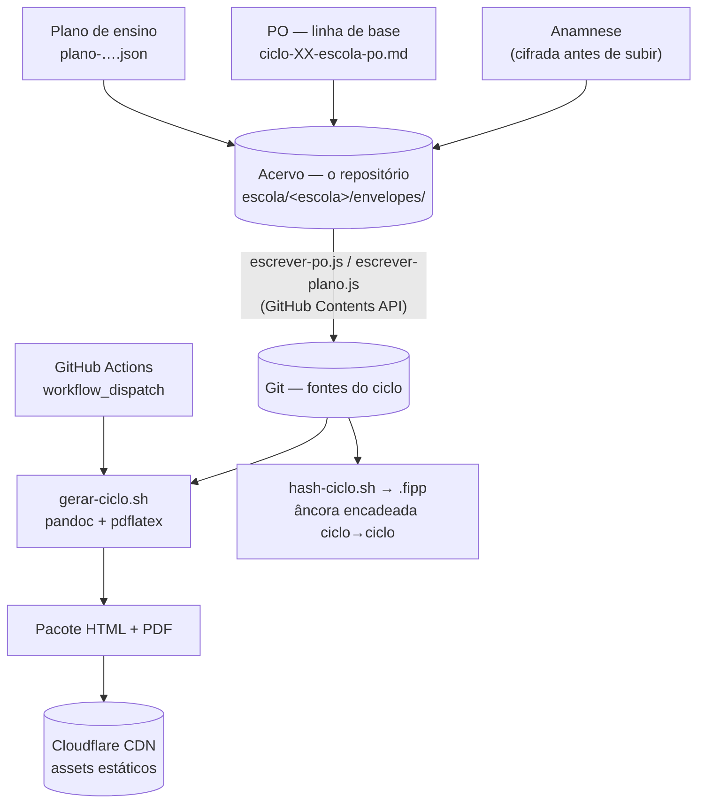

# Arquitetura geral — por que sistema de arquivos, e não um backend com banco

> **Para quem?** Material de apresentação técnica: explica, para um programador, **quais
> arquiteturas o Projeto Ciclo usa**, **por que a fonte de verdade é o sistema de arquivos
> (Git) e não um banco de dados**, e **por que isso é mais barato e mais rápido**.
>
> **Leia antes de citar.** Este documento é do **Projeto Ciclo** — a memória da aula dada,
> **protótipo testado no universo da dança** (não é agnóstico: o projeto agnóstico será criado
> a partir dele). O **FIPP não é implementado aqui**: a proveniência deste repositório é a
> **âncora encadeada** (`tools/hash-ciclo.sh` → `.fipp`), uma **aproximação** do framework do
> projeto de mestrado (outro diretório). Onde este documento disser "proveniência", entenda-se
> essa âncora, não o FIPP.
>
> Os documentos de detalhe são: [ARQUITETURA-CAPTURA.md](./ARQUITETURA-CAPTURA.md) (o JSON da
> captura), [ARQUITETURA-AULA.md](./ARQUITETURA-AULA.md) (o ciclo de vida da aula e a âncora por
> aula), [ARQUITETURA-ANAMNESE.md](./ARQUITETURA-ANAMNESE.md) (a anamnese),
> [IDEIA-PAINEL-ESCOLA.md](./IDEIA-PAINEL-ESCOLA.md) (os Bastidores), [PROTOCOLO.md](./PROTOCOLO.md)
> (as 22 pétreas) e [CONGELAMENTO.md](./CONGELAMENTO.md) (a infraestrutura congelada).
>
> **A §5 é medida, não desenhada** (04/11/2026): descreve o que o código faz quando duas escritas
> se cruzam, com o resultado das bancadas de `experimentos/`. Ela substitui a versão anterior
> deste documento, que dava o acervo como vivendo no KV e sob `professores/<professor>/escolas/`.

---

## 1. A ideia em uma frase

**As fontes de verdade são arquivos versionados no Git, e o Git é o banco de dados.** Isso vale
para as duas coisas que o sistema guarda, e é o ponto que a versão anterior deste documento errava:
as **fontes do ciclo** (`professores/<prof>/ciclos/`, Markdown e `.conf`) e o **acervo
operacional** (`escola/<escola>/envelopes/`, JSON — planos, POs, anamneses). O Cloudflare é a
vitrine e a borda: um Worker por escola para `/api/*`, e o CDN para o que já está pronto.

Não há `INSERT`/`UPDATE` num servidor de banco. Há um `commit` — e **um commit por gravação**, com
a referência do ramo como último passo. A cadeia de custódia do projeto **é** o histórico do Git,
e a "consulta" mais comum — abrir a página de um ciclo — **é um GET de arquivo estático no CDN**,
não uma query.

O **KV** ainda existe, e já não é onde o registro mora: é a reserva de leitura do que não migrou e
o estado que nunca foi registro (§7, §8).

---

## 2. Onde cada coisa vive (o mapa de componentes)

Cada caminho abaixo foi conferido na árvore do código; a coluna «verificado em» diz onde.

| Componente | Onde está | Tecnologia |
|:--|:--|:--|
| **Fontes de verdade do ciclo** | `professores/<prof>/ciclos/ciclo-NN-<escola>.md` e `.conf` | Markdown, `.conf` |
| **Schema de cada ciclo** | `ciclo-NN-schema.json` (P-08) | JSON versionado |
| **Âncora de proveniência** | `ciclo-NN-<escola>.fipp` | SHA-256 encadeado (`parentHash`) |
| **Acervo operacional — os envelopes** | `escola/<escola>/envelopes/<id>.json` | JSON versionado (planos, POs, anamneses) |
| **Acervo operacional — o índice** | `escola/<escola>/envelopes/.indice.json` | JSON derivado (`nomes` + `resumos`) |
| **Inventário da escola** | `escola/<escola>/indice.json` | JSON: `professor` (responsável) + `professores[]` |
| **Elo de expurgo** | `escola/<escola>/indice.json` → `expurgo[]` | JSON; a proveniência acrescenta |
| **Estados e vínculos dos envelopes** | derivados em `motor/nucleo/porta.js` | nenhum campo «estado» gravado |
| **Gerador de pacote** | `tools/gerar-ciclo.sh` | pandoc (MD→HTML) + pdflatex (MD→PDF) |
| **Validação** | `tools/validar-*.js`, `tools/check-pacote.js`, `tools/check-indices.js` | Node, nos hooks de commit |
| **Núcleo (lógica pura, sem IO)** | `motor/nucleo/*` | JavaScript: recebe e devolve dados |
| **Adaptadores de armazenamento** | `motor/adaptadores/*` (`node.js`, `cloudflare.js`) | `fs` ↔ KV/ASSETS |
| **Adaptador do acervo** | `motor/servidor/acervo-envelopes.js` | GitHub Contents API (Git como store) |
| **Servidor (rotas)** | `motor/servidor/*` | Web Standards (`Request`/`Response`), roteador único |
| **Worker da raiz** | `workers/raiz.js` | Cloudflare Worker (porta de entrada, Bastidores) |
| **Worker por escola** | `motor/servidor/producao.js` | Cloudflare Worker (assets + `/api/*`) |
| **Cifra de dados sensíveis** | `tools/lib-cifra.js` (uma definição: Node e navegador) | PBKDF2 + AES-GCM 256 |
| **Deploy e geração** | `.github/workflows/*.yml` | GitHub Actions |
| **KV (legado)** | binding `PADD_KV` | **só leitura** desde 19/10/2026 — ver §8 |

### 2.1 O acervo operacional: onde os documentos de facto vivem

> **Correção de premissa (04/11/2026).** Uma versão anterior deste documento dizia que planos, POs
> e anamneses viviam no KV e, noutra passagem, que viviam sob
> `professores/<professor>/escolas/<escola>/`. **Nenhuma das duas é verdade.**
> `professores/<professor>/escolas/` não existe na árvore. O acervo vive **no repositório**, no
> escopo da **escola**.

```
escola/<escola>/envelopes/<id>.json      ← plano-…, po-…, anamnese-…
escola/<escola>/envelopes/.indice.json   ← o rol: nomes + resumos (derivado)
escola/<escola>/indice.json              ← inventário: professor responsável + professores[]
professores/<prof>/ciclos/…              ← as FONTES do ciclo e o pacote gerado
professores/<prof>/perfil.json           ← a habilitação (a pessoa, não o tenant)
```

O caminho é montado por `caminhoDaChave(escola, chave)` em `motor/servidor/acervo-envelopes.js`:
`envelope/<nome>.json` → `escola/<escola>/envelopes/<nome>.json`. **O caminho não contém a
professora.**

**Qual é o isolamento, então — e qual não é.**

| Fronteira | Isolada? | Onde se vê |
|:--|:--|:--|
| Escola (subdomínio) | **Sim** | um Worker por escola, um `wrangler.<slug>.jsonc`, uma pasta `escola/<slug>/` |
| Professor, nas **fontes** do ciclo | **Sim** | `professores/<prof>/ciclos/` — nenhum caminho cruza professor |
| Professor, no **acervo** | **Não** | `escola/<escola>/envelopes/` é compartilhado pelos professores da escola |
| Professor, no **histórico** do ciclo | **Sim** | o `.fipp` é por ciclo e por variante, dentro de `professores/<prof>/` |

O `escola/<escola>/indice.json` declara **um** responsável (`professor`, no singular) e **uma
lista** de professores habilitados (`professores[]`, `comProfessor` em
`motor/servidor/repo-escola.js`, escrito por `registrarProfessorNaEscola`). Duas professoras da
mesma escola **escrevem os mesmos arquivos de envelope** — é por isso que a §5 existe.

### 2.2 A peça-chave: o núcleo não tem banco

O contrato — `motor/nucleo/armazenamento.js` — define os verbos e nada mais:

| Verbo | Contrato | Para quê |
|:--|:--|:--|
| `ler(chave)` | `string \| null` | `null` é «não existe», e nunca lança |
| `guardar(chave, valor)` | — | grava **por cima**; é a edição do mesmo documento |
| `criar(chave, valor)` | `{ criado }` | grava **só se não existir** — a corrida do nome (§5.1) |
| `anexar(chave, linha)` | — | acrescenta; o registro de custo da IA é um JSONL |
| `listar(prefixo)` | `string[]` | enumera |
| `existe(chave)` | `boolean` | — |
| `apagar(chave)` | `boolean` | idempotente: apagar o que não existe devolve `false` |

O **acervo** (`acervo-envelopes.js`) acrescenta dois verbos que só ele sabe fazer, porque precisa
de ler-modificar-gravar com o `sha` do Git: **`mutar(chave, mutacao)`** (o índice: relê e reaplica
a mutação sobre a versão que ganhou a corrida) e **`gravarComFusao(chave, base, novo, fundir)`**
(a edição que unifica duas escritas — §5.2).

O núcleo (validar, derivar, elicitar, fundir) **nunca lê nem escreve em lugar nenhum**: recebe o
que precisa e devolve o que produz. Quem persiste é o **adaptador**. Trocar de provedor é trocar de
adaptador, não reescrever o motor.

**A lista de verbos do armazenamento composto é à mão.** `combinar(acervo, resto)` — em
`acervo-envelopes.js`, montado por `criarArmazenamento` — decide por família de chave quem atende:
`envelope/*` vai ao acervo, o resto vai ao KV. **Verbo novo no acervo tem de ser acrescentado
lá**, e essa é uma armadilha medida: em 04/11/2026 o `criar` e o `anexar` ficaram de fora, e a
blindagem existia no adaptador sem nunca chegar ao motor — as bancadas não o viram porque montavam
o acervo direto. Hoje as bancadas que provam a escrita passam pelo `combinar`
(`experimentos/provar-fusao-da-edicao.js`, secção A).

### 2.3 A modalidade pertence ao professor — a escola a oferece por reflexo

> **DECIDIDO pela pesquisadora a 03/11/2026.** A pergunta era onde vive a modalidade — se na escola,
> que é a unidade que se vende, ou no professor. A resposta é o **professor**, e a razão é de domínio,
> não de conveniência: **a modalidade nasce da competência de quem ensina.** Uma escola só oferece
> balé clássico porque tem quem o saiba ensinar; a mesma escola oferece contemporâneo no dia em que
> contrata quem o ensine, e continua a ser a mesma escola. Pôr a modalidade na escola faria o
> contrário: a escola declararia uma competência que ninguém lá tem, e o balé clássico viraria um
> atributo do **edifício** em vez de um atributo do **ofício**.

**O que fica onde, depois desta decisão:**

| O quê | De quem é | Onde vive hoje |
|:--|:--|:--|
| **O conhecimento** — o alfabeto e o vocabulário de uma modalidade | da **modalidade**, não de pessoa nenhuma | `biblioteca/modalidades/<slug>/` (dado versionado, partilhado) |
| **A habilitação** — que modalidades este professor ensina | do **professor** | `professores/<slug>/perfil.json` → `modalidades` — **implementado** 03/11/2026 |
| **A oferta** — que modalidades esta escola tem à venda | **reflexo** das habilitações dos professores dela | **não existe**: nenhum registo de escola tem este campo, e é de propósito (ver consequência 1) |
| **A escolha, na aula** — que metodologia aquele ciclo segue | do **ciclo**, declarada no plano | `contexto-metodologia` no plano (P-16) |
| **A turma que perdeu quem a ensine** | da **escola** (é a turma dela) | campo `descontinuada` na turma — **implementado** 03/11/2026 |

**As três consequências que isto obriga a dizer:**

1. **A escola não herda um campo — herda uma derivação.** `modalidadesDaEscola(professores)` é a
   união das habilitações de quem lá dá aula. Escrito como campo, seria uma segunda declaração do
   mesmo facto, e a primeira contratação deixaria as duas a divergir — é a regra que esta casa já
   pagou com o vocabulário por escola (28/10) e com a conta dos tempos.
2. **O catálogo não muda de sítio.** O alfabeto continua em `biblioteca/modalidades/`, e continua
   **da modalidade** — nenhuma escola precisa de uma cópia dele. O que a decisão muda é **quem
   escolhe** qual se usa, não **onde ele mora**.
3. **A porta existe, e o dado passou a existir.** O núcleo tem `MODALIDADE_PADRAO` e os dois mapas
   (`ALFABETOS`, `VOCABULARIOS`), e a rota da Produção devolve `modalidade` na resposta. O que faltava
   era o dado lido do professor; desde 03/11/2026 ele existe em `professores/<slug>/perfil.json`, e
   nasce com a escola (`tools/criar-escola.sh`). O que ainda falta é **usá-lo**: a modalidade
   continua a ser uma constante em 10 sítios de `motor/` — é o acoplamento medido abaixo.

**O acoplamento, medido a 03/11/2026** (`experimentos/provar-sinais-da-modalidade.js`, §D): a
modalidade está escrita **à mão em 10 sítios de `motor/`** — dois mapas e o padrão no núcleo, dois
no CLI dos produtos, e **cinco na página da Produção** (o `POST` do verbete, o `DELETE`, a rota que
serve o alfabeto e os dois corpos que a tela monta). Este número é a **linha de base**: o trabalho de
médio prazo é levá-lo a zero, e a prova passa a afirmar o zero.

**As três perguntas que ficaram abertas a 03/11/2026, e as respostas dela no mesmo dia:**

| A pergunta | A resposta dela |
|:--|:--|
| Onde vive a habilitação? | `professores/<slug>/perfil.json`, independente do tenant. Nasce com a escola (o professor que a cria já nasce habilitado na modalidade principal) e edita-se nos **Bastidores · Produção → Professores → Habilitações** |
| A turma cuja modalidade o professor deixou de ter? | **Não se apaga.** Fica `descontinuada`, com data e motivo, e o histórico intacto. A marca é **revogável**: quem volta a declarar a modalidade apaga-a |
| A habilitação tem níveis? | **Não** — a habilitação é sim/não por modalidade. O nível é do **enquadramento**, e o enquadramento é da **curadoria** (§2.3): `grau` + `nivel`, na forma da tradição, declarada em `tradicoes.json` → `estruturaDeNiveis` |

**E o expurgo, que é onde a decisão se prova.** O perfil **não** é dado do tenant: o expurgo
preserva-o (`repo-escola.js` → `ehPerfilDoProfessor`), nomeia-o no relatório do commit, e há uma
guarda (`semPerfisNaLista`) que **recusa antes de apagar** se alguma regra de caminho chegar até
lá. Sem essa guarda a preservação dependeria de o caminho não casar com um padrão alheio — e uma
garantia que depende de um acidente revoga-se sem avisar.

### 2.4 A turma é o ritmo, a curadoria é o ensino

> **DECIDIDO pela pesquisadora a 03/11/2026**, revendo a arrumação do mesmo dia. O nível, a
> modalidade, a tradição e o professor tinham sido postos na **turma** de manhã; à tarde ela
> reviu, e a razão é de operação: «se a escola precisar mover uma turma de nível ou reajustá-la
> para outra modalidade por razões estratégicas ou sazonais, ela não precisa destruir ou recriar a
> estrutura operacional da turma; basta ajustar a **curadoria**». E o ganho que ela nomeia:
> «a história operacional da turma (calendário, frequência, lançamentos) descola-se das mudanças
> de enquadramento de nível».

| A **turma** — infraestrutura operacional | A **curadoria** — direção pedagógica |
|:--|:--|
| dias da semana, horários, duração, frequência e período | vinculação ao **professor** habilitado |
| a **rubrica** de medição | **modalidade** e **tradição** de referência |
| as **alunas** (o vínculo operacional) | o **nível** (`grau` + `nivel`), na forma da tradição |
| — | os **conteúdos** que aquele grupo vai aprender |
| — | as **alunas** daquela entrega (o recorte) |

> **Correção de 03/11/2026 (mesmo dia).** A primeira redação desta tabela punha «os conteúdos que
> aquele grupo vai aprender» do lado da **turma**. **Está errado**: o conteúdo prático é «um ato
> pedagógico», e o sítio de um ato pedagógico é a curadoria — a turma é o **ritmo**. A associação
> saiu do passo 3 do cadastro e vive no formulário da curadoria (`#esc-conteudos`), e o mapa antigo
> (`turma-conteudos`) **continua a ser lido**: `motor/nucleo/conteudos.js` compõe-no com o
> `repertorio` de cada curadoria e normaliza os dois lados pelo mesmo `idDe`. A versão anterior não
> é apagada — fica como o elo que regista o que se pensou antes da correção.

**A turma tem três estados, e a edição pergunta antes.** É o mesmo desenho do professor, que já
tinha três (`livre` → `curado` → `vinculado`) e não tinha do lado da turma senão dois. A assimetria
custava caro: a rota recusava (409) a turma presa a um **plano de ensino**, mas a turma apenas
**curada** gravava tudo — inclusive o **nome**, e é o nome que a curadoria guarda. Renomear partia a
ligação **em silêncio**: sem erro, sem vínculo, a curadoria a apontar para um nome que já não
existia. Hoje há `motor/nucleo/estado-da-turma.js` com os três nomes e o motivo da recusa, lido por
três sítios (a rota `turma-editar`, o `DELETE` e o cartão). **A turma curada não se apaga nem se
trava**: edita-se no lugar o que não parte a ligação, e renomear pede sair da curadoria primeiro. A
derivação preserva a ligação porque mantém o nome.

**Três leituras ficariam ambíguas sem regra escrita** — e é para isso que existe
`motor/nucleo/enquadramento.js`, um módulo puro:

1. **Qual é o enquadramento de uma turma?** A curadoria que a referencia (pelo **nome** — é assim
   que a curadoria a encontra depois de ela ser derivada). Sem nenhuma, **não há**, e não se
   inventa: a listagem diz «sem curadoria atribuída», porque a ausência é um estado operacional e
   um espaço em branco lê-se como esquecimento.
2. **Qual é o nível efetivo?** O da curadoria; sem ele, o texto que a turma guardou **antes desta
   decisão** — com a origem dita (`de: 'curadoria' | 'turma' | 'nenhum'`). **A memória não se
   apaga** (P-03/P-04): o que sai da lista de campos que o `turma-editar` copia deixa de ser
   tocado, e fica onde está.
3. **Que turmas ficaram sem quem as ensine?** Lidas pelo enquadramento. Era por
   `t.modalidade`/`t.professor` — campos que o cadastro novo **já não tem** —, e um `undefined`
   numa comparação não dá erro: dá `false`, e a marca de `descontinuada` **deixava de acender em
   silêncio**. É o modo de falha que motivou o módulo.

**O que NÃO muda:** a forma do nível continua a vir da tradição (`tradicoes.json` →
`estruturaDeNiveis`), o rótulo continua a ser composto («Grade 3» na RAD, «Intermediário 2» nas
outras), e nenhum «N» é inventado. O nome do ficheiro mudou — `niveis-da-turma.js` → `niveis.js` —
porque dizia «da turma» e deixou de ser verdade.

---

## 3. O desenho de fluxo

### 3.1 O ciclo completo (da intenção ao artefato publicado)

**Mermaid** (renderiza no GitHub):



**ASCII** (mesma estrutura, para o PDF):

```
   anamnese (cifrada) ─┐
   plano de ensino ────┼─► acervo (escola/<escola>/envelopes/*.json) ─► escrever-*.js ─► Git
   PO ─────────────────┘                                        (um commit por gravação)

   Git ──► gerar-ciclo.sh (pandoc + pdflatex) ──► pacote HTML + PDF ──► Cloudflare CDN
   Git ──► hash-ciclo.sh ──► .fipp (âncora encadeada, ciclo → ciclo)
```

**A ordem de uma gravação de envelope**, e ela importa (§5.3):

```
1. o ÍNDICE  (escola/<escola>/envelopes/.indice.json) — o rol ganha o nome
2. o ENVELOPE (escola/<escola>/envelopes/<id>.json)   — o documento
```

O índice vem primeiro de propósito: se a segunda escrita falhar, sobra um **nome órfão**, e quem
lista salta os nomes cujo arquivo não abre. Na ordem contrária sobraria o pior dos dois mundos —
o documento gravado e invisível na estante.

### 3.2 O deploy (como o código vira página)

```
push para main ──► GitHub Actions
                        ├── reancorar.yml    → a cadeia .fipp
                        ├── regerar-indices.yml → indices/*.json
                        ├── deploy-escolas.yml  → um Worker por escola
                        └── deploy-raiz.yml     → o Worker da raiz
                        │
                        ▼
               Cloudflare — um Worker por escola + ASSETS no CDN
```

O Worker serve **primeiro o asset estático**; só o que não casa com um arquivo chega ao script.
A geração (pandoc/pdflatex) **não roda no Worker** — roda no GitHub Actions, porque o runtime
`workerd` não tem pandoc nem LaTeX. O Worker **dispara** a geração (`workflow_dispatch`).

**As quatro escritas de `main` que não passam por um worktree local** — e que fazem do «o meu
`git status` está limpo» uma frase que não responde à pergunta «o repositório mudou?»:

| Quem escreve | Como |
|:--|:--|
| `gerar-ciclo.yml` | Action, depois de um `workflow_dispatch` |
| `reancorar.yml` | Action, a cada push de `professores/**` |
| `regerar-indices.yml` | Action, a cada push das fontes do acervo |
| Bastidores · Produção | API do GitHub, direto (`motor/servidor/repo-escola.js`) |

---

## 4. Por que sistema de arquivos e não banco de dados

### 4.1 Proveniência é história, não estado

A regra central do projeto (P-03/P-04) é: **o passado não é reescrito, é incorporado**. Um banco
de dados guarda o **estado final** de uma linha; para guardar a **história** é preciso montar à
mão um audit-log, triggers, tabelas `_audit`, soft-delete… O Git **já é** essa cadeia de custódia:
cada `commit` é um elo, `git log`/`blame`/`diff` são as consultas de auditoria, e uma mudança é
um *diff* — que é exatamente o dado que a escola quer ler ("que decisões o professor tomou, que
caminho seguiu").

Em cima do Git, o `hash-ciclo.sh` acrescenta a **âncora encadeada**: `SHA-256(id : tipo :
parentHash : hash_das_fontes)`. Cada ciclo carrega o hash do ciclo anterior na mesma escola.
O `.fipp` é **versionado** — é a âncora, não uma saída reconstruível.

**E a âncora não substitui o Git — ela faz outra pergunta.** `git log` responde «que versões este
documento teve e o que mudou entre elas»; o `.fipp` responde «este ciclo é a continuação legítima
do anterior desta escola, e o conteúdo dele mudou desde a última ancoragem». O encadeamento é
**ciclo → ciclo**, e não versão → versão: uma série de ajustes ao mesmo ciclo sobrescreve o mesmo
`.fipp`, e é o Git que guarda as versões intermédias (§5.6).

### 4.2 A imutabilidade é o requisito, não uma feature extra

Aula `planejada` pode ser editada; aula que já aconteceu só aceita **ajuste** (um elo novo, nunca
uma sobrescrita). Em arquivos + Git isso é estrutural: o commit novo não apaga o anterior. Num
banco, "não deixar sobrescrever" é algo que você tem que **implementar** (permissões, triggers,
append-only). Aqui é a consequência natural do meio.

### 4.3 Fontes legíveis e difáveis por humanos

O que se versiona é Markdown/JSON/`.conf` — texto plano. O professor lê o plano, o revisor lê o
diff, o auditor lê o histórico. Um banco esconde o dado atrás de schema e de um cliente SQL; o
arquivo é o próprio contrato, e o *diff* é revisável a olho.

### 4.4 Não há migração de schema

Mudar a estrutura de um ciclo é editar o `ciclo-XX-schema.json` versionado (P-08) e a validação
é um script (`validar-*.js`) que também é versionado e roda no commit. Não existe `ALTER TABLE`,
nem migração, nem "qual versão do schema está em produção". O schema de cada ciclo viaja **junto
com os dados dele**, no mesmo repositório, na mesma época.

### 4.5 Build no lugar de runtime

A página de um ciclo **não é montada a cada request**: ela é **pré-computada** pelo
`gerar-ciclo.sh` (pandoc → HTML, pdflatex → PDF) e servida como arquivo estático. O "backend que
renderiza" virou um **build de CI**. Isso elimina toda uma classe de custo e latência de
template-engine + consulta de banco por request.

### 4.6 Escala não é o problema — navegação é

O projeto não tem problema de **volume** (o limite físico de uma escola é ~230 MB em 10 anos —
`ARQUITETURA-CAPTURA.md` §6). Tem problema de **navegação**: um menu que cresce a cada aula.
Um banco resolveria escala que não existe; o sistema de arquivos resolve a organização e a
proveniência, que são os problemas reais.

---

## 5. Concorrência, corrida e integridade de dados

> **Esta secção é medição, não desenho** (04/11/2026). Cada linha foi verificada no código e, onde
> diz «medido», numa bancada que corre em `experimentos/`. O que não tem prova está dito como
> tal.

### 5.1 A corrida do NOME — fechada

O id de um envelope é um carimbo de minuto (`plano-20261104-1810`). Escolhê-lo perguntando
«existe?» e gravar depois é um `check-then-act`: entre a pergunta e a escrita há uma janela, e dois
pedidos que perguntem **antes de qualquer escrita** recebem o mesmo nome.

**Medido** (o defeito, antes da correção):

```
id do Ajuste A: plano-20261104-1810
id do Ajuste B: plano-20261104-1810     ← o mesmo nome
A gravou: true · B gravou: true          ← os dois dizem «gravado»
o que sobrou no arquivo: AJUSTE B        ← o Ajuste A não existe
```

**A correção adotada — e a que NÃO foi adotada.** A pergunta «existe?» passou a ser feita **pelo
próprio armazenamento, no instante da escrita**: `criar(chave, valor)` grava só se a chave não
existir. No repositório a escrita vai **sem `sha`**, e é o GitHub que responde pela existência —
**422 `"sha" wasn't supplied.`** significa «já existe» (medido contra a API real, num ramo
descartável). Perdida a corrida, o nome cede ao sufixo seguinte (`-2`, `-3`, …), que é **o mesmo
sufixo que a leitura daria** se tivesse visto a outra escrita.

**Um sufixo aleatório (entropia) NÃO foi adotado, e é decisão declarada.** Ele resolveria a
colisão com uma linha de código, mas pagaria três custos que o projeto não quer: o id deixaria de
ser **legível** (a estante mostra o carimbo, e o professor o reconhece); deixaria de ser
**derivável** (a reconstrução do índice e as provas que fixam nomes como
`anamnese-20261016-1351` deixariam de valer); e a unicidade passaria a depender de um gerador
aleatório em vez de uma **condição verificada pelo store**. O `-2` é determinístico e auditável;
a entropia não é nem uma coisa nem outra.

### 5.2 A corrida do CONTEÚDO — unificada por diff e recência (decisão 84)

Duas pessoas (ou duas abas) a gravar **o mesmo** documento é um problema diferente: o nome é um
só, e o que está em jogo é não perder o que a outra escreveu.

| Situação | O que acontece |
|:--|:--|
| A e B mexeram em **campos diferentes** | **As duas edições ficam.** A fusão preserva o campo de cada uma; nada se perde |
| A e B mexeram no **mesmo campo**, com valores diferentes | Vence a edição **mais recente**, comparada ao **milissegundo** (`escrito_em`) |
| Empate ao milissegundo | Vence a gravação que está a correr — o único desempate que não depende de relógios externos |
| Os dois gravaram **o mesmo valor** | Não há o que escolher: é a mesma edição |
| **Sem base** (não se sabe de onde o professor partiu) | **Não se adivinha**: grava-se como sempre se gravou |

**A unidade de «local» é a chave de `respostas`.** `objetivo-geral` é um local; o `valor` dentro
dele não é um segundo local, porque uma resposta é uma unidade — meio `valor` de um e meio
`origem` de outro não é uma resposta.

**As três versões.** Uma fusão a três vias precisa da base (o que o professor **leu**), da minha
(o que ele **gravou**) e da atual (o que **está no acervo**). A terceira o adaptador lê; a
primeira vem do cliente (`POST /api/elicitar` → `base`, só em edição) ou, quando ele não a manda,
do que o acervo tinha no início do pedido. **A fusão nunca é silenciosa**: a resposta da gravação
traz `fundido` e `fusao: { unidos, conflitos }`.

**Onde vive a regra:** `motor/nucleo/fusao.js` — função pura, sem IO. **Onde vive a repetição:**
`gravarComFusao` em `motor/servidor/acervo-envelopes.js` — lê, funde, grava com o `sha`, e repete
no 409. O adaptador não conhece a regra; o núcleo não conhece o `sha`.

### 5.3 A escrita: um commit por gravação, e a referência por último

Um envelope é gravado com **um** commit, e a ordem é sempre:

```
base (ref → commit → tree) → blobs → árvore sobre a base_tree → commit → PATCH da referência
```

A **referência é o último passo** — antes dele, nada existe. É o equivalente, num sistema sem
disco, do «arquivo temporário e depois `rename`»: o estado intermédio (com metade dos arquivos)
nunca é publicável, porque o `main` só avança quando o conjunto está completo. E há uma segunda
razão: com N commits, o repositório guardaria N estados em que o ciclo está **incompleto** — um
deles é «o `-dados.json` existe e o `.conf` ainda não o declara».

| Conflito | HTTP | O que o código faz |
|:--|:--|:--|
| O `sha` mudou entre a leitura e a escrita (`contents`) | **409** | relê o `sha` e grava de novo — até 3 tentativas, com espera crescente |
| A `base_tree` deixou de valer | **409** | refaz base, árvore e commit |
| A referência não é descendente do `main` | **422** *not a fast forward* | refaz o caminho inteiro sobre a base nova; os blobs já criados não ficam pendurados em nada |
| O caminho já existe, e a escrita foi sem `sha` | **422** *`"sha" wasn't supplied`* | «já existe»: é o `criar` a ceder o nome |

Nada disso usa `force: true`. A recusa do Git é o **mecanismo** de deteção de escrita
concorrente; forçá-la seria desligá-lo.

### 5.4 O expurgo — a mesma rotina de 3 tentativas

`apagarEscolaDoRepo` apaga 70–80 arquivos num commit só. Era o **único** escrito em lote sem
repetição: perdia a corrida e **lançava** — e chegava a esse ponto com a metade do Cloudflare
**já feita** (subdomínio, Worker e chaves apagados), deixando a escola fora do ar e dentro do
repositório. Hoje ele é embrulhado como o `apagarProfessorDoRepo` ao lado: a corrida refaz árvore
e commit, e a falha definitiva é **resultado** (`{ ok: false, erro }`), não excepção.

### 5.5 Os pipelines não se atropelam

| Mecanismo | Onde | Efeito |
|:--|:--|:--|
| `concurrency` por (professor, ciclo, variante), `cancel-in-progress: false` | `gerar-ciclo.yml` | duas gerações do mesmo ciclo **enfileiram**; a segunda corre sobre o `main` novo |
| `concurrency: reancorar-<ref>`, `cancel-in-progress: true` | `reancorar.yml` | reancoragens se substituem — só interessa a última |
| `concurrency: regerar-indices`, `cancel-in-progress: true` | `regerar-indices.yml` | os índices são derivados: só vale o último |
| `concurrency: deploy-escolas`, `cancel-in-progress: false` | `deploy-escolas.yml` | deploys não se cancelam a meio |
| `concurrency: deploy-raiz`, `cancel-in-progress: false` | `deploy-raiz.yml` | idem, para a raiz |
| Rebase + reancoragem **depois** do rebase | `gerar-ciclo.yml`, `reancorar.yml` | a âncora é recomputada sobre as fontes que o rebase deixou |
| Conflito em **derivado** (`.fipp`, `indices/`) | idem | concilia-se e recompõe-se |
| Conflito em **material** | idem | **falha dita** — dois donos do mesmo arquivo não se adivinham |

### 5.6 A âncora `.fipp` NÃO é o histórico de versões — o Git é

Esta distinção é a que mais se presta a confusão, e é explícita:

| Pergunta | Quem responde |
|:--|:--|
| Qual foi a versão do plano de ontem, e o que mudou? | **o Git** (`git log`, `git diff`, `git blame` no envelope) |
| Este ciclo é a continuação legítima do anterior desta escola? | **a `.fipp`** |
| O conteúdo deste ciclo mudou desde a última ancoragem? | **a `.fipp`** (`hash_conteudo`) |
| O ciclo anterior mudou, partindo a cadeia? | **a `.fipp`** (`parentHash`) |

A fórmula é `SHA-256(id : type : parentHash : conteúdo)`, e o `parentHash` é o hash da âncora do
**ciclo anterior da mesma variante** — vazio no ciclo 01. Uma **série de ajustes** ao mesmo ciclo
sobrescreve o **mesmo** `.fipp`: não há cadeia a «absorver», porque a unidade do encadeamento é o
**ciclo**, não a versão do documento. Quem guarda as versões intermédias é o Git.

## 6. Por que é mais barato

| # | Motivo | Detalhe |
|:--|:--|:--|
| 1 | **Sem servidor de banco** | Não há instância paga, nem licença, nem DBA, nem réplica de backup. O storage é o próprio Git. |
| 2 | **Static-first** | O HTML/PDF pronto é servido do CDN; a maior parte do tráfego **não aciona Worker**. |
| 3 | **Worker só para o dinâmico** | Cobrança por invocação real (`/api/*`, senha); o resto é asset estático. |
| 4 | **KV só como legado de leitura** | Desde 19/10/2026 o acervo é o repositório; o KV já não recebe escrita nova (§7). |
| 5 | **Geração é CI** | pandoc/pdflatex rodam no GitHub Actions, não num servidor de build pago. |
| 6 | **Deploy é push** | Publicar é `git push` + auto-deploy; não há pipeline paga nem servidor de entrega. |

O custo marginal de uma **escola nova** é um Worker a mais (ocioso quando ninguém acessa) + as
páginas estáticas no CDN — não uma instância de banco provisionada por cliente.

---

## 7. Por que é mais rápido

| # | Motivo | Detalhe |
|:--|:--|:--|
| 1 | **Latência de CDN** | A página já está pronta e distribuída na borda; baixa-se do edge mais próximo. |
| 2 | **Sem round-trip de banco** | A leitura mais comum é um `GET` de arquivo estático (cacheável), não uma query com join. |
| 3 | **Pré-computado** | O HTML não é renderizado por request; é gerado no build. |
| 4 | **Reancoragem cirúrgica** | A âncora **por aula** permite reancorar só a aula afetada (`ARQUITETURA-AULA.md` §5.2). |

**O preço, e ele existe.** A escrita vai ao GitHub Contents API — uma chamada por arquivo, com o
`sha` lido antes. Um «Guardar» de envelope custa **duas** escritas (índice e envelope) e, quando
dispara a geração, uma execução de Actions. É o custo de ter o Git como store, e é o que se paga
de bom grado pela cadeia de custódia. O que **não** se faz é medir no ar: as bancadas correm sobre
memória e sobre um GitHub falso (`experimentos/`), e o KV tem cota diária.

---

## 8. E onde ainda existe "banco"? (a parte honesta)

**Quase em lado nenhum — e o que sobrou é legado.**

1. **Os envelopes** (planos, POs, anamneses) **vivem no repositório**, em
   `escola/<escola>/envelopes/`. Não é o KV. O KV deixou de ser o destino da escrita em
   19/10/2026; hoje ele é **reserva de leitura** do que ainda não migrou — `legado` em
   `doAmbiente`, presente na `listar` (como **união**: um nome que só existe lá não desaparece) e
   ausente da escrita.
2. **O que continua no KV** é o **estado**, não o registro: o lançamento cifrado da aula, os
   cadastros dos Bastidores, o cartão da geração. A fronteira é a **família da chave**, e ela está
   numa linha de composição (`combinar`): `envelope/*` → acervo; o resto → KV.
3. **A anamnese é cifrada antes de subir** (`tools/lib-cifra.js`, no navegador). Quem a lê é o
   adaptador, que a decifra — o núcleo nunca soube que ela é cifrada.

E o ponto que fecha o argumento: **quando o dado vira conteúdo de verdade, ele já está no Git** —
o PO gravado é derivado para Markdown (`motor/servidor/escrever-po.js`) e o ciclo é gerado a
partir daí. O KV não é «o rascunho que vira arquivo»: é o que nunca foi registro.

---

## 9. O mesmo sistema, "se fosse um banco tradicional"

| Preocupação | Backend + banco tradicional | Aqui |
|:--|:--|:--|
| Fonte de verdade | linhas em tabelas | arquivos Markdown/JSON/`.conf` no Git |
| Onde vive o dado operacional | uma tabela `envelopes` | `escola/<escola>/envelopes/<id>.json` |
| Isolamento por cliente | coluna `tenant_id` + RLS | **uma pasta por escola** + um Worker por escola |
| Histórico / auditoria | trigger + audit-log | Git (`commit`, `blame`, `diff`) + âncora `.fipp` |
| Versionamento | coluna de versão / migração | Git (commit/branch) + `parentHash` entre ciclos |
| Escrita concorrente | transação + *row lock* | **`sha` do Git**: 409 → relê; 422 → refaz; `criar` condicional para o nome |
| Edição concorrente do mesmo documento | *last-write-wins* ou *optimistic lock* | **fusão a três vias** (campos diferentes unem; o mesmo campo decide pela recência) |
| Schema | DDL e migrações | `ciclo-NN-schema.json` versionado (P-08) |
| Renderização | template-engine no servidor | pandoc/pdflatex no build (CI) |
| Entrega | servidor que consulta o banco | CDN serve HTML/PDF estático |
| Custo | servidor + banco sempre ligados | CDN + Worker sob demanda + CI |

A diferença que a tabela esconde: no banco, cada uma dessas garantias é **código que se escreve e
se mantém**; aqui, as duas primeiras linhas (histórico e versionamento) são **propriedades do
meio**, e as garantias de escrita concorrente são **recusas do próprio Git** — não regras que
alguém possa esquecer de aplicar.

---

## 10. Resumo

- **Fonte de verdade = arquivos + Git.** A proveniência **é** o histórico do Git, reforçado pela
  âncora `.fipp` — que encadeia **ciclo a ciclo**, não versão a versão (§5.6).
- **O acervo operacional é o repositório**, em `escola/<escola>/envelopes/`. O isolamento estrito
  é por **escola**; por professor, existe nas fontes e no histórico do ciclo, não nos envelopes
  (§2.1).
- **Núcleo sem banco**: o armazenamento é um contrato de verbos, e o adaptador troca `fs` ↔ KV
  ↔ GitHub sem tocar a lógica.
- **Escrita é um commit, e a referência é o último passo** — o estado intermédio nunca é
  publicável (§5.3).
- **Duas corridas, duas respostas**: o **nome** cede o lugar (`criar` condicional + sufixo); o
  **conteúdo** unifica (fusão por diff, e recência ao milissegundo no mesmo campo) (§5.1, §5.2).
- **Build no lugar de runtime**: a página é pré-computada por pandoc/pdflatex e servida do CDN.
- **Runtime mínimo**: um Worker por escola, só para `/api/*` e assets não casados.
- **Mais barato** porque não há banco nem servidor sempre ligado; **mais rápido** na leitura porque
  é cache de CDN — e **mais caro na escrita**, que é uma chamada ao GitHub por arquivo (§7).

---

---

## 11. A licença — três camadas, e uma condição de conteúdo

> **Decidida em 02/11/2026.** A questão estava **aberta desde 18/09/2026**, onde o `REGISTRO.md`
> a registou pela primeira vez («Licença do repositório (a definir)», na entrada da publicação do
> repositório no GitHub). O que se segue é a decisão.
>
> **O texto que a formaliza já existe, e são dois ficheiros** (escritos a 02/11/2026): [`LICENSE.md`](LICENSE.md)
> na raiz para **a máquina** (§11.1, camada A) e [`biblioteca/LICENSE.md`](biblioteca/LICENSE.md)
> para **o catálogo** (§11.2, camada B). São dois porque as duas camadas dizem o contrário uma da
> outra — «não se licencia» e «licencia-se com limites» —, e um ficheiro só não consegue dizê-lo.
> A camada C (§11.3) fica dentro do `biblioteca/LICENSE.md` porque o regime dela **só existe** se o
> da B existir. O contrato com a escola **cita** estes ficheiros; não os substitui.
>
> **Nota de correção (02/11/2026).** Esta secção dizia «o texto que a formaliza é um `LICENSE.md` na
> raiz, que ainda não foi escrito». A primeira metade continua verdadeira e a segunda deixou de o
> ser no mesmo dia. E o nome tinha um erro de facto: o GitHub só reconhece a licença em ficheiros com
> nome reconhecido (`LICENSE.md`, `LICENSE`, `COPYING`) — `licenca.md`, que o
> `PLANO-PRODUTOS-DO-MOTOR` citava, seria um ficheiro comum, sem a licença aparecer no repositório.

### 11.1 Por que três camadas, e não uma

O repositório guarda três coisas de **donos diferentes**: a **máquina** (o motor e as ferramentas), o
**catálogo** (o que se vende) e o que **cada escola acrescenta** (que é dela). Uma licença só teria
de dar a mesma resposta às três — e as três respostas são opostas: a máquina **não** se entrega, o
catálogo **entrega-se com limites**, e o que a escola constrói **não é do projeto**.

| Camada | Onde vive | Regime | Porquê |
|:--|:--|:--|:--|
| **A máquina** | `motor/` · `tools/` · `porta/` · `raiz/` · `.github/` | **proprietário — todos os direitos reservados**, e **não licenciado** com os produtos | é o diferencial: a escola compra o **uso do produto**, não a máquina que o produz. Entregar o motor seria entregar o negócio |
| **O catálogo** | `biblioteca/modalidades/` | **licença comercial de uso, por escola** (§11.2) | é o que se vende — e é o que se **licencia**, não se vende em propriedade |
| **O que a escola acrescenta** | `biblioteca/escolas/<escola>/` | **é dela**; ela concede ao projeto o uso mínimo (§11.3) | ela construiu; o projeto só precisa de o poder servir de volta |

> **Nota de correção (02/11/2026) — onde a camada C vive HOJE.** A coluna «Onde vive» declara o
> **destino** da camada C (`biblioteca/escolas/<escola>/`), e o destino continua a ser esse. O que a
> implementação mediu é que **o ficheiro por escola não cabe no Worker**: o vocabulário chega ao
> bundle por `require` de um **caminho fixo** (`motor/servidor/catalogo-seed.js`), e o esbuild
> resolve o `require` em **tempo de build** — a escola só se sabe em tempo de execução. Enquanto
> isso não mudar, o **dono vive no termo**: `escola` ausente = termo do **catálogo**;
> `escola: '<slug>'` = termo **daquela escola**. O regime **não** muda (o termo da escola é dela);
> o que muda é **onde a marca está escrita** — e ela está num sítio só, lida pela mesma `compor`
> no gerador e na tela (`motor/nucleo/produtos/comum.js`).
>
> **E uma consequência que é preciso dizer.** `biblioteca/` **não** é do domínio do professor. É o
> **terceiro dono** — o que se vende —, e puxá-lo para dentro de `professores/<professor>/` faria
> uma cópia por professor, que divergiria ao primeiro termo novo. Foi exactamente essa cópia que o
> `termo-repo.js` matou em 28/10/2026 (havia uma por escola no KV). O que impede a contaminação
> entre escolas é o **dono no termo**, não o sítio do ficheiro.

**O repositório é privado** (`tmenegaz/danca`, verificado a 02/11/2026). Não há hoje distribuição
pública de nada — logo não há obrigação criada por distribuição, e a decisão é de negócio, não de
compatibilidade.

**E não há conteúdo de terceiros a acomodar.** Medido: os SVGs são da marca do projeto
(`tools/templates/marca/`); a tipografia é **system-ui e Georgia**, sem ficheiro de fonte embutido
(`tools/templates/ciclo.css:76-77`); e a nomenclatura RAD/Vaganova que o catálogo usa são **nomes de
posições**, que não são obra — as descrições é que são, e essas têm `fonte` (ou deviam ter, §11.4).

### 11.2 O catálogo — a licença que a escola compra

Seis cláusulas, e cada uma existe por uma razão medida neste repositório:

1. **Vinculada à fotografia datada.** A licença nomeia o catálogo **como ele está na data**, não «o
   catálogo». É a **C5a**, já decidida: «todas as perguntas disponíveis na data de vigência», e o
   contrato congela `catalogo@AAAA-MM-DD`. Aqui o mesmo princípio, do lado do conteúdo.
2. **Perpétua para a versão contratada.** O que a escola pagou não lhe é retirado quando o catálogo
   evolui. É a mesma regra da **L9** («a trava não pode ser punição ao dado»), aplicada ao produto.
3. **Não exclusiva, não transferível, não sublicenciável.** Uma licença por escola, para aquela
   escola.
4. **Uso interno permitido, sem limite de cópias** — imprimir, projetar, derivar material de aula,
   incorporar no plano do ciclo. O produto só vale se circular **dentro** da escola.
5. **Redistribuição e revenda proibidas** — inclusive «republicar o dicionário como serviço», que é
   a forma de revenda que este produto torna fácil.
6. **Atribuição preservada.** Cada descrição mantém o seu `fonte`, e a licença proíbe removê-lo ou
   esvaziá-lo. É o que impede o produto de servir para apagar a origem do que não é de quem copia.

### 11.3 O que a escola acrescenta — dela, com uma concessão estreita

Os termos, turmas e descrições que a escola cria **são dela**. A «via inversa» da **L14 (e)** — a
escola propõe ao catálogo o que construiu — **exige** uma concessão explícita, senão o projeto fica
a usar conteúdo alheio com base numa boa intenção:

- a escola concede ao projeto uma licença **não exclusiva** para (a) **servir** o conteúdo de volta à
  própria escola e (b) **avaliar** a proposta de entrada no catálogo;
- a entrada no catálogo exige **aceitação explícita** da escola, com a atribuição nomeada — não é
  automática por ter sido proposta;
- se ela recusar, o conteúdo **continua a funcionar** para ela e **não** entra no catálogo.

Sem estas três linhas, a via inversa transforma o que é dela no que é do produto.

### 11.4 A condição de conteúdo — e ela trava a venda hoje

**Uma descrição sem `fonte` declarado não entra no catálogo que se vende.** A razão não é formal: não
se licencia o que não se declarou como seu, e um catálogo com origem omissa não tem como sustentar a
cláusula 6 (§11.2) nem a Regra 8.

**Medido a 02/11/2026, em `vocabulario.json` (93 termos, 59 com descrição):**

| `fonte` | Termos |
|:--|--:|
| «Dicionário Técnico Completo de Ballet Clássico v1.0.0 — fornecido pela pesquisadora (2026)» | **30** |
| «Redigida no projeto (31/10/2026)…» | **4** |
| **vazio** | **59** |

E o cruzamento que importa, e que não estava medido: dos **59 termos com descrição**, **25 têm `fonte`
vazio**. É o buraco — **25 descrições que a edição paga não pode levar** enquanto a origem não for
declarada. As duas saídas são dela: **declarar** as 25, ou **deixá-las fora** da edição paga e dentro
da edição interna.

> **Nota de correção (02/11/2026).** Esta secção existe porque a licença passou a ser uma decisão. Ao
> escrevê-la, medi a citação que os documentos faziam dela — «`ARQUITETURA-GERAL.md:109` diz «a
> definir»» — e **ela não existe**: a linha 109 deste documento é o diagrama do deploy, e a palavra
> «licença» só aparece aqui na §5 (e não sobre isto). A frase verdadeira é outra, e está no
> `REGISTRO.md:109`, na entrada de **18/09/2026**: «Licença do repositório (a definir)». O facto
> sobreviveu; a atribuição não. Corrigida nos sítios onde vivia, com nota datada no `REGISTRO.md`.
